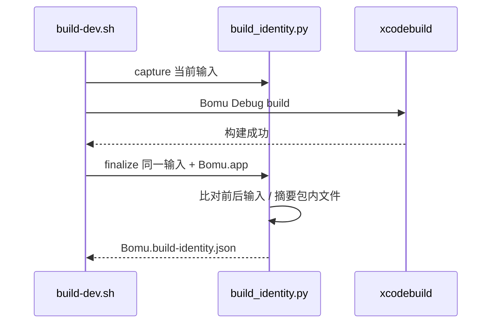

# Debug 构建身份

`./scripts/build-dev.sh` 在调用 Xcode 前，由 `scripts/build_identity.py capture` 记录工程输入的逐文件 SHA-256。Xcode 成功后，`finalize` 重新读取同一输入集合；任何新增、删除或内容变化都使构建命令失败，不为该包生成身份收据。成功时读取规范 Debug `Bomu.app` 的 Info.plist、可执行文件与全部包内文件，写入同目录的 `Bomu.build-identity.json`。收据包含源码摘要、各输入哈希、应用版本/Build、语言资源列表、包文件哈希与包摘要。构建前清理旧收据，避免失败后误用旧证明。



输入覆盖 `Sources`、`Config`、工程文件、构建脚本、基准工具源码、SwiftPM `Package.resolved` 与依赖锁；mpv overlay 的 `Tools/MPVOverlay` 输入清单及补丁、FFmpeg overlay 实际使用的 TS-seek 补丁也直接记录逐文件哈希，避免只依赖锁内声明而漏掉未同步到锁的补丁变化；`Sources/Resources` 中所有资源字节与 `.xcassets` 内全部文件也纳入输入，避免 Welcome 图片改变后仍接受旧源码收据；其余源码目录按已声明的代码/配置扩展名收集。忽略 `.build` 输出、测试日志与文档。收据是本地 Debug 验收的追溯材料，不替代签名、公证、供应链证明或发布包验证。`--analyze` 与 `--for-testing` 不生成规范应用收据。未来可见 UI 验收在启动前执行：

```sh
python3 scripts/build_identity.py verify --receipt .build/DerivedData/Build/Products/Debug/Bomu.build-identity.json
```

命令比对当前源码、规范 Debug 包内全部文件、版本和语言资源；其中任何一项变化都要重新构建并取得新收据。随后从收据记录的规范路径启动包，仍需按单窗口约束做可见检查。

`Tests/test_build_identity.py` 验证源码在构建途中改变时拒绝生成、应用字节改变时包摘要随之改变，资源图片或 asset catalog 内容变更/删除使旧收据失效，以及缺少声明可执行文件时明确失败。实际收据中的哈希和本轮构建结果记录在 [当前进度](../roadmap/progress.md)；锁屏期间不据此宣称 UI 已验收。

2026-10-26：补齐 overlay 输入的身份覆盖。新增行为回归先在旧实现中复现三类输入新增后仍接受旧快照的问题，修正后 `Tests/test_build_identity.py` 共 8 项通过；该用例逐一验证清单、mpv 补丁和 FFmpeg 补丁的新增、修改、删除都会拒绝旧收据。这里只验证收据合同，规范应用包须在后续协调构建中重新取得身份。
