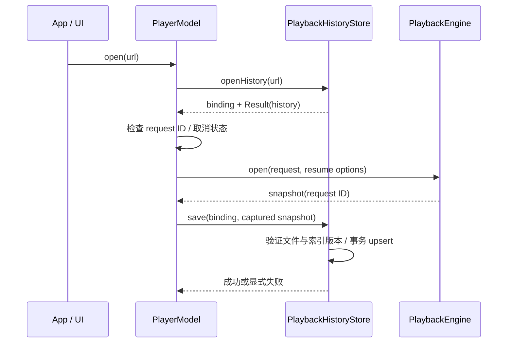
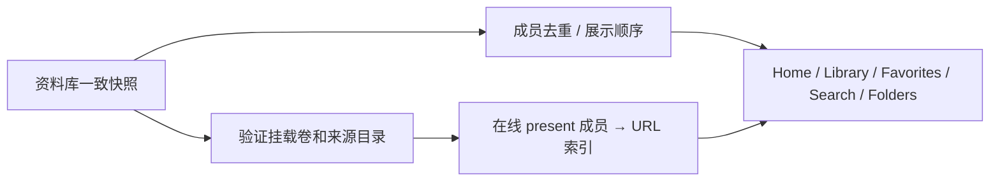

# 2026-10-24 质量收口

依据 [全量审查](../reviews/project-review-2026-10-24.md) 和用户的后续实施授权。用户将锁屏，故本轮只做编码、文档、构建和无窗口验证，不启动播放器或操作系统辅助功能设置。没有修改既有未提交的工作方向或任务验收状态。

## 最终设计与调用链

### R1：播放历史绑定内容版本

`PlaybackHistoryPersisting.openHistory(for:)` 返回 `PlaybackHistorySession`：包含不可变的 URL + `MediaFileIdentity` 绑定，以及独立的历史读取结果。即使以前从未保存过进度，也有绑定；SQLite 忙或历史读取失败不会丢掉已经采集到的身份，后续可以安全重试保存。

`PlayerModel` 每次打开清空旧绑定。异步恢复完成后，只有仍匹配当前 request ID 的结果才能绑定会话并交给内核。保存 API 必须接收绑定，生产接口不再提供按 URL 临时解析后保存的方法。保存验证卷 UUID、卷内文件号、内容 revision 和稀疏指纹；事务内再次检查已索引版本，避免旧写入把扫描器的新版本回退。检测变化后明确失败并抑制该请求的后续 checkpoint，重新打开产生新绑定。

周期、停止、切文件、自然结束、返回资料库和退出都使用同一个保存入口；排队任务捕获原请求的绑定和快照，旧请求不能覆盖新请求的错误状态。退出等待写入完成后仍释放内核。存储身份与数据库行号分离，归档导入改变行号后仍以原文件版本验证；既有导入、清除和恢复回归继续约束行为。

边界：底层身份仍使用有界稀疏采样，不是完整媒体内容哈希。正在播放的文件被重命名后，旧 URL 的保存可能明确失败；重新打开新路径仍按卷/文件号恢复已有历史，不承诺凭空发现未扫描的新路径。此修复不声称打开路径与 mpv 文件描述符之间具有文件系统原子性。

### R2：展示去重与可播放位置分离

`MediaLibraryModel.refresh()` 先读取一致快照并校验来源目录在线状态，再从**所有在线且 present 的成员关系**建立 `mediaFileID → URL` 索引。展示去重继续保留既有入库时间与顺序，不让“最早来源”决定文件是否可达。`fileURL(for:)` 对所有页面使用同一索引，逐项查询不再扫描整个 roots 数组。卷离线清空可播放索引，已保存收藏、续播等事实仍留在快照中。

测试覆盖子目录先入库、父目录先入库、子目录改名而父目录重新扫描、离线和重新挂载；确认唯一媒体、入库时间、收藏、续播、搜索和实际解析 URL 一致。未用每页特例掩盖成员关系问题。

### R3：同一窗口的应用级设置路由

`AppLifecycle` 持有唯一 `MainWindowNavigation`，将它注入主窗口、资料库页和设置页。导航值类型及当前页属于 App 层；SwiftUI 标题、图标与具体页面仍属于各视图。应用菜单 `Settings…` / `⌘,`、侧栏、Welcome 的 Settings 和 Restore from Backup 共享 `showSettings`；恢复入口选择 Storage。进入设置立即取消待完成的返回资料库任务，不等待库读取，也不创建第二个窗口或播放会话。

首次资料库加载不阻挡 Settings，空库也不再依赖添加来源才能设置/恢复。设置中的导入流程仍使用原有预览与确认合同；欢迎页不会直接导入或覆盖记录。

### 数据安全、文案与文档

- 迁移快照由独立的 `DatabaseMigrationBackup` 负责，连接和实际迁移仍由 `PlaybackHistoryStore` 拥有。详细调用链、保留与恢复步骤见 [迁移恢复](../../playback/persistence/migration-recovery.md)。
- 存储、扫描和归档错误及身份元数据错误进入本地化资源，保持路径/版本等真实参数；en 唯一打包，zh-Hans 仍是预留翻译。
- 原 progress/Todo 的全部内容原样归档到同目录日期文件，避免破坏相对链接；当前两页只维护状态和剩余门槛。审查保留发现时的原文，另链接本次解决记录，不改写历史证据。

## 验证与边界

首批工作树快照的验证（2026-10-24，Xcode 27.1 / 27A9275、Swift 6.4、macOS SDK 27.0）；后续媒体工作批次见 [接续记录](media-work.md)：

| 检查 | 结果与范围 |
| --- | --- |
| `./scripts/test-dev.sh --direct-hostless` | 148 项 Python 检查通过；193 项 XCTest、0 失败，其中 2 项 APFS 专项在默认入口跳过；本轮新增 9 项行为测试。 |
| `./scripts/test-dev.sh --direct-storage` | 两项真实临时 64 MiB APFS 专项均通过：重挂载设备号改变而文件号/历史保留；写满返回 SQLite 13 后，已提交记录仍在且可恢复写入。临时映像由测试卸载清理；末尾挂载检查无残留。 |
| `./scripts/build-dev.sh -quiet` | 构建成功（exit 0），没有启动 app。规范包 0.0.1 (2)，只含 en.lproj。 |
| `./scripts/build-dev.sh --analyze -quiet` | Xcode 静态分析成功（exit 0）。 |
| 许可证 / 运行依赖 | `license_audit.py check` 通过；`package_internal.py` 校验 44 个锁定 dylib、47 个 Mach-O、最低 macOS 14.0。 |
| 文档 / 格式 | 本地 Markdown 的 275 个文件/图片目标无缺失；`git diff --check` 通过。未把全仓 Markdown anchor 渲染纳入此次扫描。 |
| 10,000 条数据库资料库 | 最新样本 refresh 均值约 122.45 ms，内存搜索约 15.25 ms；与并行构建同机运行，只作本轮回归数据，不声称总耗时提升，也不代表滚动帧率或真机能耗。单条 URL 解析现按媒体 ID 查字典。 |

构建基线为 `e73603e16f19917e8bb31c522e094e917b5cf218` 加未提交工作树。工程输入摘要 `f685e92fb46d1c3042f5239bacd2cf51968bd2a2df9350c6b1670462cc5453d7`；App 可执行文件 SHA-256 `1609dd96ea5d0b0c6e3d2bf8ab9a225a7068d4713a4e33e265d2c19d16e8e0e6`。详细逐文件摘要在忽略目录 `.build/review-2026-10-24/quality-source-snapshot.json`，构建/测试/分析日志在同目录 `quality-*.log`。这些摘要用于区分同为 build 2 的不同工作树产物，不改变发布版本。

行为新增：`testReplacementFileCannotReceiveOldPlaybackCheckpoints`、`testBoundCheckpointRejectsInPlaceChangesAndAllowsFreshSession`、`testOverlappingSourcesKeepRenamedMediaPlayableThroughOnlineParent`、`testSettingsRouteWorksWithoutLibraryAndCancelsPendingReturn`，以及五项迁移快照/WAL/重试/保留/隐私测试。它们使用真实临时文件和 SQLite；内核事件由 recording engine 提供，不冒充实际解码。

本轮没有 UI 三尺寸、真实声音/颜色/同步、native 播放、睡醒、跨屏或 VoiceOver 的新增证据；不改系统完整键盘访问，不结束用户原有播放器进程。新设置入口和 Welcome 控件的可见检查保留在 [验收清单](../roadmap/v0.0-acceptance-todo.md)。
