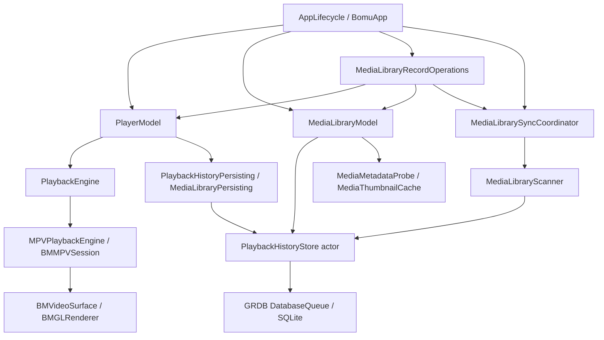

# Bomu 项目全量审查与下一步建议

> 后续处理：用户已授权实施。R1/R2/R3 与迁移备份的代码、行为测试和当前限制见 [2026-10-24 质量收口记录](../quality-hardening/implementation.md)。以下保留发现时的审查原文，不作为当前未修复清单。

审查日期：2026-10-23 至 2026-10-24（Asia/Shanghai）。基线为 `e73603e` 加当前工作区，包括未提交的 UI、媒体类型、测试与文档变更。审查期间工作区继续变化，因此恢复后重新读取了相关源码并重跑逻辑回归。本次仅审查，不修改产品代码，不改任务完成状态，不提交或推送。

## 优先发现

### R1 · P1：播放期间替换同路径文件，旧会话会把进度写进新文件

位置：`Sources/PlayerFeature/PlayerModel.swift:618–654`，`Sources/Persistence/PlaybackHistoryStore.swift:538–582`，`Sources/Playback/PlaybackHistory.swift:28–33`。

`PlaybackRequest` 只绑定请求 ID 和 URL。每次 checkpoint 都向 `save(for: URL, ...)` 传 URL，存储层重新解析此时路径对应的身份。若播放期间原文件被原子替换，当前会话的 snapshot 仍属于旧文件，但存储层会找到新文件行并写入旧进度。扫描识别新身份、清除旧记录的逻辑并不能阻止这条后续写入。

本次用实际 `PlayerModel`、`PlaybackHistoryStore`、临时文件与 SQLite，以及现有 recording engine 复现：旧文件 ID 为 1，播放位置 42 秒；原子替换后索引生成 ID 2，查询新文件历史为 nil；对旧会话调用 checkpoint 后，新文件 ID 2 的历史变为 42 秒。没有启动应用或读写用户媒体库。

```text
CHECKPOINT_REPLACEMENT oldID=1 newID=2 before=nil after=Optional(42.0) savedID=Optional(2)
```

影响：周期保存、切片前保存、退出保存都走这类 URL 重解析路径；除了位置，还可能写入旧音轨、字幕轨和音量。违反“内容替换不继承旧记录”的事实所有权约定。

建议：打开时取得并绑定持久化媒体身份/版本令牌；保存时验证仍是该会话的文件版本，身份不符就拒绝旧 checkpoint，不能自动解析新文件后接受旧状态。修复覆盖普通保存、退出、暂停/切片、恢复等待期间替换及重命名，不能只在一个调用点比较路径。

### R2 · P2：重叠来源去重忽略在线可用性，真实存在的文件会被禁用播放

位置：`Sources/Library/MediaLibraryModel.swift:188–206`、`:525–529`。

全库展示按媒体 ID 去重，优先 `isPresent`，再优先较早的 `addedAt`；之后 `fileURL(for:)` 却只检查该代表条目的 `sourceRootID` 是否在线。媒体可能有多个来源成员关系，所选代表来源离线不意味着文件不可播放。

本次真实文件/扫描/SQLite 复现：先添加 `parent/old-child`，再添加其父目录；将子目录改名为 `new-child`，完整重扫父目录。新路径存在，父目录有在线且 present 的成员，但全库去重仍选较早的失效 `old-child` 成员，得到 `playable=false`。

```text
OVERLAPPING_ROOT pickedRoot=old-child pickedOnline=false onlineMemberships=1 playable=false actualFileExists=true
```

影响：Library、Favorites、Continue Watching、Search 的统一条目可能显示 Offline 并禁用播放，而进入在线父来源仍能找到文件。

建议：明确媒体事实与来源成员关系的区别。全库可播放位置应从有效成员关系解析；最初加入时间、收藏/已看等媒体事实不应随代表成员选择而改变。补“先子后父/先父后子、改名、离线恢复、不同成员存在性”的交叉回归。

### R3 · P2：空库 Welcome 阻断设置和导入恢复入口

位置：`Sources/Library/MediaLibraryView.swift:105–153`，`Sources/App/BomuApp.swift:15–34`，`Sources/PlayerFeature/SettingsView.swift`。

初次启动且没有来源时，Welcome 代替整个 library shell，只提供 Open Video、Add Folder。Settings 唯一入口在被移除的侧栏中；App 没有 Settings scene、应用级设置命令或其他路由。归档导入又只存在于 Settings/Storage。

因此新安装用户不能先恢复导出的库，也不能在“仅打开单文件、不入库”的用法中直接设置默认倍速、续播或隐私目录。先添加无关目录才能打开设置属于额外操作，不应成为恢复数据的前提。

这是完整源码路由核查结果；本次没有用新空库窗口进行可见复现。建议保留独立的应用级 Settings 命令/入口，并在空库流程提供明确的恢复路径。检查导入、取消、失败、播放后返回和清库后的路由。

## 中低风险与验收缺口

| 项目 | 判断与影响 | 建议 |
| --- | --- | --- |
| 迁移前恢复备份缺失 | 产品定稿明确要求迁移前创建可恢复备份；当前初始化直接调用 `makeMigrator().migrate(database)`。已有事务回滚测试有价值，但不等于备份、跨版本回退或人工恢复能力。尚未公开发行，列为发行前数据安全门槛，而非已经发生的数据丢失。 | 在公开 beta 前补一致的 SQLite 备份、保留策略和恢复演练；不复制活跃 WAL 下孤立的主文件。 |
| 新 UI 验收不足 | Library 分类标签、排序、列表切换及 Welcome 最近继续调整；现有 Library 三尺寸截图是之前的控件版本，不能覆盖新布局和键盘路径。 | 用固定源码快照完成新控件三尺寸、长文件名、空态、加载态、焦点与点击边界检查。 |
| 辅助功能未闭环 | More actions 已有首项/单次 Tab 的历史证据；完整弹层顺序、分类子菜单、反向遍历和 VoiceOver 仍开放。 | 单独验收鼠标、普通键盘和 VoiceOver；需要完整键盘访问时遵守当次授权、恢复并回读的规则。 |
| 规格存在冲突 | 产品 HTML 仍写“继续观看卡片 16:9”，UI HTML 与当前卡片实现、验收记录使用 16:10。不能同时声称符合两份基线。 | 按已认可的视觉方向统一文字规格，保留变更理由；不要自动改变当前卡片比例。 |
| 文案集中不彻底 | `PlaybackHistoryError`、`MediaLibraryScanError`、`MediaLibraryArchiveError` 有用户可达的硬编码英文错误。当前英文单语言下不是缺失翻译，但违反用户文案集中约定。 | 区分用户解释与诊断细节，迁入资源；错误类型继续保持结构化。 |
| 大库性能证据有限 | 本次 1 万条测试的 SQLite 快照刷新均值约 104.8 ms，内存搜索约 13.8 ms；未测原生滚动、10 Hz 播放快照驱动下的视图刷新、抽帧竞争与内存峰值。 | 保留已测结果，补有真实数据量的 Instruments/连续帧证据，不能把查找耗时当成整页流畅度。 |

## 架构和代码质量

整体方向合理，可以继续沿现有分层修复，不需要推倒重写或立即拆 Swift package。



已建立的基础包括：

- 应用级 owner 持有一个播放 engine；页面切换通过持久视图与展示状态完成，UI 不直接持有 mpv 指针。C API 基本限制在播放/渲染适配层。
- 播放阶段、用户暂停意图、缓冲/定位状态分开表达；请求 ID 和命令 ID 拒绝旧事件，结束/失败是终态，已有行为测试。
- 控制队列和渲染队列分离；退出先释放 render context，再销毁 core。代码有线程/锁合同，也没有在两个队列之间直接同步互等。
- 数据层 actor 持有唯一连接和迁移；GRDB 只在 Persistence 实现中导入。扫描成功才核对删除，取消/失败保留既有索引；归档确认操作有应用级生命周期 owner。
- 缩略图有并发限制、共享请求、超时、取消和容量清理；媒体属性未知时使用未知值。唯一 `@unchecked Sendable` 位于带锁的 AVFoundation callback 桥接，并有合同注释。
- 工具链、第三方版本和运行时闭包有校验，hostless 与 native 入口分开，许可证/来源记录与自身 MIT 材料区分。

主要架构热点：

1. **媒体身份还没贯穿播放会话与写入合同。** R1 是边界设计问题，不能靠数据库 resolver 单独保证。
2. **媒体聚合条目与来源成员关系混合。** R2 表明展示去重已经影响文件可达性判断，需要把“哪个记录代表媒体”和“从哪个有效来源访问”分开。
3. **PlayerModel 承担了媒体库数据管理。** 导出、导入、隐私目录、清库依赖 `historyStore as? MediaLibraryPersisting`；已有 `MediaLibraryRecordOperations` 协调生命周期，但数据能力仍经过播放器转发。后续维护这些用例时，可把媒体库能力直接注入其应用级 owner，播放器只参与 checkpoint 协调。无需现在引入通用 Service 层。
4. **维护热点集中。** `PlaybackHistoryStore` 约 1,524 行，承担身份、扫描、偏好、迁移和归档；`MediaLibraryView` 已接近千行，承担路由和多页布局。可按已有独立职责提取迁移/归档实现、页面组件，保持同一个连接/事务 owner；不要仅为行数拆空包装。
5. **UI 和具体存储耦合仍较强。** `MediaLibraryModel` 依赖具体 `PlaybackHistoryStore`，不违反“UI 不依赖 GRDB 类型”，但使竞争条件、慢存储和故障测试更多依赖实际数据库。优先针对真实用例收窄协议，不一刀切为每个类新增协议。

## 当前进度与产品方向

`开发任务.json` 共 83 项：5 项已完成、30 项进行中、48 项未开始。这里是任务状态统计，不能换算成整个产品“完成百分比”。

| 阶段 | 当前状态 | 审查判断 |
| --- | --- | --- |
| v0.0 | A04/A05/A06/A09 完成；A01/A02/A03/A07/A08 进行中；A10 未开始 | 播放骨架、依赖和早期基准有基础；视觉、渲染生命周期与 SDR 门槛尚未签收。 |
| v0.1 | B01–B12 全部进行中 | 播放控制、队列、字幕、续播、设置、内部包已有大量实现；仍受 A10 和真实验收约束。 |
| v0.2 | C06 完成，13 项进行中，4 项未开始 | 媒体库广度已经较大；C06 的完成是局部任务状态，不能代表其依赖 C05 或整个 v0.2 已签收。 |
| v0.3 以后 | 未开始 | 当前没有理由推进联网整理、快捷键平台、网络播放或营销网站。 |

主要产品风险是开发广度领先于基础验收。当前已有明显超出最小 POC 的功能投入；继续增加能力会扩大回归矩阵。下一阶段应冻结功能扩展，先消除已复现的数据和入口问题，再完成 A02/A07/A08/A10。

## UI 还原度

目前能支持的结论是“主要结构与一部分尺寸 token 对齐，完整视觉与交互验收未完成”。不能可靠给出 90% 或像素一致之类百分比。

- 本次读取了批准 HTML 中的真实 CSS/布局，检查 `AppTheme`、页面组件和已有截图。侧栏 176 pt、内容横向 30 pt、三列网格 17 pt 间隙、Home 两列 16 pt 间隙、16:10 artwork 等有既往三尺寸实测记录，保存的 Home/Library 截图与这些结构一致。
- 当前源码沿用固定 16:9 播放舞台、原比例内容适配、舞台内信息面板；已有 9:16/21:9 截图和操作记录，但本次没有重新验证实际视频输出、声音、颜色或睡醒。
- Welcome 使用系统符号替代原型样片照片属于已记录的原生化差异；系统标题栏和原生文件面板也应按平台语义验收，不把网页壳带入应用。
- Library 新控件采用真实手工分类与额外观看状态，布局已记录与原型的差异；Duration 排序尚无完整时长事实支持，不能算已经完成。
- 字体实际度量、精确颜色/圆角、控件命中区、长文案截断、全阶段播放器布局与完整键盘/VoiceOver仍需新构建证据。静态 CSS 数值、JPEG 颜色采样或 AX 树都不能单独证明这些项目通过。
- 自定义 overlay scroller 通过查找 SwiftUI 的 AppKit 祖先修改原生滚动条，是需要持续验证的桥接热点。本轮没有证明它是闪烁根因，也没有排除间歇闪烁。

## 文档规范与公共影响

文档优点：入口清楚，有产品基线、真实调用链、已知限制和行为测试名称；README 明确开发版性质；历史与当前工具链的播放矩阵已做区分。当前本地链接扫描检查 61 个 Markdown 文件的 250 个文件/图片目标，未发现缺失目标（不覆盖 Markdown anchor 渲染）。

需要改进：`progress.md` 和验收 Todo 合计约 293 KB，多处重复记录同一轮打开窗口、锁屏、偏好查询、短时截图和未验收声明。读者难以迅速得到“当前还剩哪一项、哪个构建、需要什么证据”。建议保留原始历史，但把当前状态收敛为一张任务/缺陷/证据表，原始过程放到日期记录；不要再把每次观察同步复制进多份功能规格。

反复使用 0.0.1/build 2 不能唯一识别不同工作树产物。正式验收记录至少附 commit、dirty diff 或源码摘要、工具链、包身份、窗口点尺寸、数据状态、测试方法与证据位置，明确哪些截图已被新控件修改作废。本次已在忽略目录保存源码 SHA-256 快照，尚未把它变成项目的正式验收系统。

公共影响面：

| 共用能力 | 影响范围 | 必测回归 |
| --- | --- | --- |
| checkpoint 身份合同 | 单文件、队列、自动保存、切片、退出、恢复、归档 | 替换不串进度，重命名不断历史，取消/旧任务不能写新会话 |
| 媒体去重/在线解析 | Home、Library、Favorites、Search、Folders | 重叠来源、路径改名、离线/重连及各页面一致性 |
| AppTheme / 元数据呈现 | 全部页面、卡片、列表与播放器控件 | 三尺寸、加载/未知/离线、等高槽位和点击边界 |
| OpenMediaPanel / 文件类型 | 菜单打开、Welcome、错误恢复、外置字幕 | 显示当前文件类型、取消保持状态、旧字幕面板不能影响新请求 |
| 数据层迁移/导入 | 用户全部本地事实 | 事务失败、备份恢复、隐私排除、活动播放与记录操作并发 |

## 本轮验证及边界

| 验证 | 结果 |
| --- | --- |
| 2026-10-24 `./scripts/test-dev.sh --direct-hostless` | 148 项 Python 检查通过；184 项 XCTest，0 失败，其中 2 项临时卷专项按入口跳过。 |
| `./scripts/build-dev.sh --analyze` | 2026-10-23 初轮及 2026-10-24 最新工作区均通过（ANALYZE SUCCEEDED）。 |
| `python3 scripts/license_audit.py check` | 通过。只说明仓库审计规则满足，不构成公共发行批准。 |
| `python3 scripts/package_internal.py .build/DerivedData/Build/Products/Debug/Bomu.app` | 44 个锁定 dylib、47 个 Mach-O、macOS 14.0 最低版本校验通过。 |
| `git diff --check` | 通过。 |
| 两项隔离行为探针 | R1、R2 均复现；临时媒体、数据库和独立 defaults 域已清理。 |
| 原生/可见验证 | 只读取了已有规范路径 Bomu 的 Folders AX 状态；桌面工具异常耗时，没有取得新版单窗口完整可见验收。不关闭或重启审查前已有的用户进程。 |

本次没有运行 native 播放测试、完整 30/60 样本矩阵、临时卷专项、睡眠/唤醒、跨屏/全屏循环或 VoiceOver；没有修改完整键盘访问等系统设置。此前结果属于历史证据，不能写成这次通过。

本地详细日志和探针留在忽略目录 `.build/review-2026-10-24/`：`Probe.swift`、`probe-results.log`、`hostless.log`、`analyze.log`、`source-snapshot.json`。探针直接编译当前生产 Swift 实现并链接已有 GRDB 产物，使用 recording engine 仅提供旧会话事件，文件身份和持久化是真实路径；它不证明实际 mpv 解码行为。

## 下一步执行顺序

1. **先修 R1，补行为回归。** 完成会话身份绑定后，统一周期、切片、退出保存入口；验收旧版本不能写新文件，重命名仍可续播。此项优先于视觉微调。
2. **修 R2 与 R3。** 统一多个来源成员的可播放位置解析；补空库的设置/导入路由。不要为每个页面单独加例外。
3. **固定一个可复测构建，收口 A02。** 先 Welcome 和新 Library 控件，再 More actions 键盘与 VoiceOver；按三尺寸逐状态记录参考值、实际值、差异和动作结果。只测变化及缺失单元，避免重复已覆盖的静态截图。
4. **完成 A07/A08 与当前工具链播放证据。** 重跑当前锁定工具链完整 A04；安排真实 H.265 声画、有效睡眠/唤醒、停止/释放、连续切片和渲染生命周期验收。跨屏/全屏与全局键盘设置另按仓库约定取得具体授权；用无调色污染的参考样片核对 SDR，不能使用已调暗降饱和度的测试片判定准确度。
5. **更新唯一状态表并执行 A10 决策。** 已证实修复形成独立提交；当前文档压缩到任务、证据和残余限制。随后才决定 B/C 阶段收口顺序，公开 beta 前补迁移备份、恢复和发行签名/公证门槛。

当前结论：工程基础值得保留，但存在已复现的数据正确性缺陷和用户入口缺口，v0.0 也尚未完成验收；不能按“质量已收口”或“可公开发布”签收。完成上述前三项应是近期工作的中心。
