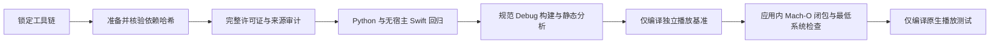

# macOS 持续集成

`.github/workflows/macos-ci.yml` 为 push、pull request 和手动运行提供单一 arm64 macOS job。它固定选择 GitHub-hosted `xcode-27` 镜像中的 Xcode 27.0；`scripts/toolchain.py` 在入口核对 Xcode build、Swift 编译器与 SDK，Xcode target 构建阶段再核对实际展开的 macOS 14.0 部署目标，避免 runner 标签变化静默升级工具链。

Job 安装合成媒体生成需要的 FFmpeg，运行 `scripts/dependencies.py bootstrap` 从哈希锁定的 IINA DMG 和 FFmpeg 9.0.1 源码准备 44 个运行库，先对完整当前清单执行 `scripts/license_audit.py check`，再执行仓库现有 Python/无宿主 Swift 回归、Debug 应用及独立播放基准构建、Xcode 静态分析、实际 `.app` 的 dylib 闭包检查，并编译 app-host 原生播放集成测试 target。共用的 `scripts/prepare-test-media.py` 只生成基础回归所需的本地样片，其中包含原生 MPEG-2 定位测试；完整 60 项 B11 suite 只由 `benchmark-dev.sh --b11-suite` 生成，避免编译几个集成用例时重建整套媒体。所有素材均通过 manifest 和 SHA-256 校验；干净构建不会依赖此前运行测试留下的 `.build` 文件。无宿主测试写入 `.build/DerivedData-Tests`，app-host 编译写入 `.build/DerivedData-ForTesting`，可打包的 Debug app 保留在 `.build/DerivedData`；这样测试插件不会污染闭包检查与内部打包所用的产品。闭包检查逐一解析构建产物中的 47 个 Mach-O 镜像，防止仅凭源文件可编译就遗漏运行库或包外链接。集成测试只执行 `build-for-testing`，不启动需要桌面可见性的播放器；长时播放测试也不在 CI 运行。无宿主 XCTest 的 `.xcresult` 保存在 runner 临时目录，报告步骤始终输出结构化摘要，包括测试在启动 Xcode 前失败、尚未生成结果包的情况。CI 不签名、不公证、不创建发行物，也不请求写仓库的权限。依赖在每个全新 runner 上重建；后续只有在测得构建时间后，才考虑针对锁定输入增加缓存。

所有外部 Action 均固定到完整 commit SHA；checkout 不持久化 Git 凭据。Workflow 使用 `contents: read` 最小权限并按分支取消过期运行。GitHub 仍将 Xcode 27 runner 标记为 public preview，且仅提供 arm64 runner（[GitHub 公告](https://github.blog/changelog/2026-07-16-xcode-27-runner-image-now-in-public-preview/)）；该镜像已迁移到 macOS 27（[迁移公告](https://github.blog/changelog/2026-09-10-xcode-27-runner-image-now-runs-on-macos-27/)），当前镜像清单报告 macOS 27.0.1，并将 Xcode 27.0（27A266a）放在 `/Applications/Xcode_27.app`（[runner 软件清单](https://github.com/actions/runner-images/blob/main/images/macos/xcode-27-arm64-Readme.md)）。因此 CI 的成功能证明最低部署目标设置为 14.0 且代码可用当前 SDK 编译，但不能证明应用实际运行于 macOS 14；发布前仍须在最低支持系统上完成运行验收。Runner 镜像本身可能更新；锁定检查会在精确工具链不再可用时失败，而不静默改用新版本。

CI 的应用构建阶段锁定 `MACOSX_DEPLOYMENT_TARGET=14.0`。包闭包检查还会遍历应用内所有 Mach-O，确认其平台为 macOS 且最低系统版本不高于 14.0；这能拦截升级第三方运行库时意外抬高部署底线。它仍不能替代在 macOS 14 上运行应用的验收。

## 锁屏时本机逻辑测试

本机若处于锁屏状态，Xcode `test` action 可能等待无法启动的 XCTest worker。`scripts/test-dev.sh --direct-hostless` 提供等价的 hostless 验证入口：先校验或生成基础本地媒体样片，再运行同一组 Python 回归，通过 `build-for-testing` 编译 `BomuLogicTests`，最后用 `xcrun xctest` 执行完整逻辑测试 bundle；不启动 app 或原生播放器窗口。所有测试入口共用样片准备步骤，因此干净 checkout 不依赖此前测试遗留的 `.build/fixtures`。该模式不接受测试过滤参数；需要选择用例时使用默认 Xcode test action。CI 继续采用默认 action，以保留标准 XCTest 结果记录。

2026-10-16 本机 Xcode 27.0（27A266a）、Swift 6.4、macOS SDK 27.0 验证：`./scripts/test-dev.sh --direct-hostless` 的 143 项 Python 与 114 项 XCTest 全部通过；Debug 应用构建、静态分析，以及 44 个运行库 / 47 个 Mach-O 的闭包与 macOS 14.0 最低版本检查也通过。2026-10-15 的 `./scripts/build-dev.sh --for-testing -quiet` 只编译 app-host 集成测试，不启动播放器。无宿主测试与测试 target 编译都不覆盖实际窗口中的鼠标、键盘、VoiceOver、音画或显示器验收。上述为本机验证记录，不代表 GitHub Actions 已执行成功。

## 当前清单与产物复核 — 2026-10-19

CI 增加独立的完整许可证/来源审计步骤。审计工具已有针对各组件和拒绝路径的测试；完整入口还会检查当前清单整体，避免某项未被分项断言覆盖的问题混进依赖变更。该步骤不修改 `distributionReady`，也不表示组合运行库已获公开发行批准。

本机完整审计通过，36 项许可证审计回归通过。当前规范 Debug 包通过 44 个锁定动态库、47 个 Mach-O 镜像及 macOS 14.0 最低版本检查。修改后的 workflow YAML 可解析，包含 12 个步骤；尚未推送运行，因此不声明 GitHub Actions 已通过。Git 跟踪文件复核未发现 `.build`、旧 `player_ui` / `player_naming`、应用运行库二进制、DMG 或测试视频。两份保留的 HTML 是用户指定的定稿与视觉基准，继续作为文档而非应用源码。

2026-10-19 增加 `./scripts/build-dev.sh --benchmark -quiet`：仅编译 `BomuBenchmark`，不启动窗口或生成完整素材。该目标的两处绝对定位调用已同步生产 API 的 request ID 合同；修复前本机编译复现缺少参数错误，修复后通过。CI 增加同一编译入口，尚未推送运行。详见 [B11 准备与证据边界](../../playback/media-suite/b11-preparation.md)。
