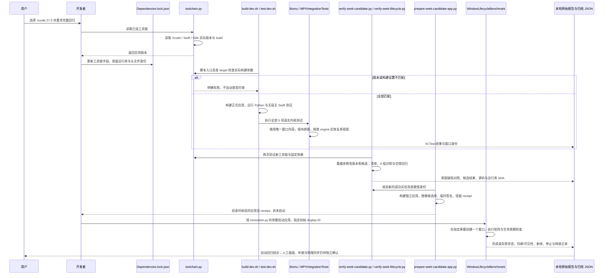

# 工具链升级调用链

本图对应用户授权的 Xcode 27 升级、实际构建和回归。正式运行库缓存保持原始固定版本；候选库只存在于独立实验及应用中。

## 版本固定、构建与单窗口验证

从用户选定新版工具链开始，经过版本与构建参数校验、真实测试和独立候选应用运行，最终归档成功或失败证据。程序日志与用户实际观感分别记录。

- 无效或不可用的指定屏幕在创建窗口前失败；窗口创建后不靠搬动、循环置前或删除断言满足要求。
- 原生 XCTest 和候选可见基准先后执行，每次一个窗口。只有无窗口的后台对照可以并行执行。
- 旧构建、旧依赖锁哈希及旧验收报告保留；新的成功结果有新的目录与校验记录，不修改历史产物。
- `prepare-seek-candidate-app.py` 只准备应用，实际启动由独立运行记录中的 `invocation.py` 执行。准备成功本身不代表播放通过。
