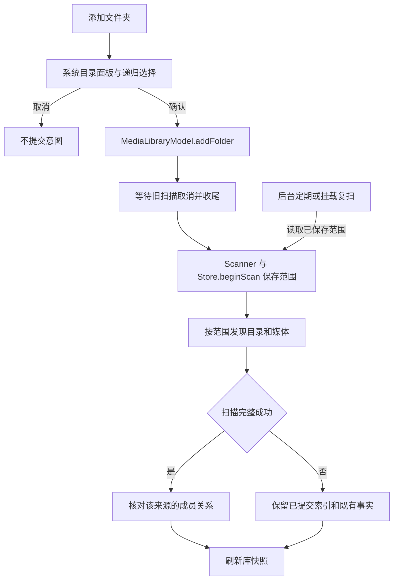

# 浏览密度与来源扫描范围

## 需求和事实源

落实开发定稿 R06 的舒适/紧凑密度，以及添加文件夹时包含子目录的选择。Grid/List 是布局，舒适/紧凑是独立密度；默认舒适保持既有视觉规格。

`PlaybackPreferences.browserDensity` 拥有整个安装的密度偏好，通过 UserDefaults 保存。Library、文件夹媒体页面和 Settings → Appearance 使用同一值。归档 Settings 增加可选的类型化字段；旧归档缺省恢复舒适，未知枚举值在解码时失败，不进入写入阶段。没有新增数据库迁移。

来源递归选项由已有的 `media_source_roots.including_subfolders` 保存；后台复扫读取这一字段。UI 不另存一份来源选项。添加面板每次默认勾选包含子文件夹，用户可以在提交前取消勾选；重新添加同一个来源会按本次明确选择调整扫描范围。

## 界面合同

| 项目 | 舒适 | 紧凑 |
| --- | --- | --- |
| Library/文件夹媒体网格 | 3 列，列/行间距 17/23 pt | 4 列，列/行间距 12/16 pt |
| 媒体列表上下留白 | 每侧 13 pt | 每侧 6 pt |
| 字体、封面比例、元数据槽位、独立操作按钮 | 沿用公共组件 | 与舒适相同 |

数值集中于 AppTheme.Layout 并同步 `设计规范.json`。Home 摘要、收藏和搜索沿用各自原布局；来源目录导航本身不缩小。紧凑网格按原稿 `.m-compact .m-media-grid` 的四列和 `gap:16px 12px` 对齐；此前 18 pt 行距与“原稿没有独立紧凑状态”的说明已更正。列表 6 pt 上下留白属于原生补充规格，字体/元数据保持公共组件合同，完整渲染对比仍待验收。

Library 与文件夹工具区有 Density 菜单，Settings 的 Appearance 也可选择；切换不修改排序、过滤、当前文件、播放或记录。Grid/List 布局的当前会话状态与密度偏好独立，跨重启密度保存，布局继续采用原来的会话默认行为。

`AddMediaFolderPanel` 使用系统目录 sheet 和默认展开的 Include subfolders 复选项。取消不提交任何扫描；确认后仅传入 URL 和布尔选择。面板拒绝文件、多个目录和创建目录操作；原始媒体只读，不复制到库中。

非递归只登记来源根及顶层媒体，不把未扫描的子目录显示成空文件夹。重新缩小范围后，成功扫描会撤销这个来源的子目录/媒体成员关系；媒体身份、收藏和播放历史仍保留，重新扩展范围后恢复显示。失败/取消仍沿用不做删除核对的策略，不以一次局部扫描清库。

## 调用链与资源边界

扫描 Task、取消和刷新仍归 MediaLibraryModel/MediaLibraryScan 拥有。增加选项没有新建后台常驻任务、事件监听或新的数据层连接。目录事件增量、持久安全书签与来源恢复属于另一个尚未完成的工作项。

## 验证记录

- 新增密度持久化/归档往返/旧归档缺省/非法枚举拒绝的行为测试。
- 新增真实临时目录和 SQLite 的模型测试：非递归只显示顶层文件；重新打开数据库保留范围；扩展后设置子文件收藏和进度；缩小再扩展后身份、收藏、42 秒进度和原文件字节不变。目录数同时断言为非递归 1、递归 2，避免空子目录误导。
- 2026-10-26 最后一次无宿主回归：233 项 XCTest 中 231 通过、2 项 APFS 专项按入口规则跳过；167 项 Python 通过。本次没有改动原生播放/渲染，未重复执行不覆盖这些行为的原生播放测试。
- 首轮规范包 `3747b57de0475a2ad7ffa11542519f1a32ee88fa851172c16feadae479340e0f`：同屏单窗口、标记临时库及 8 个有来源记录的 CC0 合成副本，实际非递归 4 条、取消后仍 4 条、重新递归 8 条、Nested 页 4 条；Compact 四列与 List 切换、Folders/Settings 的共用密度、正常重启保持 Compact 和 8 条、恢复 Comfortable 三列均取得可见证据。
- 最终规范包 `a9f3332e3801e4d151c76507826142df999ee3b9501a6accd4493c243d2178df` 构建、静态分析及身份核验通过。在同一普通窗口、同一临时库补验：取消递归后根页面只有 Clip 01–04、没有 Nested；重新勾选后 Nested 恢复，进入后显示 Clip 05–08。保持 Comfortable，正常退出 PID 21484，清理本轮带标记的临时库后恢复正常 Home。七处标题颜色已合入，完整视觉矩阵仍由 UI 验收记录负责；首轮密度/取消/重启收据仍对应首轮包。日志、构建身份、原始测试数据和来源清单位于 `.build/browser-options-acceptance-2026-10-26/`。

完整三尺寸、长文案、未知/离线元数据组合和 VoiceOver 仍保持待验，不由当前窗口检查替代。未开启完整键盘访问、未切换屏幕/Space、未进入全屏。
