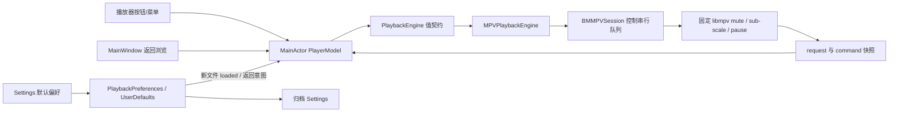

# 静音、字幕大小与返回暂停

2026-10-26 实现，属于仓库审查落地目标中的当前播放控制补齐。依据开发定稿的音量静音、字幕设置、返回默认继续播放合同；不改变 v0.0/A10 的独立验收门槛。

## 行为与事实源

- 静音使用 libmpv `mute`，不将音量改成 0。底部扬声器按钮与 Playback 菜单共用 `PlayerModel.toggleMute()`，菜单快捷键为 ⌘⇧M。控件保留原音量；静音期间拖动音量不会隐式取消静音。静音在同一内核会话的切文件/停止后重开中保留，不写入每文件历史或跨应用重启偏好。
- `PlaybackMuteRequest` 带文件 request ID 和递增 command ID。模型展示最新用户意图；native 控制队列仅对仍加载的同一 request 执行、拒绝旧命令；成功写入后快照携带 command ID。较旧快照不能回滚已确认状态。切文件、停止、退出、终止失败清理 pending 意图。native 读不到 mute 时返回未知，UI 禁用静音操作，不假定有声。
- 字幕大小提供 50%、75%、100%、125%、150%、200%。当前文件菜单调用 `sub-scale`；设置页默认值在新文件 loaded 时应用，重复 loaded 不重置用户操作。当前文件修改不覆盖默认值。旧 request 和非法数值不能更改当前字幕；native 拒绝失败走现有字幕命令错误，不通过猜测字幕文本内容补偿。
- 字幕缩放适用于文本字幕；ASS 带样式字幕由固定 mpv 的样式策略处理，不强制剥离样式，不承诺图形字幕拥有文字字号。设置文案明确这些限制。默认倍率不是字体名、双字幕或逐轨道字号配置。
- 返回浏览默认继续。开启偏好后，返回动作同步绑定当前 request 的明确暂停意图，再进行 checkpoint/媒体库刷新。已暂停或正在确认暂停时重复返回不会恢复播放。opening 或首个 snapshot 尚未到达时保留该 request 的意图，首次可控制快照到达后暂停；新文件、停止、失败和退出清除旧意图。此行为不是无声预加载保证，打开后的极短声音仍取决于内核加载和首次快照时序。

## 调用链与归属

UI 不接触 mpv 指针。可变 native 状态归现有 session 所有；新增字段不创建内核或渲染实例。音量仍是已有历史字段，静音/字幕缩放的当前状态不写入数据库瞬时状态表。

归档新增可选 `pauseOnReturn` 与 `defaultSubtitleScale`。旧归档缺失时明确恢复 false / 1；新归档导出实际偏好。导入端在任何写入前验证字幕倍率属于支持集合；偏好归一化不能替代归档验证。字幕倍率和静音的 native 读值未知时不在适配边界伪造成功值。

## 验证

- 无宿主逻辑回归：227 项 XCTest 中 225 通过，2 项 APFS 存储专项按默认入口跳过，随后通过 `--direct-storage` 单独执行 2/2 成功；167 项 Python 通过。覆盖静音未知/快速反向/旧快照/切文件/音量独立；返回默认继续/重复暂停/opening/替换请求；字幕默认/非法与旧请求；归档兼容和非法倍率。
- 真实内核：17/17 通过，含新增静音与返回、外置自生成 SRT 字幕缩放两项测试。SRT 文本由测试生成，不引入第三方字幕。
- 规范包 `c373c7f22c1c524fa53433304f61785f108402428f7d02b7fce5e73e81ccce3c`（0.0.1 (2)，仅英文）构建、静态分析和身份核验通过。临时库单窗口可见检查通过静音按钮/⌘⇧M、返回后暂停、字幕默认倍率设置；音量保持 100。返回暂停 false→true→false 和字幕默认 100%→150%→100% 已按初始值恢复。当前文件菜单辅助功能回读仍为 150%，印证它与新文件默认值独立。
- 字幕层级菜单的完整展开/选择受到桌面工具焦点限制，未取得可见字号变化证据；真实静音听感、字幕字号与 ASS 实际观感尚未签收。属性回读和 mock 不能替代这些证据；Esc、语义轨道恢复及外置字幕跨重启仍属后续项。

官方依赖依据：[mpv v0.41.0 options.rst](https://github.com/mpv-player/mpv/blob/v0.41.0/DOCS/man/options.rst)，blob `fa71dc0d1e857496fecee23aa2cec3541d8d88c0`。这里只记录链接、内容标识和实现合同，不复制上游文档原文。

本轮临时库窗口正常退出且标记目录已清理；正常库 Home 已用同一规范包恢复（交接 PID 90597），交给 UI 任务继续 Grid/List 检查，不开启额外播放器窗口。执行日志/收据位于 `.build/controls-acceptance-2026-10-26/`；可见操作以本任务工具记录为依据，未声称该轮覆盖全部三尺寸。

存储专项复核当前迁移后的事实保存：临时 64 MiB APFS 写满产生 SQLite FULL（13），原已提交 checkpoint 保留且释放空间后恢复；重新挂载设备号改变但历史身份保留。结束回读无剩余测试映像与测试目录。
