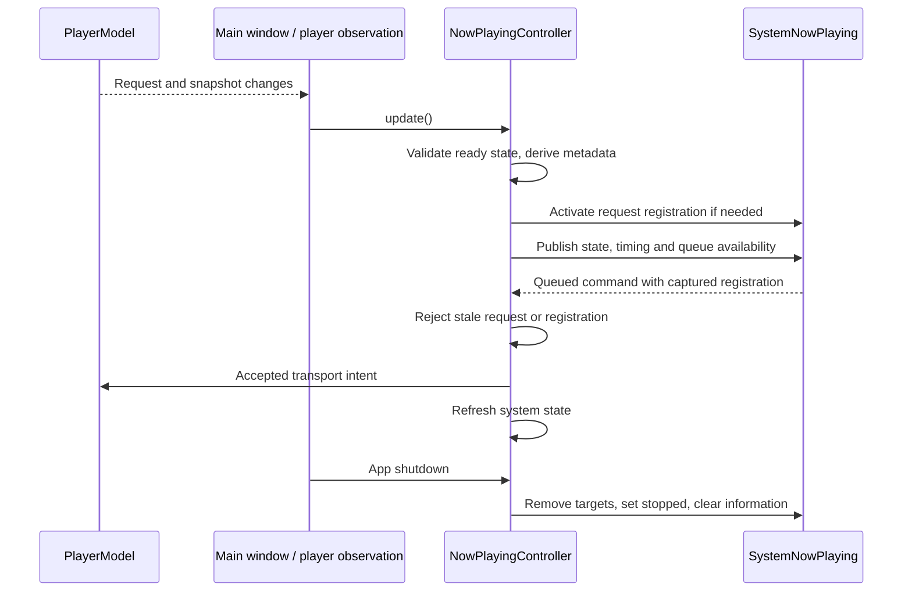

# System media controls and Now Playing

## Ownership

`NowPlayingController` coordinates one ready playback request. `SystemNowPlaying` is the platform adapter that owns this app's `MPRemoteCommandCenter` targets and `MPNowPlayingInfoCenter` writes. The narrow `NowPlayingSystem` interface allows hostless tests to record publications and invoke deferred command callbacks without touching the actual system command center.

A ready request with a snapshot activates play, pause, toggle, previous and next handlers. Queue availability updates independently of metadata throttling. Replacing the request, stopping, ending, failing or removing the player view releases the owned targets and clears published information. Deactivation is idempotent; a controller that never acquired ownership does not write to the system. Returning to the library keeps the mounted player and its system ownership. Application termination calls `shutdown()` before awaiting data operations and native teardown, permanently rejecting later view updates.

Each registration captures both its request ID and a fresh registration identity. The controller checks both before executing a callback on the main actor. A queued command from a replaced request, or from an earlier registration of the same request, cannot affect current playback. Accepted commands use `PlayerModel` and immediately refresh the system presentation; no global keyboard monitor is installed.

## Published state

Apple requires macOS apps to update [`playbackState`](https://developer.apple.com/documentation/mediaplayer/mpnowplayinginfocenter/playbackstate) when playback begins or halts. The earlier implementation only populated the metadata dictionary and omitted this property. The adapter now writes both metadata and explicit state:

| Current playback facts | System state | Extrapolated rate |
| --- | --- | --- |
| User pause intent | paused | 0 |
| Seeking or buffering without pause intent | interrupted | 0 |
| Advancing playback | playing | Actual snapshot speed |
| Released session | stopped | Published information cleared |

The interrupted mapping is Bomu's presentation decision for a temporary stall; it does not issue a pause command or change user intent. A zero rate prevents the system timeline from advancing through a stall. When the engine clears waiting flags, the current position and actual speed are published again. The distinction uses Apple's [playback state enum](https://developer.apple.com/documentation/mediaplayer/mpnowplayingplaybackstate); automatic elapsed-time extrapolation and manual publishing responsibilities are explained in [WWDC22: media metadata publishing](https://developer.apple.com/videos/play/wwdc2022/110338/).

Only the filename without extension, duration when known, position and rates are published; private source paths and asset URLs are omitted. Request, title, duration, state, playback rate and default-rate changes publish immediately. Ordinary position updates retain the existing 0.8-second position-change or one-second elapsed threshold. This is not a strict one-publication-per-second cap at faster playback speeds. A new request with identical title/time still forces fresh publication, and a speed change while paused updates the default rate even though the current rate stays zero.

## Verification boundary

Hostless controller tests use a recording platform boundary. They verify playing and stalled rates, pause independence, paused-speed publication, omission of unknown duration/private path, suppression of unchanged updates, fresh same-title requests, stop cleanup, rejection of old request callbacks, rejection after reactivation of the same request, and permanent rejection during shutdown. These tests do not prove macOS command routing or hardware media-key behavior.

The final 2026-10-19 12:54 full hostless suite passed 157 XCTest cases and 143 Python checks. The canonical Debug build and static analysis passed.

Actual Control Center presentation, keyboard media keys, another application's ownership and native stall behavior remain pending in the canonical Debug app on Screen 1. The latest desktop observation was locked. No hostless check registers system commands or claims that native acceptance passed.
