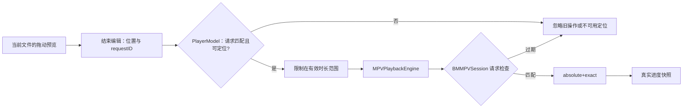

# 精确定位与时间轴拖动

## 责任边界

`PlaybackControls` 在拖动期间只更新本地预览位置，并用预览值覆盖较慢到达的播放快照；用户结束拖动时才调用 `PlayerModel.seek(to:requestID:)` 一次。因此快速拖动会合并为最终目标，不会把每个鼠标移动都排入内核。时间轴只在时长有限且大于零、媒体可定位时启用；模型同时约束绝对定位和相对跳转，避免界面与命令入口出现不同的可用状态。

绝对定位由 `PlaybackSeekRequest` 保留为绝对目标，经过 `MPVPlaybackEngine` 后进入 `BMMPVSession` 的串行控制队列，以 mpv `absolute+exact` 命令执行。方向键跳转则保留相对意图并使用 `relative+exact`，不以 UI 上一次进度快照自行累计，避免快照滞后造成偏移。请求 ID 在原生边界再次核对，旧媒体的定位不会作用于新媒体。

定位不改变暂停意图。暂停中的媒体收到绝对定位后继续保持暂停；恢复播放必须来自独立的播放/暂停动作。快照仍是实际位置的权威来源，拖动预览不伪装成播放进度。

## 文件切换与控件生命周期

时间轴结束编辑时提交该快照的 `requestID`，模型在发送命令前核对当前请求。更换文件、停止或退出后的旧回调不能定位新文件；该检查发生在原生命令入队之前，原生层仍保留自己的请求检查。

`PlaybackControls` 的 SwiftUI identity 绑定媒体请求 ID，使拖动预览、焦点和自动隐藏计时归属于同一次打开。只重置控件叠层，`VideoHostView`、`PlayerModel` 和原生内核不使用该 identity。此处采用 [Apple 的视图 identity 语义](https://developer.apple.com/documentation/swiftui/view/id(_:))，不按每次快照更新重建视图。

### 定位请求链路

拖动预览属于控件，实际定位属于当前播放请求；过期请求在模型和原生适配边界各自拒绝。

## 验证

- `PlayerModelTests.testRelativeSeeksKeepTheirIntentAcrossDelayedSnapshotsAndReplacement` 覆盖相对意图、过期快照、绝对定位、无效输入和文件替换。
- `PlayerModelTests.testSeekCapabilityGatesBothAbsoluteAndRelativeCommands` 覆盖不可定位与未知时长。
- `PlayerModelTests.testSeekingWhilePausedDoesNotIssueResumeIntent` 覆盖暂停时定位不会生成播放命令。
- `PlaybackControls.timeline` 在用户结束 Slider 编辑时只提交一次最终目标；真实快速拖动、暂停 seek 和画面落点仍须在屏幕 1 的单一播放器窗口完成可见验收。

### 2026-10-19 请求归属回归

新增的延迟时间轴回调测试先在旧实现中失败：第一文件的 45 秒操作被记录为第二文件的定位命令。修正后旧回调被拒绝，新文件的 12 秒操作正常提交，停止后的回调不生成命令，暂停意图保持不变。不可定位、未知时长、零、负数、NaN 与无穷时长均不发送定位。

修正后的无宿主回归为 158 XCTest / 143 Python，全部通过，Debug 构建、原生测试入口编译和静态分析通过；本轮未启动原生测试。以上是模型边界的真实回归结果；原生拖动与自动换片交错仍待单窗口验收，不将模拟回调等同于已经复现鼠标操作。
