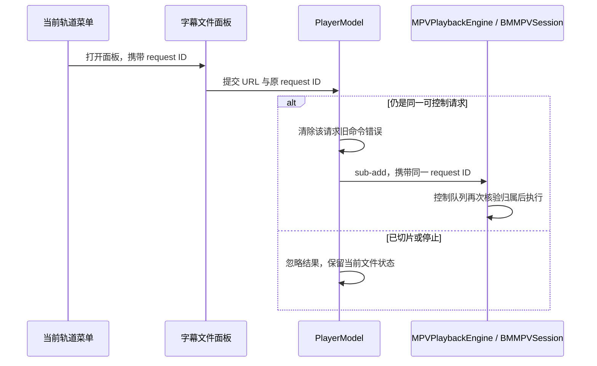

# 播放速度、音轨与字幕

## 调用链

播放菜单只提交 `PlayerModel` 意图。`PlaybackSnapshot` 携带实际速度、字幕偏移和已解析的轨道列表；`MPVPlaybackEngine` 将值映射为无原生句柄的 Swift 模型；`BMMPVSession` 在唯一的内核控制队列读取 `track-list`，将语言、标题、选中状态、内嵌/外部标志复制后释放 `mpv_node`，并串行提交轨道、速度和字幕命令。

轨道 ID 始终来自当前文件的 libmpv 快照。音轨/字幕菜单在生成内容时捕获对应的请求 ID；外置字幕面板沿用打开面板的同一个请求 ID。模型接收选择、偏移和加载意图时先核验请求仍有效，原生边界再次核验，避免旧菜单或晚返回的文件面板将操作应用到新文件。字幕关闭使用轨道 ID 0；外置 SRT、ASS、SSA、VTT、SUB、SUP 和 IDX 文件通过 `sub-add ... select` 加入，源文件只读。偏移以秒表示，限制在 ±30 秒；快速连续微调从尚未被快照确认的目标继续累加。

音轨与字幕菜单显示内核提供的语言和标题；外置轨道追加本地化的“External”标记。同一菜单中显示名称相同的轨道会追加真实轨道编号，避免无法区分的重复项。缺少名称信息时直接显示轨道编号。

字幕同步子菜单显示当前偏移，支持按 0.5 秒提前或延后，并可一键重置为零。偏移以秒表示，限制在 ±30 秒；快速连续微调从尚未被快照确认的目标继续累加，归零与微调使用相同的当前请求和待确认状态。

速度菜单提供 0.5×、0.75×、1×、1.25×、1.5× 和 2×。模型与原生适配层将速度限制在 0.25× 到 4×，界面只显示内核回报值。

轨道选择或外置字幕命令失败使用独立的 `commandFailed` 事件，不将其升级为播放会话失败。媒体仍保持播放；播放器页显示可关闭的音轨/字幕提示和有界诊断信息。新播放请求或再次尝试轨道操作会清除旧提示。无法访问的外置字幕使用友好说明，不把本机文件路径写入诊断文本。

## 验证

- `PlayerModelTests.testTrackSelectionExternalSubtitlesAndOffsetUseCurrentRequest` 覆盖当前请求 ID、快速字幕偏移累加、归零，以及音轨/字幕/外置字幕命令。
- `PlaybackStateTests` 覆盖无效音轨/字幕命令后保留 `.ready` 阶段与当前快照、忽略旧请求或未就绪请求的错误，并允许关闭提示。`PlayerModelTests` 验证操作失败不会停止当前会话。
- Xcode 27.0 下完整无宿主回归通过：139 项 Python、106 项 XCTest；本轮 Debug app/Objective-C bridge 构建通过。
- 真实 libmpv 错误路径尚未在本轮可见播放器测试中触发，因此“错误提示出现且画面继续播放”仍需原生验收。真实轨道解析与速度往返测试已实现；播放速度听感、音轨切换听感及字幕同步听感仍未覆盖。
- 既有单窗口测试记录验证了双音轨菜单状态切换、外置字幕加载/关闭、字幕偏移调整/归零；该静音操作不作为音轨或速度听感证据。

## 2026-10-19 selection feedback check

The subtitle Off menu condition was inverted and is now checked only when no subtitle track is selected. In the canonical Debug app, Off initially displayed its checkmark; loading a generated local SRT selected the external track and removed the Off checkmark. Selecting Off again succeeded. The temporary subtitle was removed after the owned playback session ended. This verifies menu state, not subtitle timing or every track format.

## 请求归属与延迟选择 — 2026-10-19

回归复现了旧字幕面板完成时，将字幕加载到替换视频并清除替换视频当前错误提示的问题。`PlayerModel` 的轨道选择、外置字幕及偏移接口现在显式要求调用方提供原请求 ID。面板打开前与结果提交时都校验同一归属；停止、自动切片、重新打开同一路径均不会把旧选择转交给新请求。过期调用在修改错误状态或待确认偏移之前返回。

12:49 的完整无宿主回归通过 155 项 XCTest 与 143 项 Python 检查，覆盖旧选择拒绝、当前错误保留、当前字幕加载、停止后的晚结果，以及音轨/字幕/偏移的相同隔离边界。现有当前请求的轨道、偏移累加和归零测试仍通过。规范 Debug 包、原生测试目标编译和静态分析通过；未启动原生测试窗口，已清理临时测试宿主应用副本。真实面板在自动下一集时完成选择的原生交错仍需 Screen 1 验收。
