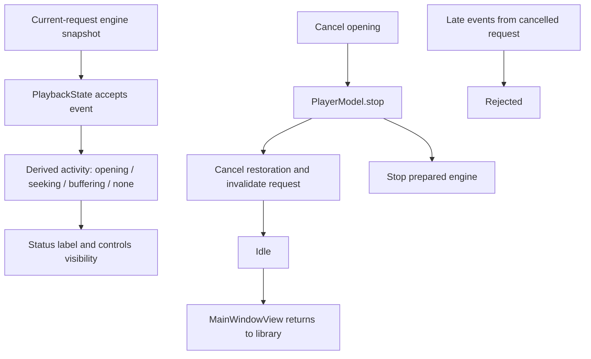

# Playback waiting and cancellation

## State ownership

`PlaybackState.activity` derives presentation from the current request phase and its accepted engine snapshot. Opening, or loaded without a first snapshot, displays Opening. While ready, seeking takes precedence over buffering when both flags are true; clearing seeking leaves Buffering only if the engine still reports it. Idle, ended and failed states have no waiting activity. The derived value does not change pause intent, synthesize progress, persist transient state or accept events from replaced requests.

`PlaybackControls` displays the activity next to the filename and pins controls while it is present. Activity changes reveal controls and restart the ordinary idle deadline after waiting finishes. Pausing, pointer interaction, keyboard focus, VoiceOver and slider editing continue to pin controls independently. Whether a native menu remains usable through its entire tracking session still needs a desktop check.

The opening overlay includes Cancel. It invokes the existing `PlayerModel.stop()` boundary: invalidate pending import work, cancel restoration, stop the engine if prepared, and clear the current request. `MainWindowView` observes idle and returns to the library through its existing refresh path. The UI does not create another cancellation task or replace the player session.

## Verification boundaries

Hostless tests cover opening before the first snapshot, seeking/buffering precedence, preserving pause through waiting, stale-request rejection, and clearing activity at terminal states. The cancellation model test requires an engine stop call, ignores late loaded/failure events, then opens another request and reaches ready. The recording engine proves model behavior, not native decoder cancellation or visible overlay layout.

The final 2026-10-19 12:46 hostless suite passed 154 XCTest cases and 143 Python checks. Debug build and static analysis passed on the pinned Xcode 27 toolchain; version 0.0.1 (2) still packages only English.

The native follow-up must use the canonical Debug app in the single ordinary Screen 1 window: inspect the status with a slow source or real seek, verify controls remain usable, cancel an in-flight open and reopen a file, and confirm the header still fits at the specified window sizes. The last desktop observation was locked; none of those checks is claimed complete here.
