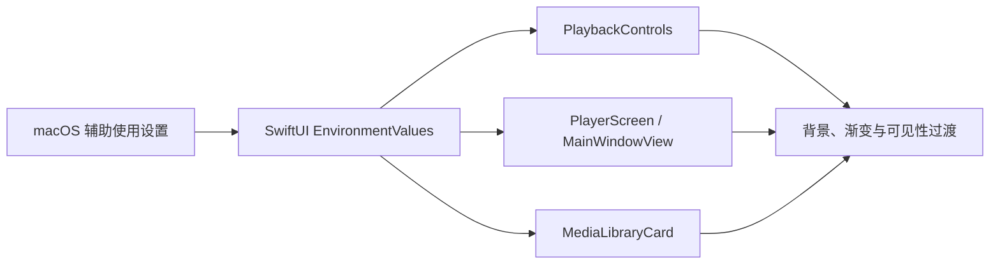

# 媒体库辅助使用与搜索性能

本文记录当前实现及其验收边界。布局和尺寸以 [原生界面规格](../../product/native-ui-spec.md) 为准；任务状态见 [进度记录](../../engineering/roadmap/progress.md)。编译或模型测试通过不代替 VoiceOver 朗读、可见效果和三种窗口尺寸验收。

## 媒体信息与访问方式

媒体库由 `MediaLibraryView` 的横向布局组织侧栏和内容区；文件夹内部使用 `NavigationStack`。播放、选择、筛选和右键菜单使用原生语义控件，名称来自本地化资源；卡片与列表的可见 More actions 控件使用 SwiftUI 按钮和弹层。侧栏、主内容及网格卡片声明 `focusSection()`，用于提示焦点遍历顺序，不代替 macOS 全键盘导航设置，也不证明弹层内的键盘顺序正确。

网格卡片与列表行共用 `MediaLibraryAccessibilitySummary`，向媒体选择按钮提供选中/观看状态、手工分类、续播位置、技术信息及文件大小。卡片的静态详情隐藏于辅助功能树，避免重复朗读；播放和操作菜单仍各自可访问。面包屑采用包含式分组，保留每一级导航按钮。

技术摘要来自 `MediaMetadataProbe`，包括已知时长、画面尺寸、视频编码、音轨数量和音频编码；视频与音频按各自可用属性呈现。文件大小独立显示。卡片与列表分别表达加载中和最终未知，不以扩展名猜测编码，不以文件大小冒充元数据。

缩略图和元数据在独立、可取消的 SwiftUI task 中读取，各自完成后发布结果。缩略图最多等待 10 秒，不阻塞已完成的属性探测。缓存与抽帧边界见 [缩略图设计](thumbnails.md)。

## 系统显示辅助选项

`PlaybackControls` 订阅系统 VoiceOver 状态。VoiceOver 开启、播放暂停、控件聚焦或用户操作控件期间，覆盖控件保持可见；正常播放且无交互时遵循闲置隐藏规则。VoiceOver 关闭后恢复原隐藏策略，不创建额外播放会话。

2026-10-19 的界面调整直接读取 SwiftUI 环境值，不复制系统偏好，也不修改用户的系统设置：

- `accessibilityReduceTransparency` 开启时，播放器中央按钮、顶部工具条和底部时间线采用不透明深色表面，去掉视频上的装饰渐变；加载与结束状态面板使用同一不透明颜色。拖放提示、封面播放按钮和时长徽标也使用实色背景。扫描状态栏始终使用白色内容表面。
- `accessibilityReduceMotion` 开启时，播放控件的可见状态不再使用 0.18 秒淡入淡出。暂停、聚焦、自动隐藏期限和可访问性状态不变。
- 默认显示模式保留既有布局、控件尺寸、自动隐藏规则及半透明播放叠层；系统菜单和窗口由 macOS 管理。

Apple 要求减少透明度时界面背景不再半透明；减少动态效果时避免大幅动画。这里进一步取消控件淡入淡出，是应用的保守显示策略。[减少透明度](https://developer.apple.com/documentation/swiftui/environmentvalues/accessibilityreducetransparency)；[减少动态效果](https://developer.apple.com/documentation/swiftui/environmentvalues/accessibilityreducemotion)。

### 显示偏好的调用链

显示选项只影响视图呈现，不参与播放状态或持久化。

## 已有验收证据

| 检查 | 结果与边界 |
| --- | --- |
| 元数据及卡片布局 | 2026-10-16、10-19 的 Screen 1 单窗口检查显示真实 H.264、HEVC 和多音轨属性；未知文件保持 Unknown。可见卡片封面、标题及文件大小基线对齐。没有测量首次出现的延迟，也未证明所有文件格式均可探测。 |
| Tab / Shift+Tab | 2026-10-16 临时启用 Full Keyboard Access 后，Tab 到达导航、筛选、媒体选择/播放与 More actions；主内容 Add Folder 的 Shift+Tab 返回侧栏 Settings。2026-10-21 在 Library 网格复现了原生 More actions 菜单被 Tab 跳过。2026-10-23 当前 Debug 包的 Home 卡片经焦点分组后，Tab 可从 Play 到 More actions，Return 打开弹层并聚焦第一项。后来复现首项按 Tab 会关闭弹层；给其余动作添加显式 `.focusable(true)` 后，新构建中的第一个 Tab 保持弹层打开并聚焦 Mark as Watched。连续遍历、反向顺序、分类菜单、文件夹列表与跨页循环仍未通过；本轮未开启 Full Keyboard Access。 |
| VoiceOver | 2026-10-16 首次 VO+右方向键到达 Settings；随后桌面状态变化，重新读取时 VoiceOver 已关闭，因此停止操作。未确认完整朗读和菜单动作，仍未通过。 |
| 显示偏好实现 | 2026-10-19 Xcode 27 Debug 构建与静态分析通过。没有在真实系统开关下完成减少透明度/动态效果的可见复核。 |
| 逻辑回归 | 2026-10-23 无宿主回归通过 148 项 Python 检查和 182 项 XCTest（2 项临时卷用例按该入口跳过）；最终 Debug 构建与静态分析通过。它覆盖模型、存储、属性和缓存等行为；菜单焦点与视觉结果另用规范应用窗口检查，未以镜像测试冒充可见验收。 |

## 万条索引搜索

`testDatabaseBackedTenThousandItemLibraryRefreshAndSearch` 在 10,000 条 SQLite 媒体索引上调用正式 `MediaLibraryModel.refresh()`，并检索最后一条记录。2026-10-15，MacBook Pro / arm64 / macOS 26.7.1：来源、媒体和目录合并在同一读事务后，含查询、行映射和模型发布的刷新平均 177.1 ms（5 次）；已加载记录的文件名过滤平均 7.08 ms（10 次）。当时结果记录为 `.build/test-20261015-library-snapshot-final.xcresult`。

索引通过测试事务批量写入，并复用一次真实扫描建立的来源、卷和扫描记录。该测量不包括 10,000 个物理文件的扫描、元数据解码、缩略图生成或滚动帧率，也不证明十万条规模性能。

### 2026-10-19 相对路径映射优化

一次较慢的回归中，调用栈采样定位到 `PlaybackHistoryStore.makeLibraryItem`：为取得展示文件名，每条记录都用 `URL(filePath: relativePath)` 构造相对文件 URL，Foundation 会读取当前工作目录。数据库已经保存规范的 POSIX 卷相对路径，这一步只需要路径最后一个分量，不需要访问文件系统。当前改为在字符串中寻找最后一个 `/` 并截取文件名；不改变媒体身份、查询排序、原路径或实际打开文件的解析方式。

新增回归先真实扫描包含中文、空格、`%2F`、`#`、`?`、冒号、反斜杠与 emoji 的文件名，再移除临时来源目录并读取数据库快照，确认名称仍按原文字面值展示。该回归与完整逻辑套件通过，原媒体身份与归档字段不变。

相同本机、Xcode 27 Debug、10,000 条 SQLite 记录、每次 5 次完整刷新和 10 次已加载列表搜索：

| 测量 | 优化前 | 优化后 |
| --- | ---: | ---: |
| 刷新均值 | 179.43 ms | 97.53 ms |
| 刷新样本范围 | 179.08–179.70 ms | 96.39–98.01 ms |
| 搜索均值 | 12.98 ms | 13.67 ms |

本轮刷新均值减少约 46%，搜索算法未修改。刷新包括数据库查询、行映射与模型发布；它不是可见网格渲染或滚动帧率。系统负载影响测量，不能把先前异常慢的一次整项测试耗时归因于单一原因，或把这里的比例视为所有机器的承诺。原始均值与逐次样本已由该测试同时输出到无宿主日志，Xcode test action 仍保留 XCTest attachment；本轮本地日志为 `.build/library-path-before.log` 和 `.build/library-path-after.log`。11:34 的完整套件通过 143 项 Python、134 项 XCTest，最终 Debug 构建与 Xcode 静态分析也通过。

### 2026-10-24 万条排序抽样

同一个 `testDatabaseBackedTenThousandItemLibraryRefreshAndSearch` 在已加载的 10,000 条 SQLite 索引上，另对正式 `MediaLibraryModel.sorting` 的 Name 与 Duration 排序各测三次。Duration 使用与每个条目当前内容版本匹配、覆盖 0–9,999 秒的合成事实，仅测排序计算，不读取真实文件属性。当前 Xcode 27.1 无宿主运行：Name 为 20.16、19.72、19.97 ms，均值 19.95 ms；Duration 为 29.27、29.34、29.25 ms，均值 29.29 ms。完整回归为 156 项 Python、206 项 XCTest（2 项独立存储专项跳过），0 失败。

`MediaLibraryView.filteredMediaGrid` 目前在视图计算中同步筛选、排序。单次排序超过常见 60 Hz 显示器的 16.7 ms 帧间隔，但本样本没有渲染窗口、没有卡片图像、没有播放，也没有可见帧时长，不能直接推算掉帧次数或认定旧 30 项滚动采样的延迟来自排序。10,000 项首次 Duration 探测及每批事实发布后的重排成本仍需测量；若可见大库复现主线程延迟，应以实际调用栈决定是否把派生排序移出主线程或缓存，而不预先改变用户可见顺序。

诊断脚本收紧后的 `414fdba9…` 收据又运行一次完整无宿主套件：160 项 Python、208 项 XCTest（2 项临时 APFS 专项按此入口跳过）通过。相同万条索引测试本次刷新均值 114.71 ms、搜索 13.19 ms、Name 排序 20.79 ms、Duration 排序 34.81 ms；这与上次 Duration 29.29 ms 的差异表明当前抽样有环境波动，不能取单次均值作为性能承诺或帧时长。

## 滚动跟踪与后台解码

2026-10-24 的 25.97 秒 Animation Hitches 探索采样，在旧规范包中记录到 14 次主线程潜在交互延迟及 6 次超过 33 ms 的画面更新间隔；详细阈值、时长和适用范围见[本轮可见记录](../../engineering/roadmap/visible-acceptance-2026-10-24.md#library-滚动的-instruments-短时采样)。这不是确定的根因。随后将缓存 JPEG 的读取/解码从 SwiftUI 视图计算移到卡片的可取消后台任务，并纳入与抽帧、属性探测共用的播放期许可，调用链和资源归属见[媒体工作预算](media-work-budget.md)。新规范包已在唯一普通窗口做过短时 Grid/List 抽查；两次后续 Instruments 录制均未成功产出可用汇总，最近一次 12 秒时限的进程仍持续约 1 分 40 秒并生成 4.8 GB 未完成 trace，已停止并删除。仍没有修正后帧时长的可签收证据，见[当前包记录](../../engineering/roadmap/visible-acceptance-2026-10-24.md#当前包的-library-滚动采样未完成)。

后续摘要 `ad6188f3…` 的规范包在隔离库打开 15 分钟样片并返回 Library 后，List 向下滚动两页，当前视口新行显示缩略图、真实属性或未知占位，未观察到长期加载；这是播放期间的短时可见抽查，没有记录并发任务数或帧时长。摘要 `f1f91c80…` 的规范包又在隔离 Library List 复核 FLAC 技术标签与行布局。两份收据的有限观察分别记录在[播放中抽查](../../engineering/roadmap/visible-acceptance-2026-10-24.md#后台许可竞态修正包的播放中资料库抽查)和[FLAC 复核](../../engineering/roadmap/visible-acceptance-2026-10-24.md#最新包的-flac-标签可见复核)，均不替代量化性能门槛。

随后增加了有墙钟和原始数据大小上限的 `scripts/capture-animation-hitches.py`。摘要 `6326ec31…` 的规范包播放长时样片、Library Grid 上下滚动时，Xcode 27.1 录制仍在 45 秒上限前未完成；脚本停止本轮进程并删除 trace，没有可导出的帧时长。相同进程的两段约 17.5 秒 `ps` 采样分别显示播放中 Library 滚动 46.98% CPU、RSS 峰值 96.41 MiB，播放器页持续播放 52.95% CPU、RSS 峰值 87.02 MiB（100% 等于一个逻辑核）。样本顺序执行且卡片已预热，不能从数值差判断滚动流畅度或长期内存表现；具体收据和清理见[有界采样记录](../../engineering/roadmap/visible-acceptance-2026-10-24.md#播放中滚动的有界采样与进程负载)。

同一 Animation Hitches 模板附加本轮创建的无界面 `/bin/sleep` 进程，3 秒时限后也超过 25 秒未结束并产生约 1.2 GiB 原始 trace，随后已清理。这使当前命令行工具路径本身成为待查项，不能以 Bomu 的页面负载解释所有录制失败；也不提供 Bomu 的任何帧时长证据。

继续在允许 Instruments 写入用户缓存的环境中做受限无窗口对照：本机可列出 `Animation Hitches` 模板及录制选项，但去掉 `--window`、改为 `--launch -- /bin/sleep 15` 后，3 秒 Animation Hitches 录制仍超过 20 秒墙钟上限未完成，trace 约 0.05 MiB。再以 Time Profiler 对 `/bin/sleep 12` 录制 3 秒，10.18 秒时触及 64 MiB 上限，trace 约 75.75 MiB；两次均无诊断 stderr。守护逻辑结束本轮进程并删除原始 trace，回读无 `xctrace` 或测试 `sleep` 残留。这排除了仅由 `--window` 或 Bomu 界面负载造成超时的解释，尚不能确定 Xcode、设备采样服务或模板组合中的具体根因。后续不要把这条命令行路径当作已可用的帧时长验收工具。

随后加 `--no-prompt` 再对本轮独有的 `/bin/sleep 8` 做 2 秒 Animation Hitches 无窗口录制；它没有形成可用 trace，约 14.6 秒时目录写出已达约 1.7 GiB，命令以 `SIGSEGV` 结束。系统生成的本地 `xctrace` 崩溃报告为 `EXC_BAD_ACCESS`，故障线程栈出现 `agxps_counter_get_ident`；`sysmond` 服务只读回查处于运行状态。该栈指向本机 Instruments 的 GPU 计数器路径，是环境诊断线索，不能单凭它确定 Apple 工具的根因，更不能归因于 Bomu。单独的 `Core Animation FPS` Instrument 在人为 64 MiB 单文件限制下即以 `SIGXFSZ` 退出，也没有产生可用结果；这个受限对照不能判定该 Instrument 在正常大小下是否可用。两份原始 trace 均已删除，本轮测试 `sleep` 和 `xctrace` 进程无残留。

这个对照暴露 `capture-animation-hitches.py` 原来的目录大小轮询在单次突发写入前不能构成硬上限。脚本现给 `xctrace` 子进程及其子进程设置每个文件的 `RLIMIT_FSIZE`，目录总量仍每 0.5 秒轮询，命令另加 `--no-prompt`；超过任一条件均没有测量结果并清理原始 trace。单文件 1 MiB 写入对照实测最多写入 1 MiB，子进程非零退出；这验证了操作系统限制生效，但目录总量仍可能在两次轮询之间超出阈值，故不把它称为总量硬配额。该诊断脚本变更后的规范 Debug 包摘要为 `414fdba99407e60e89d8662a4c5ca8bae63bf283736ddcd07ff387bb6ed3c825`，身份核验、Debug 构建、Xcode 静态分析与汇总器 3 项 Python 测试通过；产品 UI/播放源码未改。当前包后来补做了 1280 点 Library Grid/List 的有限可见布局抽查，见[当前记录](../../engineering/roadmap/visible-acceptance-2026-10-24.md#当前摘要-414fdb-的-1280-点单窗口复核)；该次没有在播放中滚动，也没有取得修正后的帧时长。

可替代的系统测量入口是 [Apple `XCTHitchMetric`](https://developer.apple.com/documentation/xctest/xcthitchmetric)：本机 Xcode 27.1 的 macOS XCTest 头文件声明它自 macOS 26 可用，并要求以 `XCUIApplication` 指定目标。同一工具链的 `XCUIApplication` 在 macOS 提供文件 URL 初始化，可指向规范 Debug `.app`，因此不必仅凭 Bundle ID 选择安装副本。此前工程没有 UI-test target，XCTest 的实际附加行为也尚未验证。测量入口必须先核验屏幕解锁、目标包身份、现存 Bomu 进程及单窗口同屏条件，再对唯一窗口的 Library 滚动取样并检查结果确实包含 hitch 指标。`launch()` 会结束同一目标的既有实例，`activate()` 在目标未运行时会自行启动，均不能在未完成上述预检时盲用。此路径尚未执行，不能当作本轮性能结果。

2026-10-26 增加了独立 `BomuHitchUITests` scheme 和显式入口 `scripts/measure-library-hitches.sh`；UI 测试只以规范 Debug `.app` 的文件 URL 附加，先核对同 Bundle ID 的唯一进程、包路径、单个窗口、Library 滚动区与正在播放的 Pause 控件，再用 `XCTHitchMetric` 量测上下滚动。该目标 `build-for-testing` 已编译成功，正式 Debug 包摘要 `2e9af560…` 已构建并核验；测试尚未运行，因此没有新帧时长。一次准备阶段发现桌面自动化启动进程继承了已删除的旧隔离库环境变量，应用正确显示资料库不可用；只退出本轮进程后，改用当前带标记路径显式启动，Welcome 和 `media-suite` 导入在唯一窗口可见成功。用户要求先推送时，已退出该窗口并清理临时目录。以后准备样本须确认进程实际环境，不能只依赖 `launchctl getenv`；测量前仍须让长时样片保持播放，并确认结果中的动作确实造成滚动。

`scripts/summarize-animation-hitches.py` 只通过精确 XPath 导出 `potential-hangs` 和 `hitches-updates`，解析 XML 引用、去重同一画面更新的多色记录，并输出 Bomu 的脱敏计数与最长时长；不导出 trace 目录中包含环境变量的 TOC。复测时先确认录制完成，再运行 `python3 scripts/summarize-animation-hitches.py .build/benchmarks/<name>.trace --output .build/benchmarks/<name>-summary.json --remove-trace`。`--remove-trace` 仅允许清理本仓库 `.build/benchmarks` 中的 trace。后续若要保留原始堆栈调查，须认识到原始 trace 含被附加进程的环境变量；不得提交或公开。当前脚本以合成表测试了 XML 引用、阈值、进程筛选和重复记录去重，尚未用于新包的真实 trace。

## 剩余验收

- 在 Screen 1 同一个普通 Bomu 窗口完成三种指定点尺寸的布局、键盘与 VoiceOver 检查；截图像素尺寸不能替代 AppKit 点尺寸。
- 确认卡片摘要的真实朗读顺序、截断内容可访问性及菜单动作。
- 检查系统减少透明度/动态效果开关切换后的实际显示、控件隐藏和焦点保留，结束后恢复原系统偏好。
- 测量实际大库滚动和可见属性更新。索引查询基线不能代替渲染与真实文件 I/O 性能。
- 在新包的同屏滚动测量中复核 Grid/List 缩略图的稳定呈现、真实主线程延迟与播放期间后台工作数；后台解码已实现，但未取得修正后的可见帧时长证据，不能宣称旧采样中的卡顿已消失。

A02、C10 保持进行中。
