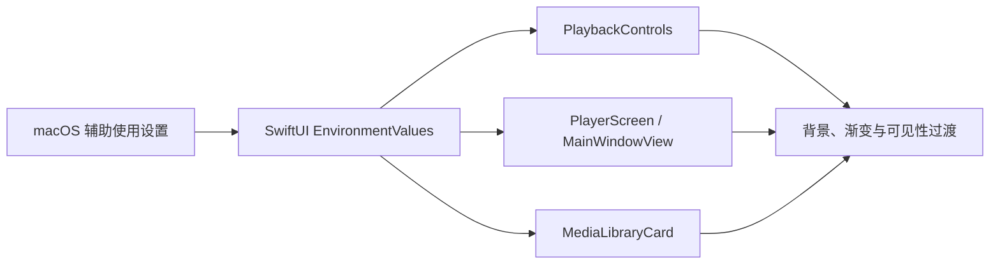

# 媒体库辅助使用与搜索性能

本文记录当前实现及其验收边界。布局和尺寸以 [原生界面规格](../../product/native-ui-spec.md) 为准；任务状态见 [进度记录](../../engineering/roadmap/progress.md)。编译或模型测试通过不代替 VoiceOver 朗读、可见效果和三种窗口尺寸验收。

## 媒体信息与访问方式

媒体库由 `MediaLibraryView` 的横向布局组织侧栏和内容区；文件夹内部使用 `NavigationStack`。播放、选择、筛选和菜单使用原生语义控件，名称来自本地化资源。侧栏和主内容分别声明 `focusSection()`，用于提示焦点遍历顺序，不代替 macOS 全键盘导航设置。

网格卡片与列表行共用 `MediaLibraryAccessibilitySummary`，向媒体选择按钮提供选中/观看状态、手工分类、续播位置、技术信息及文件大小。卡片的静态详情隐藏于辅助功能树，避免重复朗读；播放和操作菜单仍各自可访问。面包屑采用包含式分组，保留每一级导航按钮。

技术摘要来自 `MediaMetadataProbe`，包括已知时长、画面尺寸、视频编码、音轨数量和音频编码；视频与音频按各自可用属性呈现。文件大小独立显示。卡片与列表分别表达加载中和最终未知，不以扩展名猜测编码，不以文件大小冒充元数据。

缩略图和元数据在独立、可取消的 SwiftUI task 中读取，各自完成后发布结果。缩略图最多等待 10 秒，不阻塞已完成的属性探测。缓存与抽帧边界见 [缩略图设计](thumbnails.md)。

## 系统显示辅助选项

`PlaybackControls` 订阅系统 VoiceOver 状态。VoiceOver 开启、播放暂停、控件聚焦或用户操作控件期间，覆盖控件保持可见；正常播放且无交互时遵循闲置隐藏规则。VoiceOver 关闭后恢复原隐藏策略，不创建额外播放会话。

2026-10-19 的界面调整直接读取 SwiftUI 环境值，不复制系统偏好，也不修改用户的系统设置：

- `accessibilityReduceTransparency` 开启时，播放器中央按钮、顶部工具条和底部时间线采用不透明深色表面，去掉视频上的装饰渐变；加载与结束状态面板使用同一不透明颜色。拖放提示、封面播放按钮和时长徽标也使用实色背景。扫描状态栏始终使用白色内容表面。
- `accessibilityReduceMotion` 开启时，播放控件的可见状态不再使用 0.18 秒淡入淡出。暂停、聚焦、自动隐藏期限和可访问性状态不变。
- 默认显示模式保留既有布局、控件尺寸、自动隐藏规则及半透明播放叠层；系统菜单和窗口由 macOS 管理。

Apple 要求减少透明度时界面背景不再半透明；减少动态效果时避免大幅动画。这里进一步取消控件淡入淡出，是应用的保守显示策略。[减少透明度](https://developer.apple.com/documentation/swiftui/environmentvalues/accessibilityreducetransparency)；[减少动态效果](https://developer.apple.com/documentation/swiftui/environmentvalues/accessibilityreducemotion)。

### 显示偏好的调用链

显示选项只影响视图呈现，不参与播放状态或持久化。

## 已有验收证据

| 检查 | 结果与边界 |
| --- | --- |
| 元数据及卡片布局 | 2026-10-16、10-19 的 Screen 1 单窗口检查显示真实 H.264、HEVC 和多音轨属性；未知文件保持 Unknown。可见卡片封面、标题及文件大小基线对齐。没有测量首次出现的延迟，也未证明所有文件格式均可探测。 |
| Tab / Shift+Tab | 2026-10-16 临时启用 Full Keyboard Access 后，Tab 到达导航、筛选、媒体选择/播放与 More actions；主内容 Add Folder 的 Shift+Tab 返回侧栏 Settings。系统设置随后恢复。该结果取代 10-15 未启用完整键盘导航时的反向焦点失败记录，但不覆盖其他页面和尺寸。 |
| VoiceOver | 2026-10-16 首次 VO+右方向键到达 Settings；随后桌面状态变化，重新读取时 VoiceOver 已关闭，因此停止操作。未确认完整朗读和菜单动作，仍未通过。 |
| 显示偏好实现 | 2026-10-19 Xcode 27 Debug 构建与静态分析通过。没有在真实系统开关下完成减少透明度/动态效果的可见复核。 |
| 逻辑回归 | 最近一次无宿主回归为 2026-10-19 11:34：143 项 Python、134 项 XCTest 通过。它覆盖模型、存储、属性和缓存等行为；本轮纯视图调整使用构建与静态分析验证，未以镜像测试冒充视觉验收。 |

## 万条索引搜索

`testDatabaseBackedTenThousandItemLibraryRefreshAndSearch` 在 10,000 条 SQLite 媒体索引上调用正式 `MediaLibraryModel.refresh()`，并检索最后一条记录。2026-10-15，MacBook Pro / arm64 / macOS 26.7.1：来源、媒体和目录合并在同一读事务后，含查询、行映射和模型发布的刷新平均 177.1 ms（5 次）；已加载记录的文件名过滤平均 7.08 ms（10 次）。当时结果记录为 `.build/test-20261015-library-snapshot-final.xcresult`。

索引通过测试事务批量写入，并复用一次真实扫描建立的来源、卷和扫描记录。该测量不包括 10,000 个物理文件的扫描、元数据解码、缩略图生成或滚动帧率，也不证明十万条规模性能。

### 2026-10-19 相对路径映射优化

一次较慢的回归中，调用栈采样定位到 `PlaybackHistoryStore.makeLibraryItem`：为取得展示文件名，每条记录都用 `URL(filePath: relativePath)` 构造相对文件 URL，Foundation 会读取当前工作目录。数据库已经保存规范的 POSIX 卷相对路径，这一步只需要路径最后一个分量，不需要访问文件系统。当前改为在字符串中寻找最后一个 `/` 并截取文件名；不改变媒体身份、查询排序、原路径或实际打开文件的解析方式。

新增回归先真实扫描包含中文、空格、`%2F`、`#`、`?`、冒号、反斜杠与 emoji 的文件名，再移除临时来源目录并读取数据库快照，确认名称仍按原文字面值展示。该回归与完整逻辑套件通过，原媒体身份与归档字段不变。

相同本机、Xcode 27 Debug、10,000 条 SQLite 记录、每次 5 次完整刷新和 10 次已加载列表搜索：

| 测量 | 优化前 | 优化后 |
| --- | ---: | ---: |
| 刷新均值 | 179.43 ms | 97.53 ms |
| 刷新样本范围 | 179.08–179.70 ms | 96.39–98.01 ms |
| 搜索均值 | 12.98 ms | 13.67 ms |

本轮刷新均值减少约 46%，搜索算法未修改。刷新包括数据库查询、行映射与模型发布；它不是可见网格渲染或滚动帧率。系统负载影响测量，不能把先前异常慢的一次整项测试耗时归因于单一原因，或把这里的比例视为所有机器的承诺。原始均值与逐次样本已由该测试同时输出到无宿主日志，Xcode test action 仍保留 XCTest attachment；本轮本地日志为 `.build/library-path-before.log` 和 `.build/library-path-after.log`。11:34 的完整套件通过 143 项 Python、134 项 XCTest，最终 Debug 构建与 Xcode 静态分析也通过。

## 剩余验收

- 在 Screen 1 同一个普通 Bomu 窗口完成三种指定点尺寸的布局、键盘与 VoiceOver 检查；截图像素尺寸不能替代 AppKit 点尺寸。
- 确认卡片摘要的真实朗读顺序、截断内容可访问性及菜单动作。
- 检查系统减少透明度/动态效果开关切换后的实际显示、控件隐藏和焦点保留，结束后恢复原系统偏好。
- 测量实际大库滚动和可见属性更新。索引查询基线不能代替渲染与真实文件 I/O 性能。

A02、C10 保持进行中。
