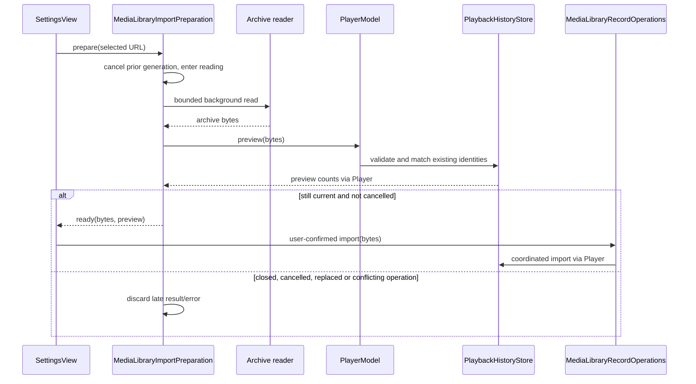
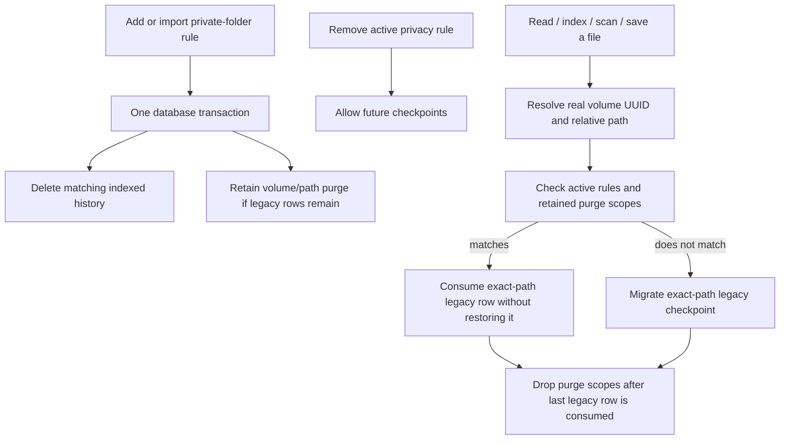

# Media library archive import

## Scope

The version 2 JSON archive transfers library metadata between Bomu installations. It contains source roots, local file identity including a bounded content fingerprint, membership, favorite/watched/category state, playback checkpoints, private-folder rules, and playback preferences. Its logical file ID includes the fingerprint, so a detected content replacement at the same inode produces a distinct identity. It never contains media bytes. Version 1 archives remain readable for backups created before fingerprint support.

Import is additive for sources and memberships. Version 2 records require a 64-character lowercase hexadecimal SHA-256 sampled fingerprint plus matching metadata revision. The importer first checks volume UUID and the file number parsed from the current or legacy filesystem resource identifier; if that identifier changed, it accepts a fallback only when volume UUID, relative path, byte count, metadata revision, and fingerprint all match. Version 1 records retain their historical metadata-only match rules. Ambiguous duplicate matches reject the archive. Historical database rows that normalize to the same volume/file-number pair also reject import rather than choosing or merging user records. Files without a safe match are skipped and counted in the preview and result. Matching uses existing local indexed identities: after clearing the library, re-add and scan the source folders before importing their file preferences and checkpoints. Restoring source rows alone does not automatically apply previously skipped records later.

For the corrected 16–80 KiB fingerprint range, the destination also retains or computes the old prefix digest as a compatibility alias. Old version 2 backups remain readable under their original detection limits; new full-digest backups cannot match a file whose tail has changed. Exports made before the first post-migration file access retain the known legacy digest rather than discarding its verification evidence. See [identity migration and limits](media-identity.md#small-file-fingerprint-upgrade).

The settings screen previews match and replacement counts before the user confirms. The importer validates the complete archive before writing. Source roots, privacy rules, file preferences, checkpoints, and memberships are then applied in one SQLite transaction, so a failed write rolls back the whole import. Existing privacy rules on the destination also prevent checkpoint import for excluded files.

## Call path

`SettingsView` submits the selected URL to its owned `MediaLibraryImportPreparation`. The preparation reads under a security-scoped URL through `MediaLibraryArchive.readForImport`, then asks `PlayerModel` for a preview. The archive reader enforces the 256 MiB limit while streaming from the file handle, so missing or stale filesystem size metadata cannot cause an unbounded allocation. Export uses the same limit and rejects an archive that would exceed the importer's supported size. `PlaybackHistoryStore` decodes and validates the schema, matches local media identities, and returns counts without changing the database. After confirmation, the application-owned `MediaLibraryRecordOperations` drains manual scans and preference writes, suspends background reconciliation, then asks `PlayerModel` to wait for pending checkpoint writes and call `PlaybackHistoryStore.importArchive`. The same boundary is used for clearing records; success and failure both resume library writes and reconciliation. The store applies rows inside one GRDB write transaction. On success, `PlayerModel` applies archived playback settings and the library view reloads. A currently playing item immediately records its current position after import, preserving the live playback session as the current checkpoint.

## Export ownership

Export enters the same application-owned record-operation boundary without suspending scanning. It first waits for accepted library preference writes, then flushes the active playback checkpoint through the player’s ordered persistence queue. A checkpoint failure aborts export before touching the destination. The store reads an archive snapshot, and an owned background task atomically writes the file. Application shutdown waits for that write; duplicate data operations are rejected until it finishes. Playback and scanning continue. A failed destination write leaves the operation reusable and reports the error.

## Failure and privacy behavior

- Archives over 256 MiB, unsupported schema versions, invalid settings/checkpoints, invalid identities, duplicate identities, and non-canonical relative paths are rejected before a transaction begins. Path validation covers source roots, file identities, membership roots, and privacy folders, so imported state cannot make the scanner or library resolve outside a mounted volume.
- An import failure inside the transaction leaves sources, preferences, checkpoints, and memberships unchanged.
- A file that cannot be matched is never recreated as a local media file and is never copied.
- A destination private-folder rule takes precedence over an archived checkpoint.
- Import never changes source media bytes.

## Verification

`PlaybackHistoryStoreTests` covers matched record replacement, unmatched-file skips, successful preference/history restore, rollback after an injected SQLite write failure, traversal rejection for all four persisted relative-path fields at both preview and import, bounded archive reads at and above the configured byte limit, and export rejection at the same size boundary. The suite uses temporary media files and never opens or modifies user media. The settings confirmation remains subject to the Screen 1, single-window visible UI walkthrough.

The 2026-10-19 export regressions verify a current 52.5-second checkpoint, accepted favorite/category changes, and export completion while a scan is deliberately held. An injected checkpoint-write failure preserves an existing backup; retry clears the errors, and an unwritable destination fails without leaving the operation busy. Both tests use temporary files and verify unchanged media bytes. The full 12:10 hostless run passed 143 Python checks and 144 XCTest cases.

## Preparation and confirmation lifecycle

Preparation is a Settings-owned state machine: idle → reading → ready or failed. Ready contains the archive bytes and their matching preview together; confirmation consumes that pair. Choosing another file, cancelling, closing Settings, or starting a conflicting data operation cancels the current preparation and releases its retained preview. A generation guard rejects late results and errors even if an awaited provider does not observe cancellation. Only a confirmed archive enters the application-owned record-operation boundary; closing Settings does not cancel an already accepted import.

The reader runs off the main actor, owns the security-scoped access and file handle, and retains the 256 MiB streaming limit. Cancellation reaches the worker and is checked before opening and between 64 KiB reads. A blocking filesystem read cannot be preempted, but its late result cannot reopen confirmation. Database preview is read-only and similarly checked after completion. Loading has a visible progress label and Cancel action; invalid backups show a retryable failure.

Regression coverage uses controlled read/preview barriers and real SQLite archive data. It checks replacement during both phases, suppression of obsolete failures, cancellation on close, release of prepared bytes, invalid-file recovery, cancellation before file access, and unchanged database favorites when the previewed archive requests a different value. Native file-panel/confirmation verification was attempted after the Debug build but the Mac was locked; it remains open. No archive was imported into the user's database.

The final hostless run on 2026-10-19 passed 143 Python checks and 149 XCTest cases. The Debug app build and Xcode static analysis also passed. These results do not replace the locked-screen native confirmation check.

## Imported privacy rules and existing checkpoints — 2026-10-19

Imported private-folder rules now use the same indexed-history deletion operation as manually added rules. Deletion covers every indexed file beneath the volume/path boundary, even when the archive contains no matching file record. Rule insertion, deletion and archive application remain in the same transaction. Settings confirmation now states that importing private-folder rules removes existing viewing history in those folders.

A real SQLite regression imports a rule-only archive into an indexed destination. A delete trigger forces failure and verifies that both the history and absence of the new rule are preserved. After retry, export contains no private checkpoint, retains the favorite and similarly named sibling-folder history, and removing the rule does not restore that indexed checkpoint. Media bytes remain unchanged. The 13:54 hostless run passed 168 cases, with two explicit storage tests skipped, plus 148 Python checks.

The subsequent legacy-history correction below extends this indexed-history evidence. Overall privacy acceptance still requires the native Settings workflow; the isolated tests do not close that gate.

## Deferred legacy privacy deletion

The v0.0 table stores canonical absolute paths without volume identity. An imported volume/path rule cannot safely identify every offline legacy row at import time. Deleting all legacy history would also delete unrelated records; treating removal of the active rule as permission to migrate old records would undo the user's earlier deletion.

`legacy_history_purges` therefore records the volume UUID and relative directory whose old history was purged, independently of `private_media_roots`, which controls future recording. A scope is recorded only while deferred legacy rows exist. It survives removing the active rule or source. Normal file access resolves real identity, then the legacy migration checks both current privacy rules and retained purge scopes before copying an exact-path checkpoint. A matching old row is consumed without restoring it; unmatched rows migrate normally. This check precedes the active-privacy early return for reads, direct indexing, scanning and saves. New checkpoints after privacy is disabled remain allowed.

The additive `legacyHistoryPrivacyPurges` database migration creates the scope table and applies every currently active rule to existing indexed history and deferred migration. It uses no filesystem lookups, so an unavailable source does not block upgrade. All scope writes and indexed deletions remain in the enclosing transaction. Failure rolls back the migration or import, including scope creation. When the last legacy row is consumed, the pending scopes are discarded; clearing history or library records also clears them in the same transaction. The local purge table is not exported: archives contain current indexed facts and current privacy rules, not v0.0 rows. The archive schema remains version 2.

The regression first reproduced five failed assertions, including a 77-second checkpoint returning after rule removal. It now covers source paths made unavailable during import, active-rule access, removing rules before other files are first accessed, reopening the database, all four access paths, a different-volume whole-root rule, similarly prefixed siblings, new recording, source-byte preservation and scope cleanup. This models unavailable paths; it is not a physical external-drive unplug test. A second regression reconstructs the preceding schema, forces migration deletion to fail, checks schema/data rollback, retries successfully, removes the backfilled rule and verifies no legacy restoration. The indexed import regression additionally verifies a failed import leaves no purge scope behind.

Compatibility limit: rules removed before this migration have no surviving deletion evidence and cannot be reconstructed safely. Legacy absolute-path records that cannot yet be associated with a real file remain deferred, excluded from archive export; this is not a secure-erasure guarantee for raw database pages or external backups. Final validation is recorded in the roadmap.
