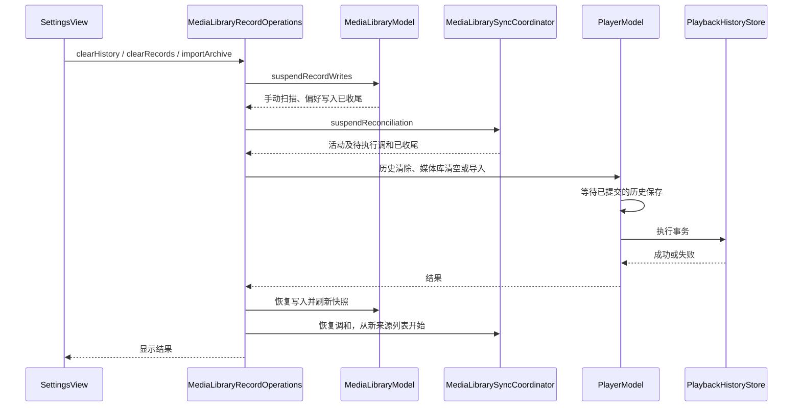
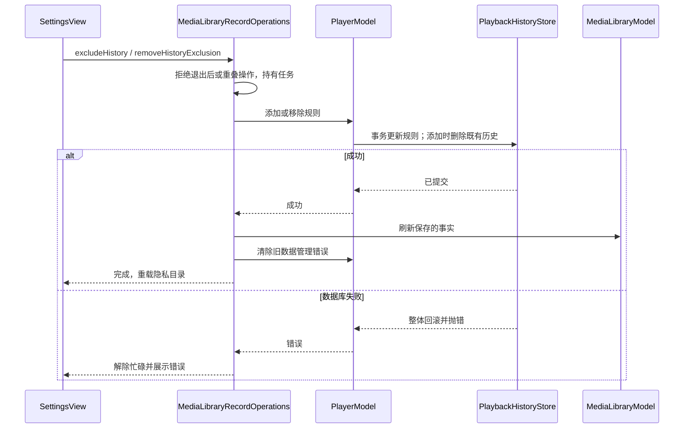

# 媒体库隐私、导出与清理

## 隐私目录

设置页允许用户选择不记录历史的目录。规则以卷 UUID 和卷相对目录保存；查询使用路径分隔符边界判断，`Private` 不会误匹配到 `Privateer`。手动添加规则时立即删除该目录已索引的播放进度及能按当前路径匹配的旧版记录。后续打开、扫描或写入进度时再次检查规则，所以私密目录中的音轨、音量和位置不会恢复或落盘。规则可以随时移除；移除后允许后续播放检查点重新保存，但不会复活已删除的旧记录。

目录隐私只抑制播放历史，扫描到的文件名、来源归属和缩略图仍属于媒体库功能。原视频不会移动、复制或修改。规则可以在外置卷离线时移除，因为管理接口使用稳定的卷 UUID 和相对路径。

### 旧版记录与删除语义

v0.0 的旧历史只有绝对路径，不能在离线时可靠地推导所属卷。添加或导入隐私规则时，只要仍有待迁移旧记录，数据层就独立保存卷 UUID 与相对目录的删除范围。移除隐私规则只允许后续保存新进度，不撤销这个删除事实。文件以后被读取、索引、扫描或保存时，先用真实卷身份检查删除范围，再决定迁移还是丢弃旧记录；相似目录前缀和其他卷不受影响。

增量迁移会为仍生效的隐私规则补充删除范围并清理匹配的已索引历史；迁移不访问文件系统，失败完整回滚。旧记录全部处理完或用户清除全部历史后，删除范围也清理。升级前已经被移除的规则没有可恢复的证据，不能猜测并批量删除其他历史。具体事务、测试和兼容限制见[旧记录处理](archive-import.md#deferred-legacy-privacy-deletion)。

## 导出格式

设置页通过系统保存面板导出版本化 JSON。`schemaVersion` 当前为 2（仍支持读取旧版 1），包含来源和目录、稳定逻辑文件 ID、卷相对路径、大小/修改时间、收藏、已看、手工分类、播放进度/轨道/音量、隐私目录规则和播放设置。导出不会包含媒体内容或缩略图字节，编码器使用 ISO 8601 日期和原子文件写入。导出只写用户选定的位置。

重新导入已按 C18 实现：先预览匹配、跳过与覆盖数量，确认后只对本机能够安全匹配的媒体记录恢复数据。来源、隐私规则、文件偏好和播放记录在单个 SQLite 事务中应用；任何数据库写入失败都会回滚本次导入。播放设置仅在数据库提交成功后写入独立的 UserDefaults，不属于同一 SQLite 事务。另一台 Mac 上不同的卷或文件身份不会被直接信任，也不会据归档新建本地媒体记录。完整格式、匹配规则和失败语义见[归档导入说明](archive-import.md)。

## 清理与联网边界

设置页提供单独确认的媒体库清理操作：删除来源会级联删除媒体索引、播放进度、收藏和分类；保留不记历史规则与播放偏好，不影响原始媒体文件。正在播放的会话不会继续写回刚清掉的历史。

若播放历史清理、媒体库清理或归档导入失败，正在播放请求恢复操作前的历史写入策略；这既避免失败清理意外恢复已清除的进度，也避免失败操作永久停止当前会话的进度保存。其他正在进行的新播放请求不受旧请求失败回滚影响。

当前没有在线元数据匹配服务，也没有自动上传路径、名称或媒体内容的代码路径；导出是显式的本地用户操作。

### 仅清除观看历史

`clearHistory` 同样通过应用持有的数据操作入口，等待扫描和待保存偏好收尾后调用 `PlayerModel.clearPlaybackHistory()`。存储层在同一个事务中清除 `playback_history` 与尚未按文件迁移的 `playback_history_legacy`，保留来源、索引、收藏、观看标记、分类及隐私规则。后者不能遗留，否则升级后尚未打开过的媒体会在首次打开时重新迁回旧进度。

任一删除失败时整个事务回滚；播放器恢复原来的历史写入策略，并把失败抛给设置页展示。成功后清除旧错误，协调入口刷新媒体库快照，因此“继续观看”立即消失，不需要切换页面或重启。当前播放会话继续受到既有保存抑制，防止刚清掉的进度立即写回。

## 扫描与数据操作的协调

`MediaLibraryRecordOperations` 由应用生命周期持有，统一执行历史清除、媒体库清空、导入与导出。以下暂停扫描的流程仅用于前三种替换记录操作。开始后拒绝重复数据操作；媒体库暂时拒绝新的扫描、收藏、观看状态、分类和撤销。先取消并等待手动扫描、排空已接受的偏好写入，再暂停后台调和，取消并等待它的活动/待执行扫描。完成这些步骤后才调用 `PlayerModel`，由其等待播放历史写入并执行实际数据操作。

成功与失败均恢复媒体库写入、刷新真实数据库快照，再重新安排后台调和。这样失败不会让整个库停留在不可操作状态，成功后的后台扫描也只能从新的来源列表开始；清空后来源为空，不沿用旧列表。设置页处理期间显示状态并禁用 Data 页操作，媒体库浏览操作也暂时禁用，当前播放栏的播放控制保持可用。导入成功后同时刷新隐私目录列表。

应用退出先拒绝新的记录操作并等待当前操作结束，再停止后台调和、手动扫描/偏好队列和播放器。设置页自身只提交意图，不承担这些任务的生命周期。该协调不触碰原媒体，也不会替用户自动确认清空或导入。

## 验证

`PlaybackHistoryStoreTests.testPrivateFolderStopsHistoryWritesWithoutMatchingSiblingPrefixes` 验证目录边界、清除旧进度、阻止新记录和移除规则后的恢复。`PlayerModelTests.testFailedLibraryClearRestoresActiveHistoryPersistence` 验证清理失败后恢复当前进度保存；`testFailedDataManagementPreservesExistingHistorySuppression` 验证连续清历史、归档导入和媒体库清理失败不会撤销先前成功清理的抑制策略。`testExportContainsLibraryMetadataAndSettingsButNeverMediaBytes` 解码导出并检查播放信息/设置，同时确认测试媒体 payload 不在导出字节中；归档导入测试覆盖安全匹配、预览、覆盖、设置恢复和数据库故障回滚。设置页保存面板和导入确认仍待屏幕 1 可见验收。

2026-10-19 新增隔离回归覆盖：待执行手动/后台扫描与偏好写入排空后清空，等待下一次调和仍为空；用户显式重新添加来源可恢复索引且旧偏好不复活；SQLite 删除触发器强制失败后收藏与后台发现仍可用；无效归档失败后可再次导入；显式阻塞扫描收尾时退出必须等待，并拒绝重复清空及暂停期间的新写入。使用独立临时数据库、偏好域和合成媒体，不清空用户当前媒体库。原生设置页确认与进行中退出的可见验收仍未完成。

本轮最终无宿主回归于 2026-10-19 11:31 通过 143 项 Python 检查和 133 项 XCTest。扫描预览回归改为等待全部发现事件并显式放行索引，消除原先固定延时窗口与仅等待首事件的竞态。

最终 Debug 构建与 Xcode 静态分析通过。该轮未启动原生设置窗口，未修改用户的媒体库或偏好域。

2026-10-19 11:38：138 项 XCTest 和 143 项 Python 检查通过。新增旧版记录回归在修复前实际恢复出 77 秒旧进度；修复后重开数据库及首次访问该文件仍无历史。另用旧表删除触发器强制失败，验证现代记录回滚到原 42 秒且旧记录保留，移除故障后两者均清除。协调层验证继续观看立即清空、来源与收藏保留，以及失败时可见进度保持、收藏仍可修改、重试后错误消失。使用隔离临时数据，不清除用户历史；原生 Settings 确认与实际朗读仍待可见验收。

历史清除修复的最终 Debug 构建与 Xcode 静态分析通过。

### 当前会话导出

导出等待已接受的收藏、分类等偏好写入，再主动保存当前播放检查点。检查点写入失败向上传播，导出不能用旧进度假装成功，也不会覆盖已有备份。数据库一致读取后，在后台执行原子文件写入；应用持有操作直到文件写完，退出也等待它结束。导出无需暂停扫描或播放，失败后解除忙碌状态并允许重试。2026-10-19 的两项真实 SQLite 回归覆盖扫描进行中导出、当前进度与已接受偏好、保存失败时原备份不变、重试恢复和目标写入失败。12:10 完整回归为 143 项 Python 检查和 144 项 XCTest，均通过。

## 隐私规则操作的生命周期

设置页添加、移除隐私目录均进入应用持有的 `MediaLibraryRecordOperations`。操作成功后刷新媒体库快照，避免数据库已删除历史而“继续观看”仍展示旧进度；同时清除上一次数据管理错误。退出等待已接受的操作，进入退出流程后拒绝新添加或移除请求，重复数据操作也沿用同一忙碌边界。

隐私规则和既有历史删除由存储层在同一个事务完成；每次历史保存也在事务内检查规则，因此不需要取消扫描或停止播放。移除规则不会重建旧进度，之后的新检查点可以重新保存。操作失败保留原来的规则与历史，不发布虚假的成功状态。

2026-10-19 12:22 的修复前回归实际得到规则生效后仍显示 42 秒的旧媒体库进度。接入统一入口后，两项真实 SQLite 回归覆盖：隐私规则在受控扫描未结束时完成、继续观看立即清空、来源和收藏保留、隐私期间保存不落盘、移除规则不复活历史、后续 67 秒检查点可保存、退出后拒绝新规则操作；以及删除触发器注入失败时规则插入和历史删除一起回滚，移除故障后重试并清除错误。原视频字节不变。

12:23 完整无宿主回归通过 143 项 Python 检查和 146 项 XCTest。Debug 构建与 Xcode 静态分析通过；原生隐私目录选择和实际退出中的可见验收仍待补充。本轮仅使用隔离临时数据库，没有修改用户的隐私规则或历史。
