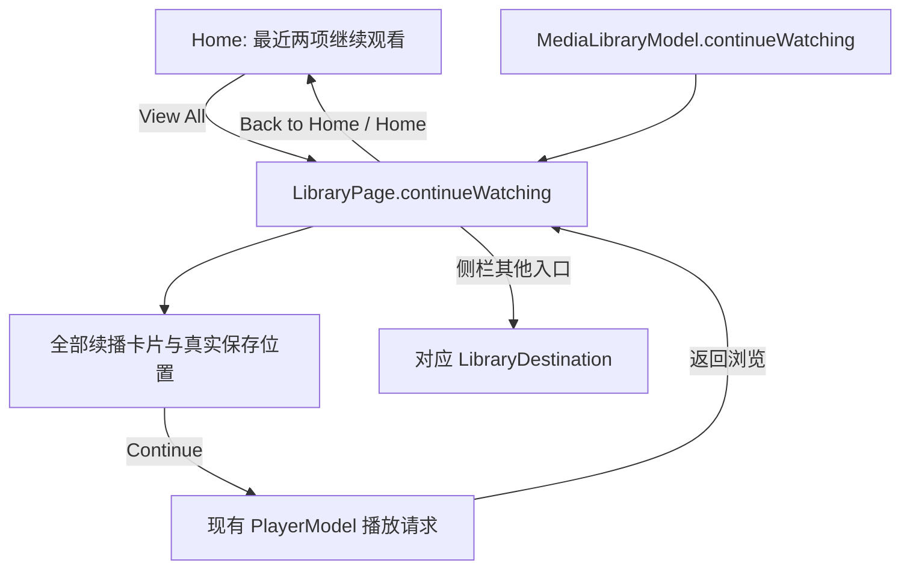
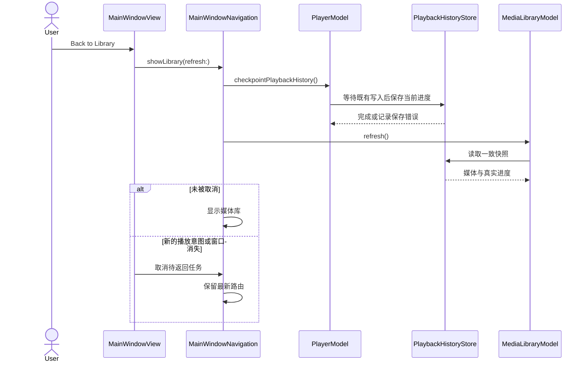

# 媒体库首页与侧栏

## 结构

`MainWindowView` 持有 `MainWindowNavigation`，由它拥有主窗口页面路由及异步返回任务。`MediaLibraryView` 展示媒体库；`PlayerScreen` 持续挂载在同一窗口中，保留现有 `PlayerModel`、AppKit 视频宿主和原生播放会话。选择已索引媒体后切到播放页；返回媒体库时继续播放，并显示当前播放栏。停止播放后回到媒体库。

侧栏提供首页、视频库、文件夹、收藏和搜索入口；设置仍使用系统设置场景。选择文件夹后启动 `MediaLibraryScanner`，进度栏展示发现数、索引数和最多五个最近发现的文件名，也可取消扫描；文件名预览在扫描结束后清除，索引完成的项目由数据库快照发布。刷新时来源状态同时检查卷 UUID 是否挂载，以及卷相对路径指向的来源目录是否仍为目录；文件路径只对在线来源解析。临时离线不会删除来源、媒体条目或播放历史，目录恢复后模型刷新即可重新联机。媒体文件使用身份层保存的卷相对路径定位。主导航留在 `MediaLibraryView.swift`；卡片和列表行分别由 `MediaLibraryCard.swift` 与 `MediaLibraryListRow.swift` 呈现，共用的缩略图视图位于 `MediaLibraryPresentation.swift`，技术属性格式化与辅助功能摘要分别位于 `MediaTechnicalMetadataText.swift` 和 `MediaLibraryAccessibilitySummary.swift`。卡片和列表行单击只更新媒体库模型中的选中媒体；独立播放按钮才创建播放请求，选中项在库刷新和播放器/浏览切换时保留。

## 空库欢迎页

没有任何媒体来源且 Home 为当前页面时，首次存储刷新完成后展示独立 Welcome 页面，不显示媒体库侧栏或两个空媒体分区。它不保存独立的“首次启动”标记：是否显示直接由现有来源快照派生。加载、扫描、数据库不可用和已报告的错误优先展示各自状态；已添加但没有媒体的来源仍进入常规 Home。Open Video 复用 `OpenMediaPanel`，Add Folder 复用 `MediaLibraryView` 的文件夹选择及 `MediaLibraryModel.addFolder`；取消选择不会添加来源。如果是从直接打开的单个视频返回，现有播放栏仍显示在 Welcome 底部并可返回播放器。Welcome 只有本地化文案和不代表媒体内容的系统图形，不加载设计稿中的示例视频图片。

2026-10-23：规范 Debug 构建、Xcode 静态分析、英/中资源格式及 token JSON 校验通过。解锁后使用临时 `CFFIXED_USER_HOME` 启动 0.0.1 (2) 英文 Debug 包；`lsof` 确认数据库及 WAL/SHM 位于隔离临时目录。一个普通窗口的约 960×640 pt Welcome 实际显示独立无侧栏布局、完整英文文案和两个操作，未见裁切。Add Folder 打开系统目录选择器，Cancel 返回 Welcome，未添加来源。Open Video 的 AX 按钮操作未观察到面板，随后文件菜单在桌面自动化中无法稳定执行，因此该入口的实际行为仍待复验，不据此判断产品故障或通过。1280×800、1440×900 pt、导入后切回 Home 与播放后返回仍开放。本次测试进程退出、临时库清理，未开启「完整键盘访问」；此前 Home 空库截图已过时并从公开验收素材中移除。

后续源码对照发现参考 Welcome 说明文字有 340 px 宽度上限，原生文字先前会随宽窗口无限放宽。现在通过共享 token 将其限制为 340 pt，并在 `设计规范.json` 同步；Xcode 27.1 Debug 构建与静态分析通过。1280×800、1440×900 pt 的真实换行与垂直间距仍待可见复核。

## 继续观看完整列表

首页仍展示最近两项续播记录；`View All` 进入独立的继续观看页面，直接使用完整的 `model.continueWatching`，不会跳到整个视频库，也不继承视频库的类型或观看状态筛选。完整页面使用三列卡片、同一续播文案和操作；首页仍为两列预览。集合为空时提供续播专用空状态。`Back to Home` 或侧栏 Home 返回首页，其他侧栏与来源入口直接离开此子页面。

页面以 `LibraryPage.destination / continueWatching` 表达；侧栏选中项由当前页面派生，续播子页归属 Home，不额外复制导航状态。原 `MainWindowNavigation` 仍独立拥有播放器与浏览的切换，因此进入完整列表不会新建播放会话。

2026-10-19 12:42 的完整无宿主回归通过 152 项 XCTest 与 143 项 Python 检查，包含既有偏好、续播、取消和本地化检查；最终 Debug 构建与静态分析通过，规范包版本为 0.0.1 (2)，仅打包英文。这些测试不证明新页面的点击行为。Screen 1 工具返回锁屏，`View All`、返回、三列布局和播放后回到该页面的原生验收仍待完成。

## 数据流

`AppLifecycle` 将现有 `PlaybackHistoryStore` 同时交给播放器、自动核对协调器和 `MediaLibraryModel`，并持有一个 `MediaThumbnailCache`。模型在单个 SQLite 读事务中读取来源根目录、媒体条目和目录成员关系，避免扫描写入穿插读取时发布互相矛盾的快照；全库视图按稳定媒体 ID 去重，保留来源和路径查询的首次顺序。同一文件属于多个来源时优先选当前仍存在的成员记录；状态相同时选最早加入的记录，避免某个旧来源的删除标记把另一个来源中的有效文件隐藏。每个根目录仍保留独立条目用于文件夹页。继续观看读取真实播放进度。最近添加按成员关系中的 `added_at` 排序；该值只在首次加入来源时写入，后续扫描会保留。收藏与已看状态放在独立的 `media_file_preferences` 表中，不和播放进度混为一项。

媒体库显示时，卡片和列表行才请求缩略图和真实媒体属性；离开媒体库后，异步任务会取消。文件路径、内容版本或页面可见性变化会重新识别加载任务，因此来源内移动后不会一直保留旧位置的占位结果。缩略图和元数据探测服务都限制并发，按文件 ID 与内容版本复用有效结果，来源视频保持原样。文件大小、路径和播放进度来自真实文件身份及历史记录；时长、尺寸、编码和音轨由 AVFoundation 探测。缺少可展示的技术属性时，紧凑卡片和列表行显示真实文件大小，完整属性详情仍标为未知，不根据文件名猜测。

首页、视频库、收藏、已看、继续观看、最近添加和搜索都从 `MediaLibraryModel.browsableItems` 派生；它包含上次有效扫描仍存在的媒体，不因磁盘暂时离线而移除。离线卡片显示状态并禁用播放，收藏、分类、已看和历史记录保留。已有封面可从本地缓存读取，未缓存时显示占位，不读取离线源文件；重连后按卷 UUID 恢复文件 URL。完整扫描确认删除的成员仍不进入这些列表，SQLite 保留其身份和历史以供文件重现后恢复。

## 播放与浏览切换

打开媒体只切换 `MainWindowView` 的可见路由。`MediaLibraryView`、`PlayerScreen`、`PlayerModel` 和 AppKit 视频宿主始终由同一个根视图持有；浏览页通过透明度和命中测试隐藏，离开时取消卡片的缩略图/元数据任务，但保留侧栏选项、搜索、筛选、导航和滚动状态。每次返回都先通过 `PlayerModel.checkpointPlaybackHistory()` 排队保存当前进度并等待该次写入，再刷新媒体库和 Now Playing 状态后切回浏览，不停止播放；明确停止后，播放器状态进入 idle，根视图再自动返回媒体库。当前播放栏从同一 `PlayerModel` 读取播放项和暂停状态。

返回任务由 `MainWindowNavigation` 持有。重复点击合并为同一个返回；新的打开/显示播放器意图取消旧返回，窗口消失也取消待返回任务。即使底层数据库工作晚于取消完成，旧任务也不能覆盖新页面意图或清除新任务的所有权。进度仍沿用播放器现有写入队列、隐私排除和当前会话历史清除规则；写入失败走现有错误展示，不伪造成功进度。停止时即使用户已经在库页也刷新快照。

### 返回媒体库链路

同一个播放会话保持挂载，路由只在保存和刷新完成、且未被新意图取消时切换。

2026-10-19 单窗口走查中，Library 选中项和可见内容位置在往返后保留；底部播放栏出现使滚动条比例改变，但截图中内容位置保持。片段在浏览期间继续推进，回到播放器时暂停位置和内嵌时间码同为 9.767 秒。第二次返回仍显示旧的 `Continue at 0:08`，据此去掉“同一播放请求只刷新一次”的判断。新的真实 SQLite 回归连续保存 8.3 和 9.767 秒，验证媒体库进度更新、选中项保留，且录制引擎只收到一次打开请求、没有额外暂停或定位指令。异步门控回归覆盖重复返回合并、新播放意图取消旧返回、旧任务晚完成和窗口消失取消；清除历史后主动检查点仍不会重建记录。2026-10-19 11:49 无宿主回归通过 143 项 Python 检查和 141 项 XCTest，Debug 构建与静态分析通过。新代码的可见复验等待 Screen 1 解锁；上述连续播放观察不替代真实内核实例计数。

无宿主行为测试覆盖缺失成员过滤；实际窗口走查在屏幕 1 的同一个 Bomu 窗口完成。用完整扫描留下的 60 条历史测试成员确认，Library 只呈现当前存在的媒体，历史数据库记录没有删除；英文界面和选中导航状态也已目视复核。更大窗口尺寸、VoiceOver 和键盘焦点仍待验收。

## 当前边界

文件夹浏览按来源根目录展示已索引目录，离线来源可进入已保存的层级，子目录从已索引媒体的相对路径派生；可逐层进入、通过面包屑返回，并切换网格/列表。扫描器也会索引空目录，使空目录可以进入并显示空状态。搜索在内存中筛选已加载索引，万条命中回归通过；更大规模的数据库查询优化按 C10 的测量结果决定。文件夹重定位与安全书签持久化仍属于 C03 后续工作。收藏、单项已看和手工媒体分类已持久化；批量已看后置。

## 待验证

之后在屏幕 1 的同一个普通 Bomu 窗口中继续检查：真实用户素材缩略图、离线来源提示、筛选与页面切换。子目录往返、网格/列表切换、面包屑和滚动恢复已有单窗口人工记录，详见[文件夹浏览与密度](folder-navigation.md)。当前窗口中的彩条封面来自许可测试夹具，不代表最终内容视觉；损坏夹具也只用于错误状态覆盖。

## 文件夹视图职责

来源卡片、离线来源提示、目录卡片/行和面包屑组合放在 `MediaLibraryFolderViews.swift`。这些值视图只依赖目录事实与导航绑定；目录栈、密度、滚动锚点及数据查询仍归 `MediaLibraryView` 所有，避免展示拆分复制业务状态。Xcode 27 app 构建与静态分析通过，内部 DMG 也按当前源文件重建并校验。文件夹外观与键盘焦点仍需单窗口验收；滚动恢复已有行为与人工走查证据。

### 2026-10-19 交互一致性复验

新版单窗口中，侧栏 Library/Folders/Favorites/Search、来源与 Add Folder 的右侧留白均能触发对应操作；文件面板随后取消。网格卡片说明区留白、列表封面与行内留白均可选中，菜单与播放仍独立工作；网格封面描边和列表平面底色显示选中状态。暂停于 7.933 秒后返回 Library，条目显示 Continue at 0:07，底栏显示 Play/Show Player。该观察验证当前返回的保存与刷新，不代替多次往返和真实内核计数验收。完整审计范围见[交互一致性](../../product/interaction-consistency.md)。

## Availability across overlapping sources (2026-10-24)

Aggregate display selection retains the earliest source membership, while `MediaLibraryModel` independently builds a media-ID-to-URL index from all online, present memberships. An unavailable child source therefore cannot disable a file found by an online parent source. Home, Favorites, Search and folder actions use the same resolver; going offline removes access without deleting durable facts. The new Welcome settings/recovery entries use the application-owned same-window route. See [implementation and limits](../../engineering/quality-hardening/implementation.md).
