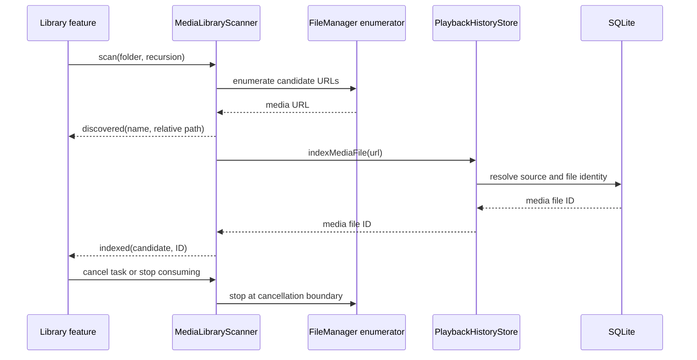

# Incremental local folder scan

## Behavior

`MediaLibraryScanner` enumerates one user-selected directory on a utility task. It emits each media filename before asking `PlaybackHistoryStore` to resolve and register its durable file identity. While indexing proceeds one file at a time, `MediaLibraryModel` retains only the five most recently discovered names and `MediaLibraryView` shows them under the progress count. This preview is transient and clears after completion, cancellation, or failure; the database snapshot remains the source for durable library rows. A bounded 32-event stream applies backpressure if the consumer is slow; it does not build an unbounded in-memory copy of the directory.

Library records, categories, scan events, and scan errors live in `MediaLibraryTypes.swift`, separate from the scanner implementation and persistence adapter. The app, test bundle, and standalone playback benchmark can share those contracts without pulling the directory scanner or SQLite implementation into targets that only use playback state.

Each indexed file is committed independently through the identity store. Cancellation stops enumeration at the next filesystem or stream boundary and releases any security-scoped access started for the selected URL. A root that is missing or is not a directory fails before any database mutation. Item-level permission or identity failures are reported as skipped paths, and successful files remain registered. The scanner never deletes or hides old rows based on an incomplete, cancelled, offline, or permission-limited pass.

When a user selects another folder during a scan, the model cancels the current task and serializes the replacement behind it. The waiting task checks both its own cancellation state and the active scan ID after the wait; cancelling a task does not automatically cancel a newer task awaiting its value. Every event and final refresh is also scoped to the active ID, so a superseded scan cannot reset newer progress, publish stale errors, or refresh as if it were the current request. A direct user cancellation of the active scan still reloads the last durable snapshot. `testRapidFolderChangesDoNotStartCancelledPendingScans` verifies that three rapid selections start only the final scan.

The scan supports recursive traversal by default and can restrict traversal to the selected directory. Hidden files and package descendants are skipped. Symbolic links are followed only when their resolved target remains inside the selected source; links out of the source are omitted so they cannot import unrelated files or persist a path that cannot be reopened from its volume. Candidates use the app's shared video/audio extension list. It also drives the open-file panel because macOS may classify formats such as MKV and M4A as dynamic, non-conforming types. The file itself is never copied or transcoded.

## Call chain

## Verification

Logic tests verify that movie and audio filenames arrive before their indexed events, unsupported files are omitted, nested paths are retained, links outside the source are omitted, an unavailable root leaves an existing checkpoint intact, and cancellation leaves prior history unchanged. `testLibraryModelShowsRecentDiscoveredNamesBeforeIndexingCompletes` pauses a controllable scanner between discovery and indexing, verifies only the most recent five of seven names appear during that gap, then verifies transient names clear when the scan ends. `testCancellingScanClearsUnindexedFilenamePreviews` cancels during that pause and verifies the preview clears without indexing. Incremental change detection, offline source cards, and source management belong to C03.
