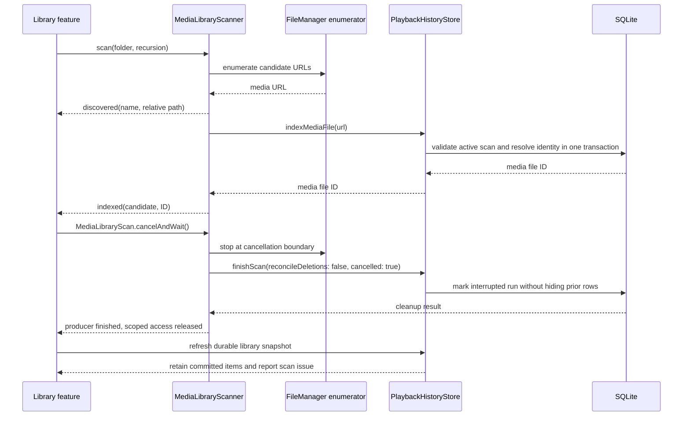
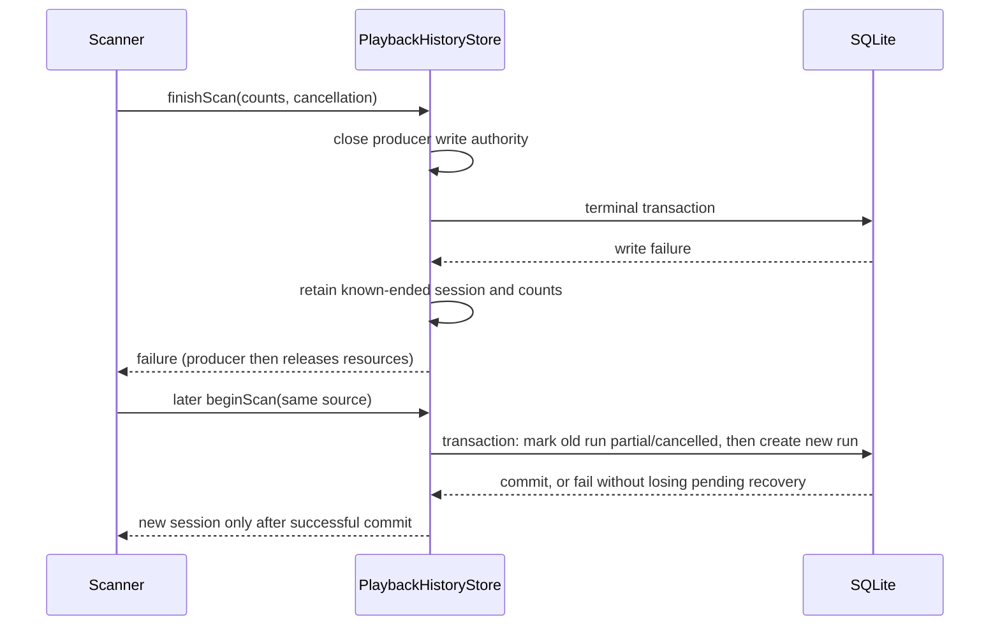

# Incremental local folder scan

## Behavior

`MediaLibraryScanner` enumerates one user-selected directory on a utility task. It emits each media filename before asking `PlaybackHistoryStore` to resolve and register its durable file identity. While indexing proceeds one file at a time, `MediaLibraryModel` retains only the five most recently discovered names and `MediaLibraryView` shows them under the progress count. This preview is transient and clears after completion, cancellation, or failure; the database snapshot remains the source for durable library rows. A bounded 32-event stream applies backpressure if the consumer is slow; it does not build an unbounded in-memory copy of the directory.

Library records, categories, scan events, and scan errors live in `MediaLibraryTypes.swift`, separate from the scanner implementation and persistence adapter. The app, test bundle, and standalone playback benchmark can share those contracts without pulling the directory scanner or SQLite implementation into targets that only use playback state.

Both file and directory writes verify the scan ID, source-root ID, and `running` status inside the same database transaction before changing any rows. Completed, partial, cancelled, and cleared sessions cannot publish late discoveries into a later scan. An invalid session is a terminal scanner error, not a skipped-file error; the producer stops instead of traversing the rest of the folder and emitting a failure for every file. This guards writes from an already-created session; the application-owned record-operation coordinator separately suspends and drains newly scheduled reconciliation around Settings clear/import (see [data management](data-management.md)).

Each indexed file is committed independently through the identity store. Cancellation stops enumeration at the next filesystem or stream boundary and releases any security-scoped access started for the selected URL. A root that is missing or is not a directory fails before any database mutation. Item-level permission or identity failures are reported as skipped paths, and successful files remain registered. The scanner never deletes or hides old rows based on an incomplete, cancelled, offline, or permission-limited pass.

`scan` returns a `MediaLibraryScan` operation that owns both the event stream and its producer task. A consumer that stops early must call and await `cancelAndWait()`. Ending event consumption alone does not prove the producer or its database cleanup has ended. The scanner finishes an interrupted run in a separately created task that is explicitly awaited, so cancellation of enumeration does not also cancel the cleanup transaction. Filesystem access is released before the operation finishes. A storage failure can still prevent recording that terminal state; startup recovery retains its role for interrupted runs.

When a user selects another folder during a scan, the model cancels the current task and serializes the replacement behind it, including the operation's cleanup. The current accepted scan ID is the single source of `isScanning`, including the waiting and cleanup phases; there is no separately maintained busy flag. Progress/previews reset when the new intent is accepted. Each task installs its ownership-scoped cleanup before awaiting the previous task, so cancellation before enumeration starts still retires that intent.

After the wait, a superseded task cannot start a scanner or clear newer state. The latest task either starts enumeration or, if cancelled while waiting, skips enumeration and still reloads the durable snapshot after the old producer finishes. The refresh runs in an awaited task that is not already cancelled. Every event and final refresh is scoped to the current ID, so a superseded scan cannot reset newer progress or publish stale errors. Scan failures and skipped-path warnings are retained after refresh. `testRapidFolderChangesDoNotStartCancelledPendingScans` verifies that three rapid selections start only the final scan; the queued-cancellation regression separately verifies cleanup and publication when that final selection is cancelled.

The scan supports recursive traversal by default and can restrict traversal to the selected directory. Hidden files and package descendants are skipped. Symbolic links are followed only when their resolved target remains inside the selected source; links out of the source are omitted so they cannot import unrelated files or persist a path that cannot be reopened from its volume. Candidates use the app's shared video/audio extension list. It also drives the open-file panel because macOS may classify formats such as MKV and M4A as dynamic, non-conforming types. The file itself is never copied or transcoded.

## Call chain

### 扫描与取消收尾

事件消费与后台任务归属于同一个扫描操作；取消后先等待事务收尾，再刷新已有条目或启动下一次扫描。



## Failed terminal writes

A producer finishing is distinct from its terminal database transaction committing. `PlaybackHistoryStore` closes file/directory write authority before awaiting that transaction. If the write fails, the store retains the final counts and cancellation flag for that known-ended session in memory. A late producer cannot use the still-`running` database row as permission to publish more discoveries. Successful completion and already-invalid sessions release the transient record.

The next `beginScan` for the same source retries these terminal records in the same transaction that checks for another active scan and creates the new session. Recovery writes only `partial` or `cancelled` plus counts; it never replays deletion reconciliation from the failed pass. If the database remains unavailable, the transaction still fails and the retained terminal record remains available for a later retry. Unrelated live scans keep their existing conflict protection. Clearing library records removes the retained failures after its transaction succeeds; after process restart the existing startup recovery cancels interrupted persistent runs.

### 收尾失败后的恢复

数据库未写入结束状态不代表扫描任务仍有写入权限；新扫描先恢复已结束任务的状态，再建立新会话。



## Verification

Logic tests verify that movie and audio filenames arrive before their indexed events, unsupported files are omitted, nested paths are retained, links outside the source are omitted, an unavailable root leaves an existing checkpoint intact, and cancellation leaves prior history unchanged. `testLibraryModelShowsRecentDiscoveredNamesBeforeIndexingCompletes` pauses a controllable scanner between discovery and indexing, verifies only the most recent five of seven names appear during that gap, then verifies transient names clear when the scan ends. `testCancellingScanClearsUnindexedFilenamePreviews` cancels during that pause and verifies the preview clears without indexing. Incremental change detection, offline source cards, and source management belong to C03.

On 2026-10-19, a real-directory regression failed before the lifecycle change: cancelling after the first discovered filename and rescanning raised `scanAlreadyRunning`. After the change, the operation completes its cancellation cleanup, retains the old checkpoint, and indexes all 501 files on rescan. A separate model regression cancels an active 500-file scan, verifies already committed items remain visible without a cancellation error, and successfully rescans all files. Missing-root and real unreadable-subdirectory tests verify that final refresh preserves both the existing library and the failure/warning. The full hostless run passed 143 Python checks and 123 XCTest cases. These are background behavior checks; interactive cancellation and external-volume removal still need visible/native acceptance.

On 2026-10-19, the closed-session regression reproduced a late old write replacing the newer scan's `last_seen_scan_id`, which made the newer completion incorrectly mark an existing file absent. The fix covers completed, partial, and cancelled sessions, plus a cleared session followed by a new source. A real 100-file scanner is invalidated during discovery: it reports one terminal session error with no skipped-file loop, leaves the cleared library empty, and permits an explicit new scan to index all 100 files. The 11:22 hostless run passed 143 Python checks and 129 XCTest cases; the Debug build and Xcode static analysis also passed. Tests used isolated temporary files/databases and preserved media bytes; this does not establish the complete Settings reset workflow under all background scheduling interleavings.

On 2026-10-19, an injected SQLite trigger rejected both normal completion and cleanup. Before the fix, the ended session still accepted file writes and the next actual scanner pass threw `scanAlreadyRunning`. After the fix, the catalog stays intact during failure, late writes are rejected, removing the fault allows a rescan without relaunch, and only the successful new pass reconciles the removed fixture. A cancellation regression also verifies continued database failure does not fake recovery, late directory writes fail, and original discovery/skipped counts survive with `cancelled` status. The final 13:24 hostless run passed 167 XCTest and 143 Python tests; Debug build and static analysis passed. These are isolated database-fault and real-directory tests, not a disk-full or physical-volume-removal claim.

### Queued replacement cancellation — 2026-10-19

A real-directory/SQLite regression holds the first scanner's producer completion after its file is committed, selects a second directory and immediately cancels the queued replacement. Before the correction, `isScanning` remained true, filename previews remained, and the committed first file was not published. After the correction, the model waits for the held producer, exits scanning, clears previews, retains the first file without an error, and never starts the cancelled second scan. An explicit later selection scans the second directory successfully and preserves both files.

```mermaid
sequenceDiagram
    participant UI as Library view
    participant Model as MediaLibraryModel
    participant Old as Previous scan
    participant Store as PlaybackHistoryStore
    UI->>Model: select replacement folder
    Model->>Old: cancel and wait for producer completion
    UI->>Model: cancel queued replacement
    Old-->>Model: prior commits and cleanup finished
    Model->>Model: skip cancelled enumeration; retain current ownership
    Model->>Store: refresh committed snapshot
    Store-->>Model: previously committed library items
    Model->>Model: retire scan ID and transient previews
    Model-->>UI: isScanning becomes false
```

The final 13:50 hostless run passed 167 logic cases (169 discovered, two explicit storage cases skipped) and 148 Python tests. The Debug application build passed; static analysis is recorded in the roadmap. This verifies the model and real storage publication, not a new pointer/keyboard pass: Screen 1 remained locked.
