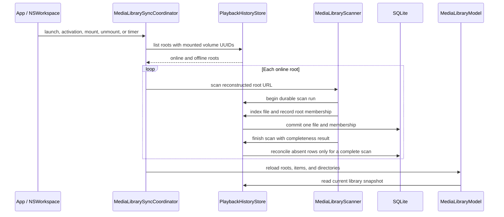

# Media source reconciliation

## Source and membership model

`media_source_roots` stores each selected directory by volume UUID and its path relative to the mounted volume. `media_source_files` records membership between a selected root and a durable `media_files` identity, so one file can belong to overlapping roots without duplicating playback history. Each scan receives a durable run ID; membership rows record the last run that observed them.

The catalog keeps absent file rows and playback history. A complete, error-free scan marks unseen memberships absent; it does not delete the file identity or its checkpoint. The same file moved within a selected tree keeps its identity and gets a refreshed relative path. A file moved into a different selected root is linked there on scan and later marked absent from the old root after that root completes a scan.

## Reconciliation policy

The app schedules a scan on launch, application activation, volume mount/unmount, and every ten minutes while running. Volume notifications are hints; mounted state is determined from mounted volume UUIDs, and a periodic full scan recovers missed filesystem events. Saved roots remain queryable while their volume is offline. When the same volume UUID returns, the root URL is reconstructed from its mounted volume URL and stored relative path.

Each directory scan indexes discoveries independently. Only a complete scan with zero skipped items reconciles unseen memberships. One scan at a time is allowed per source root, preventing overlapping runs from marking each other's discoveries absent. At store startup, leftover `running` rows from a previous process are marked `cancelled` so a later pass can retry safely. Cancellation, a missing root, an item permission failure, or a partial enumeration marks the run without changing existing presence state. This keeps old library rows visible when the source cannot be checked reliably.

After a reconciliation pass, the coordinator asks the library model to reload roots, items, and directory membership from the store. This keeps newly indexed files and changed online/offline state visible without requiring an app restart. The model assigns each refresh a generation; a slower earlier database read cannot overwrite a newer snapshot.

Shutdown closes the reconciliation input first: it rejects new refreshes, cancels the periodic trigger, and unregisters workspace/application observers before cancelling and joining the active scan. Concurrent shutdown callers await the same completion task. This prevents a queued mount or activation callback from starting work after application termination has begun.

## Call chain

## Verification

Logic tests verify that a complete second scan marks a deleted file absent, an interrupted/partial run leaves the previous presence state intact, offline roots remain available and become online when their volume UUID is mounted, launch reconciliation recovers a file added while the app was away without a filesystem notification, and the v0.0 path-history migration still works. `testReconciliationTracksMovedFileWithoutLosingPlaybackHistory` moves a real fixture within a selected root, rescans it, and verifies the membership path changes while the file identity and saved 42-second checkpoint remain. These checks cover database and scanner behavior; visual offline cards and relocation controls are part of the library UI task.
