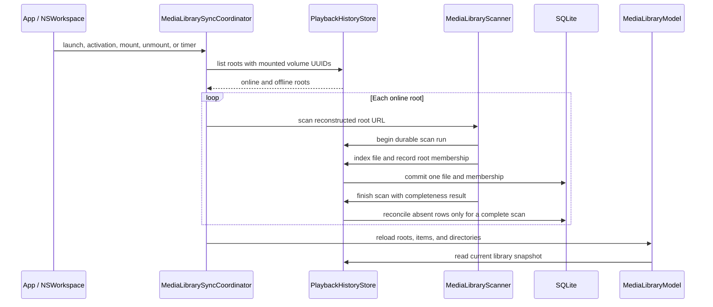
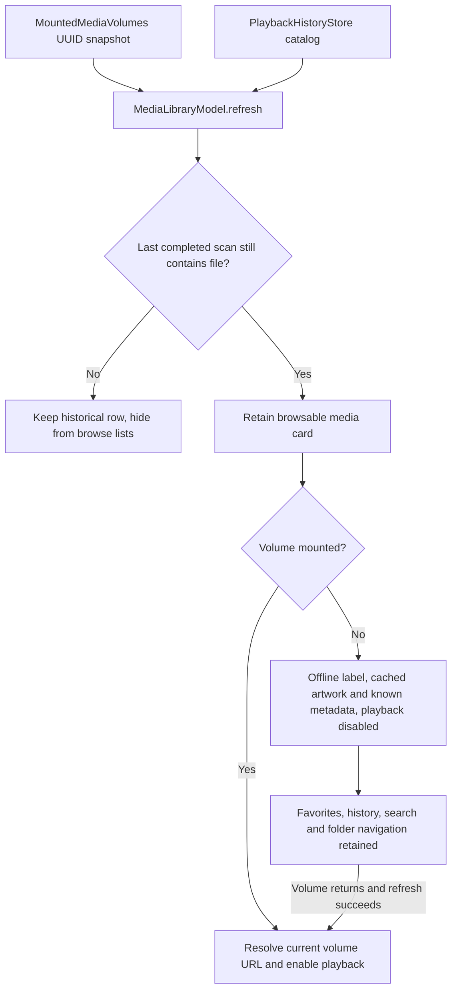

# Media source reconciliation

## Source and membership model

`media_source_roots` stores each selected directory by volume UUID and its path relative to the mounted volume. `media_source_files` records membership between a selected root and a durable `media_files` identity, so one file can belong to overlapping roots without duplicating playback history. Each scan receives a durable run ID; membership rows record the last run that observed them.

The catalog keeps absent file rows and playback history. A complete, error-free scan marks unseen memberships absent; it does not delete the file identity or its checkpoint. The same file moved within a selected tree keeps its identity and gets a refreshed relative path. A file moved into a different selected root is linked there on scan and later marked absent from the old root after that root completes a scan.

## Reconciliation policy

The app schedules a scan on launch, application activation, volume mount/unmount, and every ten minutes while running. Volume notifications are hints; mounted state is determined from mounted volume UUIDs, and a periodic full scan recovers missed filesystem events. Saved roots and present memberships remain browsable while their volume is offline, including Library, Favorites, Continue Watching, Search, and indexed folder navigation. Only memberships marked absent by a complete scan are hidden. Cards and rows show Offline and disable playback actions; local preferences remain editable. Cached artwork and previously probed technical metadata are reused without opening the offline source. Uncached artwork keeps its placeholder; unavailable metadata remains Unknown. Technical metadata uses the bounded in-memory cache for the same file identity and content revision, so an evicted entry or a fresh app process does not promise offline metadata. Online state participates in artwork/metadata task identity, so reconnection retries unavailable work. When the same volume UUID returns, the root URL is reconstructed from its mounted volume URL and stored relative path.

Each directory scan indexes discoveries independently. Only a complete scan with zero skipped items reconciles unseen memberships. One scan at a time is allowed per source root, preventing overlapping runs from marking each other's discoveries absent. At store startup, leftover `running` rows from a previous process are marked `cancelled` so a later pass can retry safely. Cancellation, a missing root, an item permission failure, or a partial enumeration marks the run without changing existing presence state. This keeps old library rows visible when the source cannot be checked reliably.

After a reconciliation pass, the coordinator asks the library model to reload roots, items, and directory membership from the store. This keeps newly indexed files and changed online/offline state visible without requiring an app restart. The model assigns each refresh a generation; a slower earlier database read cannot overwrite a newer snapshot. The mounted-volume map is published alongside the accepted database snapshot, so a failed or superseded refresh cannot silently change URL availability independently of the displayed roots. Both the model and coordinator use the same `MountedMediaVolumes` UUID lookup.

Shutdown closes the reconciliation input first: it rejects new refreshes, cancels the periodic trigger, and unregisters workspace/application observers before cancelling and joining the active scan. Concurrent shutdown callers await the same completion task. This prevents a queued mount or activation callback from starting work after application termination has begun.

Replacement reconciliation tasks await the previous task before starting their debounce and root traversal. Each root traversal owns a `MediaLibraryScan` operation and awaits its `cancelAndWait()` on success, cancellation, or error. Joining the coordinator therefore includes the producer's database cleanup, rather than only the task consuming its events. The shared scanner's cancellation/rescan regression is recorded in [incremental scanning](incremental-scan.md); the coordinator's real mount/unmount and application-exit paths still require native acceptance.

`AppLifecycle` now awaits three owners before replying to the termination request: the reconciliation coordinator, `MediaLibraryModel.shutdown()` for manual scans and accepted preference writes, then `PlayerModel.shutdown()` for the final checkpoint and native playback teardown. The manual model closes its command input before draining work, and concurrent shutdown calls share one completion task. The 2026-10-19 real-directory model regression verifies that the scan run is no longer active when shutdown returns; actual application termination remains a separate native check.

## Call chain

## Verification

Logic tests verify that a complete second scan marks a deleted file absent, an interrupted/partial run leaves the previous presence state intact, offline roots remain available and become online when their volume UUID is mounted, launch reconciliation recovers a file added while the app was away without a filesystem notification, and the v0.0 path-history migration still works. `testReconciliationTracksMovedFileWithoutLosingPlaybackHistory` moves a real fixture within a selected root, rescans it, and verifies the membership path changes while the file identity and saved 42-second checkpoint remain. These checks cover database and scanner behavior; actual unplug/replug presentation and relocation controls still require native acceptance.

### Offline catalog regression — 2026-10-19

A real temporary SQLite catalog and directory tree are scanned, including a file later removed by a complete scan. The model receives a controlled mounted-volume snapshot, transitions online → offline → online, and verifies that only the removed member stays hidden. Favorites, history at 42 seconds, selection, search results, and child-directory browsing survive. Playback URL resolution becomes unavailable offline and returns on reconnect; editing Watched while offline persists. A recording thumbnail generator is invoked once online; cached artwork remains available offline, and an uncached item does not invoke the generator. Original media bytes remain unchanged. This exercises production model/store/cache behavior with simulated volume availability, not physical device unplugging or screenshot acceptance. The 11:53 hostless run passed 143 Python checks and 142 XCTest cases; Debug build and static analysis passed. The canonical app still packages English only.

#### Offline presentation flow

Volume availability and stored file presence have separate responsibilities; only completed reconciliation can mark membership absent.

### Offline metadata retention — 2026-10-19

The extended offline regression initially failed: the model returned nil after disconnection despite having probed the real H.264 fixture while online. `MediaMetadataProbe.cachedMetadata` now provides source-free access with the existing revision key and LRU policy; the model uses it when playback URL resolution is unavailable. The regression verifies retained duration, dimensions and codecs, no probing on an offline cache miss even when the test file is still readable, and successful probing after reconnect. The bounded-cache test also verifies that offline access updates recency and that a different revision cannot reuse old facts. The 12:39 hostless suite passed 152 XCTest cases and 143 Python checks; Debug build and static analysis passed. Physical unplug/replug and native presentation remain open.

## Remount identity continuity

The persistence resolver now uses volume UUID plus volume-local file number instead of treating the current POSIX device number as durable. An additive migration reads the prior device/inode serialization without filesystem I/O; the same resolver serves scan, checkpoint and archive paths. Temporary APFS remount observation and real-file/SQLite regressions establish the underlying condition and store behavior. Actual physical-disk removal/reconnection and native offline presentation remain separate acceptance gates. See [identity evidence and conflict policy](media-identity.md#remount-stable-lookup).
