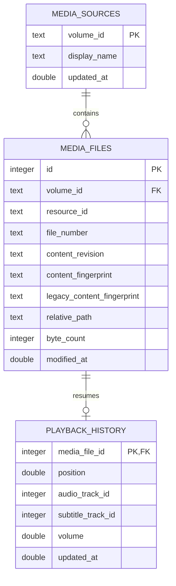
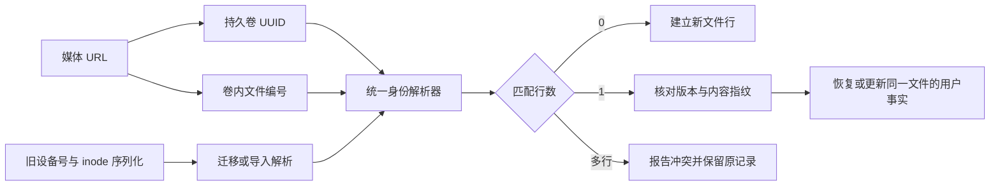
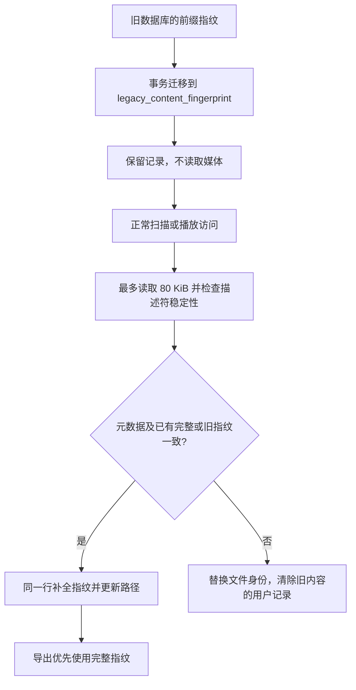

# Local media source and file identity

## Contract

`MediaFileIdentity` is resolved at the persistence boundary for a local regular file. The mounted volume UUID identifies the source; the inode/file number identifies the filesystem object within that volume; size plus nanosecond content-modification time form its metadata revision. A SHA-256 fingerprint adds file size and deterministic samples from five evenly spaced locations. Files up to 80 KiB are fingerprinted in full; larger files read at most 80 KiB. The path relative to the mounted volume is mutable location metadata, so renaming a file updates its location without changing its logical row. The volume name is a display label and may change independently of the stable volume UUID.

The resolver follows symlinks before collecting resource metadata, matching the existing playback URL behavior. Missing files, unavailable volume UUIDs, non-regular files, or failed `stat` calls return an explicit persistence error. Playback itself remains independent of the store and can continue when a checkpoint cannot be identified.

Fingerprint sampling runs on the scanner's utility task or inside the persistence actor and uses bounded random reads rather than hashing the full media file. The open descriptor's device, inode, size, modification time, and change time are checked before and after sampling, so an atomic replacement or concurrent rewrite cannot commit a mixed fingerprint. Change time is only a stability check here; it is not part of durable identity because a rename may update it. When metadata or a known fingerprint changes, one transaction removes the old media row and its checkpoint/preferences, creates a fresh media row, and reattaches source memberships while preserving their original `added_at`. Sparse sampling is a content-change signal rather than a proof of byte-for-byte identity; a rewrite that leaves all sampled regions unchanged may not be detected. Rows created before this migration have no fingerprint and retain their checkpoint while the first observed fingerprint is established.

## Relational model

`media_files(volume_id, file_number)` is the lookup key for a filesystem object. `resource_id` remains a serialized archive identifier: new rows use `inode:<number>`, while historical `<device>:<inode>` strings stay intact for old exports. The original unique `(volume_id, resource_id)` constraint remains; the new volume/file-number index is nonunique so migration can preserve historical conflicts for explicit resolution instead of deleting user facts. A source has many current files, and each current file has zero or one resume checkpoint. Replacing content at that resource creates a new database row ID, so old favorites, watched flags, category labels, and progress cannot leak into the replacement. The volume-relative path index supports later library lookup by location; it does not define identity. Checkpoints retain the existing single-file lookup and atomic upsert behavior.

## Lifecycle and migration

The playback model asks `PlaybackHistoryPersisting` for a checkpoint when opening a URL and saves progress through the same protocol. `PlaybackHistoryStore` resolves filesystem identity, updates source and file metadata, and reads or writes the checkpoint inside one serialized GRDB transaction. The UI and playback engine do not own database rows or resource identifiers.

Migration `mediaFileIdentity` renames the v0.0 path-keyed table to `playback_history_legacy` and creates the source, file, and identity-keyed history tables. The later `mediaContentFingerprint` migration adds a nullable fingerprint column so existing rows can be upgraded lazily without reading every library file during database startup. On first access to a still-existing file at its exact old canonical path, a transaction moves that checkpoint to the resolved file row and removes the legacy row. A legacy path whose file had already moved before this migration cannot be associated safely with its new location; it remains available in the legacy table rather than being guessed by filename.

## Remount-stable lookup

A POSIX device number describes the current attachment, so it is not part of durable file identity. The volume uses its [persistent UUID](https://developer.apple.com/documentation/foundation/urlresourcekey/volumeuuidstringkey); `st_dev` remains relevant only when checking that an open file descriptor did not change during fingerprint sampling. Apple's [file resource identifier](https://developer.apple.com/documentation/foundation/urlresourcekey/fileresourceidentifierkey) is explicitly not persistent across system restarts and is not substituted for the stored identity.

Migration `volumeScopedFileNumber` parses only the known legacy numeric-device/inode and current `inode:` formats into an indexed `file_number` column, without touching media. Playback lookup, scanning and archive matching use the same volume-scoped resolver. Metadata revision and content verification still decide whether the same filesystem object has been replaced. Different volume UUIDs cannot supply each other's history even when file numbers match.

If historical rows already contain the same volume/file-number pair, the resolver reports a localized identity conflict and preserves both records. It does not pick the first history, combine favorites, or erase an older category. Library snapshots mark the conflict and omit its arbitrary checkpoint, so the file is not advertised in Continue Watching and accessibility does not announce a false resume position. When this happens during playback startup, the player explains that it will start at the beginning without saving progress, then suppresses further checkpoint writes for that request. The native session still opens normally. This prevents a second generic save alert and avoids repeatedly attempting an operation known to be ambiguous; it does not resolve the stored records. A user-directed data-repair workflow remains open because choosing a checkpoint or merging other library facts can discard user data.

### 挂载与身份查找链路

系统设备号只用于本次读取的稳定性检查；数据库通过持久卷标识和卷内编号查找，旧序列化格式保留兼容。

On 2026-10-19, two temporary 64 MiB sparse APFS images were used to force a changed attachment number. The media image's `st_dev` changed from `16777247` to `16777255`, while its volume UUID, inode `16`, and fixture bytes stayed unchanged. Both images were unmounted and deleted; no player or desktop window was opened. This directly demonstrates the filesystem condition, not the complete application unplug/replug UX.

A separate real-file/SQLite regression changes the prior recorded device number, recreates the old schema, renames the unchanged file, and then migrates/reopens the store. Before the fix it lost the checkpoint, created a second file row, and failed renamed-file backup restore. It now preserves the row/checkpoint and restores an old backup into a fresh store. Additional tests verify cross-volume separation and rejection/preservation of conflicting rows during playback lookup, scanning and import. The final 13:18 hostless run passed 165 XCTest and 143 Python tests; Debug build and static analysis passed. These store-level tests do not replace native volume-removal UI acceptance.

## Small-file fingerprint upgrade

Before the 2026-10-19 correction, files larger than 16 KiB and no larger than 80 KiB were mistakenly fingerprinted using only their first 16 KiB. The current sampler reads those files in full, while preserving the existing digest format for files of at most 16 KiB and the five-sample algorithm for files larger than 80 KiB. Total source reads remain bounded at 80 KiB; the compatibility digest is computed from the same buffer.

Migration `completeSmallFileFingerprint` adds nullable `legacy_content_fingerprint`. For the affected size range it moves the stored prefix digest into that column and clears the current digest, in one transaction. It performs no filesystem reads. Normal identity resolution first verifies the metadata revision and the available prior digest, then establishes the full digest on the same logical row. A known full digest always takes precedence; a matching prefix cannot override a changed full digest. New and replacement rows use the same insert path.

This preserves progress, favorites, watched state and categories for unchanged files, including files renamed before upgrade or currently unavailable. A changed prefix still invalidates the old row during the first upgrade access. Tail changes that occurred before a full baseline was established cannot be recovered from the old prefix digest; the migration does not claim retrospective verification.

### 迁移与正常访问链路

迁移保留旧校验事实，正常文件访问才建立完整小文件指纹；校验失败仍走既有的内容替换事务。

Version 2 exports retain their format: they use the full digest when available, or the retained old digest before first access. Imports accept a verified legacy digest alias as well as the current digest, under the existing revision/resource-or-path checks. Older backups therefore retain their former prefix-only limitation; new full-digest backups reject tail-only content replacement. A fresh database can also compute the old alias when indexing unchanged media, so compatible restore does not depend on having migrated the original database.

## Verification

Behavior tests cover durable reopen, independent files, rename continuity and relative-path refresh, atomic replacement at the same path, in-place content changes, same-size content replacement with the original modification date restored, invalid checkpoint values, and migration of a v0.0 path record. The archive format is now version 2 and includes the fingerprint; version 1 imports remain readable with their prior metadata-only matching behavior. These tests exercise real temporary files on the host volume; they do not infer identity from file names.

The 2026-10-19 regression first reproduced retained checkpoints and archive matches after changing only the final byte at 16 KiB + 1, 48 KiB and 80 KiB while preserving size and nanosecond mtime. All three are now rejected. Additional real-SQLite tests cover an old-layout database, unchanged renamed-file fact preservation, old backup import into fresh stores, copied-file path fallback, rejection of a changed legacy prefix, and transaction rollback/retry after an injected migration failure. The final 13:11 hostless run passed 162 XCTest and 143 Python tests; the Debug app build and static analysis passed. These tests use isolated temporary files/databases, not the user's library.

The later explicit 13:32 storage test also verified the complete store path across a real APFS unmount/remount and rename, preserving the same row, checkpoint and favorite after the device number changed. See [disposable-volume acceptance](storage-integration.md). Physical disconnection during playback and native source-state presentation remain separate gates.
