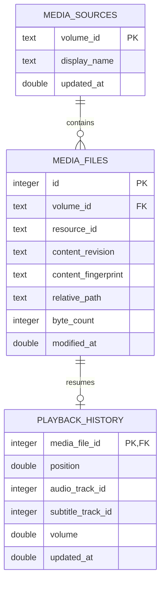

# Local media source and file identity

## Contract

`MediaFileIdentity` is resolved at the persistence boundary for a local regular file. The mounted volume UUID identifies the source; the POSIX device and inode pair identifies the current filesystem object; size plus nanosecond content-modification time form its metadata revision. A SHA-256 fingerprint adds file size and deterministic samples from five evenly spaced locations. Files up to 80 KiB are fingerprinted in full; larger files read at most 80 KiB. The path relative to the mounted volume is mutable location metadata, so renaming a file updates its location without changing its logical row. The volume name is a display label and may change independently of the stable volume UUID.

The resolver follows symlinks before collecting resource metadata, matching the existing playback URL behavior. Missing files, unavailable volume UUIDs, non-regular files, or failed `stat` calls return an explicit persistence error. Playback itself remains independent of the store and can continue when a checkpoint cannot be identified.

Fingerprint sampling runs on the scanner's utility task or inside the persistence actor and uses bounded random reads rather than hashing the full media file. The open descriptor's device, inode, size, modification time, and change time are checked before and after sampling, so an atomic replacement or concurrent rewrite cannot commit a mixed fingerprint. Change time is only a stability check here; it is not part of durable identity because a rename may update it. When metadata or a known fingerprint changes, one transaction removes the old media row and its checkpoint/preferences, creates a fresh media row, and reattaches source memberships while preserving their original `added_at`. Sparse sampling is a content-change signal rather than a proof of byte-for-byte identity; a rewrite that leaves all sampled regions unchanged may not be detected. Rows created before this migration have no fingerprint and retain their checkpoint while the first observed fingerprint is established.

## Relational model

`media_files(volume_id, resource_id)` is unique for the current content at a filesystem resource. A source has many current files, and each current file has zero or one resume checkpoint. Replacing content at that resource creates a new database row ID, so old favorites, watched flags, category labels, and progress cannot leak into the replacement. The volume-relative path index supports later library lookup by location; it does not define identity. Checkpoints retain the existing single-file lookup and atomic upsert behavior.

## Lifecycle and migration

The playback model asks `PlaybackHistoryPersisting` for a checkpoint when opening a URL and saves progress through the same protocol. `PlaybackHistoryStore` resolves filesystem identity, updates source and file metadata, and reads or writes the checkpoint inside one serialized GRDB transaction. The UI and playback engine do not own database rows or resource identifiers.

Migration `mediaFileIdentity` renames the v0.0 path-keyed table to `playback_history_legacy` and creates the source, file, and identity-keyed history tables. The later `mediaContentFingerprint` migration adds a nullable fingerprint column so existing rows can be upgraded lazily without reading every library file during database startup. On first access to a still-existing file at its exact old canonical path, a transaction moves that checkpoint to the resolved file row and removes the legacy row. A legacy path whose file had already moved before this migration cannot be associated safely with its new location; it remains available in the legacy table rather than being guessed by filename.

## Verification

Behavior tests cover durable reopen, independent files, rename continuity and relative-path refresh, atomic replacement at the same path, in-place content changes, same-size content replacement with the original modification date restored, invalid checkpoint values, and migration of a v0.0 path record. The archive format is now version 2 and includes the fingerprint; version 1 imports remain readable with their prior metadata-only matching behavior. These tests exercise real temporary files on the host volume; they do not infer identity from file names.
