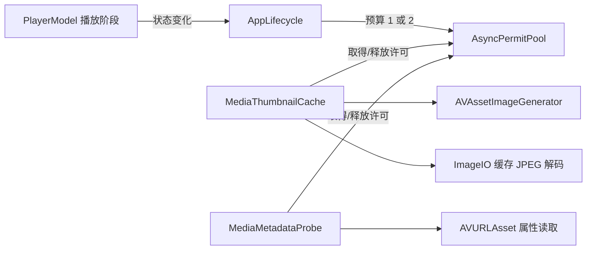

# 播放与资料库后台媒体工作

## 资源与状态所有者

`AppLifecycle` 拥有一个 `AsyncPermitPool`，同时交给缩略图缓存和技术属性探测器。非播放阶段该预算最多容纳两项媒体工作（AVFoundation 抽帧/属性读取或缓存 JPEG 解码）；`PlayerModel` 的播放阶段进入 `opening` 或 `ready` 后，预算降为一项，回到 `idle`、`ended` 或 `failed` 后恢复两项。已取得许可的工作正常结束，降载不会中途破坏它们；新工作排队且可取消。播放位置等高频快照不触发预算更新。预算是并发数约束，不是 CPU、内存或能耗的实测承诺。

`PlayerModel` 只发布资源活动布尔值，不依赖缩略图或属性实现；`AppLifecycle` 串行应用连续的状态变化，避免快速切文件时旧状态晚到覆盖新状态。资料库 UI 仍只持有展示状态和用户意图，两个后台服务各自拥有缓存与工作任务。退出依次等待预算更新、停止资料库任务并关闭播放会话。

## 探测生命周期

`MediaMetadataProbe` 以媒体 ID 和内容版本合并同一进程的重复请求；每个调用方有独立等待者。取消一个等待者不影响其他请求，最后一个取消时取消工作。取得共享许可后开始十秒时限；成功读到的事实进入最多 2,048 项的进程缓存，失败、取消、超时或全未知结果不缓存，允许后续重试。AVFoundation 适配器取消时调用父 `AVURLAsset.cancelLoading()`，并在容器、轨道与音轨读取之间检查取消。许可只在工作实际结束后释放，不把一个迟滞的读取误算为已释放。

缩略图仍使用自己的同键生成合并、超时和磁盘 LRU。生成器取消时同时取消画面生成与父 asset 的加载；持有共享许可的工作结束后才释放名额。两个服务不会分别各跑满两个并发。

2026-10-24 的滚动采样后，展示层不再在 SwiftUI `body` 中同步执行 `NSImage(contentsOf:)`。卡片已有任务先取得缓存 URL，再让 ImageIO 在可取消的后台任务中提前解码为 `CGImage`，主线程只接收解码后的图像；卡片离开视口时释放该图像状态。解码也持有同一个共享许可，快速滚动与播放并行时不会绕开 1/2 项工作上限。`AsyncPermitPool.snapshot()` 只提供当前限额、活动数和等待数的只读观测；它不代表帧率或能耗。

许可等待者在被放行的同时可能被取消：取消回调若晚于放行执行，就已找不到队列中的等待者。`acquire()` 现在在续体恢复后再次检查取消，并把刚分配的许可归还后抛出 `CancellationError`。50 轮取消/放行竞争回归要求每轮活动数和等待数都归零；这约束许可不泄漏，不等于测得真实播放中的 CPU、帧率或任务总数。

边界：超时和取消依赖 AVFoundation 协作式返回；若系统调用本身长期不响应取消，结构化任务仍会等待它结束，因此此机制不能保证硬实时终止。缺失/不支持的媒体属性继续显示未知，不影响真实播放，也不修改来源文件。

## 验证

无宿主行为回归覆盖共享许可在限额收缩后等待、重新放宽后唤醒、等待取消后不占位，以及取消与放行交错时不泄漏名额；真实 JPEG 解码排队、取消后不占位、成功/无效文件返回后释放许可；属性请求合并、单等待者与末等待者取消、超时后释放许可及重试；播放器活动只在阶段转换时发布。2026-10-24 当前工作树通过 160 项 Python 和 208 项无宿主 XCTest，2 项显式 APFS 专项按此入口跳过；`./scripts/build-dev.sh --analyze -quiet` 与普通 Debug 构建通过。合成真实媒体的既有元数据测试继续验证时长、尺寸和轨道编码。实际播放期间的 CPU/内存、卡片滚动帧率和取消迟滞仍需规范 Debug 包的单窗口可见/性能验收，不把 mock 计数视为性能数据。

播放中滚动的指标采集入口见[滚动性能采样](scroll-performance.md)：独立 XCTest runner 只观察，CUA 提供实际输入。编译通过和 CPU/RSS 抽样均不关闭真实滚动帧指标门槛。
