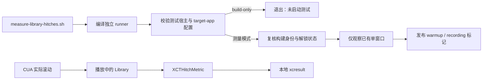

# 播放期间的资料库滚动采样

## 职责与入口

`BomuHitchUITests` 是独立的 macOS 26+ 性能测试目标，不依赖 Bomu 应用 target。`scripts/measure-library-hitches.sh` 编译测试 runner 并校验生成的 xctestrun；只有普通测量模式才执行测试。测试只附加到已经运行的规范 Debug 应用，观察 `XCTHitchMetric`，不调用应用 launch、activate、terminate 或 XCTest 输入操作。滚动由已获单窗口时段的 CUA 操作提供。

锁屏期间可运行 `./scripts/measure-library-hitches.sh --build-only`。该入口只编译、检查配置，不验证正在运行的产品包、不启动测试，也不产生性能结论。脚本本身属于构建身份输入；修改它以后，真正测量前必须重新运行 `./scripts/build-dev.sh` 并取得有效收据。

实际测量前，操作者需确认桌面解锁，唯一播放器来自 `.build/DerivedData/Build/Products/Debug/Bomu.app`，且运行中的进程确实是该次构建；仅检查磁盘包不能证明旧进程已重启。准备同一屏幕上的普通窗口、可滚动的真实 Library 和足够长的播放样片，确认 Now Playing 显示 Pause，再运行不带参数的测量脚本。该命令不会替操作者打开播放器或切换页面。

## 采样阶段和有效性

测试在每段观测前向 XCTest Runner 的用户临时目录原子写入 `bomu-library-hitch-phase-<Bomu PID>.json`，包含 phase、invocation、pid、startedAt 和 deadline。Runner 无法可靠写入桌面仓库的 `.build` 目录。`XCTMeasureOptions.iterationCount = 1` 按当前 SDK 合同执行两次闭包：第一次 warmup 被丢弃，第二次 recording 形成一个样本；每次观察 20 秒。测试检查实际调用次数为 2，结束后再次确认播放器未退出、仍为单窗口 Library 且播放仍活跃。正常返回时删除阶段文件；异常中止可能遗留文件，读取方必须拒绝过期 deadline 或不匹配 PID，不能把遗留标记视为活跃任务。

CUA 必须在两段有效时间内提供实际滚动，并记录时间、方向、距离及滚动前后的视口证据。没有 recording 段滚动证据，即使 XCTest 显示通过，也只能说明观察器执行成功，不能签收滚动性能。锁屏、页面/窗口改变、播放停止、应用退出或阶段写入失败均使本轮样本无效。测试不会自动补发输入、抢焦点或循环重跑。

一个记录段只用于诊断，不能作为稳定的性能基线。需先读取 xcresult 的实际指标单位，再讨论 hitch time/ratio；不能把它换算为 p95/p99 帧时长，也不能用 CPU/RSS 代替帧指标。报告须写明样片、媒体项数量、窗口尺寸、滚动路径、预热状态、观察区间与包身份。暖缓存和记录段中的空闲首尾都会影响比较。

## 失败和资源边界

runner 编译墙钟上限 300 秒，测量命令上限 180 秒；XCTest 单用例执行允许 90 秒，且只选择一个用例、不并行。子命令由独立进程组拥有，失败、超时或中断后仅清理该组，先 TERM 后 KILL；不按名称查找或结束 Bomu。Xcode 服务可能位于该进程组之外，因此异常后仍需检查本轮 runner 残留，不能未经核实重复启动。

生成配置必须只有 `BomuHitchUITests` 测试目标，宿主为对应 Runner.app，标记 UI test 和 test-provided application，且不存在 `UITargetAppPath`。不满足即停止，不启动测量。每次真正测量创建独立输出目录，保存 xcresult 和原始 xctestrun；执行使用原始路径，以保留 `__TESTROOT__` 的解析语义。本地诊断产物不进入 README 或公开截图目录。

## 当前证据

2026-10-26 已完成观察器替换与后台校验：Swift 语法、shell 语法通过；启动配置行为检查覆盖正常配置，以及额外 target、错误宿主、非 UI bundle、缺少 test-provided application、配置自动启动应用等拒绝路径。进程组 helper 的既有隔离验证覆盖成功/失败退出码、超时、忽略 TERM 的子进程及后代回收，并确认无关进程保持运行。`--build-only` 已在固定 Xcode 27.1 / Swift 6.4 下成功编译独立 runner，并通过真实生成 xctestrun 的启动配置检查；未执行 test-without-building。以上均不代表已取得真实 hitch 数据。

本轮脚本变更后的规范 Debug 构建成功，身份 `c5926bd9c8cf70c54df97ca9108b117909eb085bf116cc6329f916ba2bf56a3e` 独立核验通过。未重启旧播放器进程；实际测量仍需确认运行身份与桌面条件。

持久化后台回归：`Tests/test_hitch_launcher.py` 直接执行生产脚本内的 Python helper（不 source 顶层构建命令），验证正常/失败退出码、TERM 中断清理、忽略 TERM 的子进程超时回收且无关进程存活，以及允许/拒绝启动配置。`python3 -m unittest discover -s Tests -p test_hitch_launcher.py -v` 的 4 项测试于 2026-10-26 通过（6.754 秒）；未启动 Xcode 或播放器。

2026-10-27 的首次真实尝试以 `fd5b5d99…` 规范包、同屏唯一窗口、播放中的 4K HEVC Main10 样片和打开的 Library 为前提。脚本完成构建后，Xcode 27 以退出码 64 拒绝命令行 `-test-iterations 1`（它只接受大于 1 的迭代数）；未进入测试。已删除该无效参数，并在 build-only 之后额外检查 Runner.app 可执行文件与内嵌 `.xctest` 是否实际存在；修正后 `--build-only` 成功。当前观察器源码与脚本随 `b92331d7…` 规范包重建并通过身份核验。

在修脚本前，使用同一个已校验的 xctestrun 直接去掉无效参数试运行一次，以区分脚本参数与 XCTest 宿主故障。`manual-hitch-fd5b5d99.xcresult` 显示 0 passed、1 system failure：Runner PID 64298 在约 101.9 秒后于 bootstrapping/建立连接之前被 signal kill；阶段文件从未发布，目标用例的测量闭包没有执行。对该 Runner 的 2 秒只读 sample 全部停在 `_dyld_start`，不是 Bomu 滚动栈。Xcode 随后清理了临时 Runner 产品，重新 `--build-only` 又能生成它；这个现象不足以判断早退的根因。此轮没有 recording 段滚动，也没有任何可解释的 hitch 指标，不能签收性能。XCTest 宿主启动问题须单独诊断后再做一次有阶段标记的真实滚动；不为了凑指标连续重跑。

后续只读系统日志将这次早退缩小到 Runner 签名/系统策略：`syspolicyd` 在 10:33:27 记录 `Terminating process due to Gatekeeper rejection: 64298`；当前 `BomuHitchUITests-Runner.app` 的 `codesign --verify --deep --strict` 返回 `CSSMERR_TP_NOT_TRUSTED`，内嵌测试 bundle 还报告资源封装签名不一致。Xcode 的 `noBaselinesDirectory` 与 task-port 诊断也出现，但这些记录不足以单独证明因果。下一步只修本地独立测试产物的签名和启动配置并重新验证；不关闭 Gatekeeper、不改变播放器包或把这次失败写成性能样本。

一个忽略目录中的 Runner 副本在依次对 `.xctest` 和 `.app` 作临时 ad-hoc 签名后，通过 `codesign --verify --deep --strict`；这仅证明封装签名可以修复。`spctl --assess` 仍拒绝该副本，而且副本没有启动过，因此不能推断 XCTest 已可运行。正式入口需在不触碰当前 Bomu 窗口的条件下重新验证签名、系统策略和 Runner 启动，再采集滚动。

2026-10-27 后续修复：独立 Runner 改由 Xcode 使用本地 ad-hoc 身份签名，脚本在启动前执行 `codesign --verify --deep --strict`；`--build-only` 通过。第一次真实重跑证明 Runner 可以启动，但测试以 `.app` URL 末尾斜杠差异误判运行包路径，0 个性能样本；改为比较规范化路径组件。第二次重跑已确认唯一窗口、播放和 Library，随后 Runner 因 macOS 拒绝写入桌面仓库 `.build/benchmarks` 而在两段测量中失败；改用 Runner 的用户临时目录。两次失败的 xcresult 留在忽略的 `.build/benchmarks/library-hitches-20261027-113529.Q9Ypp2/` 和 `library-hitches-20261027-113652.Ko725z/`，均不得算性能样本。

第三次运行使用身份 `7e349b32fc1a57383f9402dbc5a3f3e25554940d57c82a2120231cad9017bae1` 的规范 Debug 包，在内建屏唯一普通窗口打开 Library，后台播放本地许可的 240 秒 4K HEVC Main10 样片。30 个真实媒体条目，窗口截图为 2572×1768 backing px（约 1286×884 pt）；CUA 在测试运行期间对 Library 结果区作正反向滚动，辅助功能滚动条值从 0 到约 0.259、0.518，再返回约 0.259。`library-hitches-20261027-113811.pZLqlz/result.xcresult` 中 1/1 测试通过，`XCTHitchMetric` 的唯一记录样本是 **4 hitches、3.3325 ms/s hitch time ratio、0.066670332 s total hitch duration**。`Tests/test_hitch_launcher.py` 4/4 通过。Runner 的临时阶段文件在退出时删除，外部监听未定位到记录段的即时路径，无法逐次证明上述每次 CUA 滚动落在哪个 20 秒阶段；因此这是一条有播放和滚动的探索性指标，不构成稳定滚动性能签收或 p95/p99 帧时长结论。没有为取得指标关闭 Gatekeeper、改变全局权限或启动第二个 Bomu 窗口。
