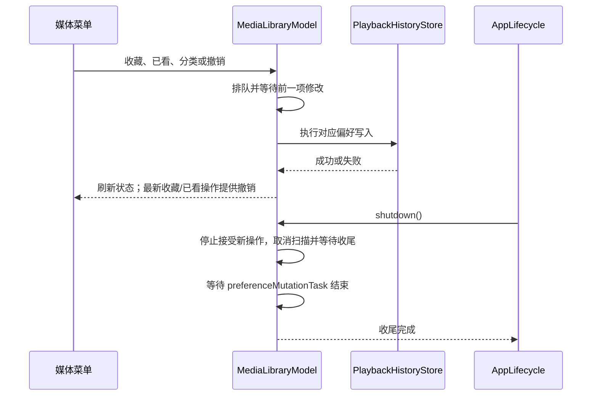

# 搜索、收藏、观看状态与手工分类

## 数据模型

收藏、已看和手工分类属于 `media_file_preferences`，通过媒体文件稳定 ID 关联；播放进度仍属于 `playback_history`。分类字段由独立 GRDB migration 添加，并限制为 `movie`、`series`、`personal` 或 `NULL`。NULL 表示用户尚未分类，读取时不会根据文件名猜类型，也不会替换原始文件名。

`PlaybackHistoryStore.libraryItems(in:)` 将偏好映射为 `MediaLibraryItem`。`MediaLibraryModel` 提供本机已索引记录的搜索结果；库页可以按观看状态及分类筛选，搜索页只做文本匹配。媒体卡片上下文菜单可切换收藏、切换已看、设定分类或清除分类。所有写入只更新数据库，不触碰来源媒体。

## 搜索字段与规模

搜索在当前已索引列表上执行本地匹配：原文件名、来源根目录名，以及媒体相对路径中的每一级父目录名都可命中。匹配使用 `localizedStandardContains`，查询会去除首尾空白；不读写来源媒体。`MediaLibraryModel.searchResults` 从已加载来源构建根目录名映射，再调用无状态的 `matchingItems`，所以文件名和嵌套目录逻辑可以脱离 SwiftUI 与数据库直接测试。

定稿另列了“标题”字段，但当前 `MediaLibraryItem` 没有独立媒体标题。内嵌容器标题与不带扩展名的文件名是不同来源，尚未把任一者冒充为已实现的标题搜索；在标题定义明确前，这项 R07 验收仍开放。

1 万条记录仍在内存中过滤；十万级及以上性能尚未承诺。现有回归验证末尾记录命中和搜索耗时，C10 仍需在目标 Mac 上补充交互测量，再决定是否将查询下推到 SQLite。搜索 `TextField` 直接绑定 `MediaLibraryModel.searchText`，不额外持有重复查询副本。

## 筛选无结果

库页的 `filteredMediaGrid` 由筛选前后的条目决定提示：库本身没有条目时显示媒体库空状态；原集合有条目而分类/观看状态筛选后为空时显示筛选无结果，并提供 `Clear Filters`。清除操作只将分类和观看状态重置为全部，不修改媒体偏好或数据库。搜索关键词没有命中时使用搜索专用提示。

2026-10-23：库页的分类改为胶囊；保留独立的观看状态菜单，并新增最近添加/自然文件名排序和网格/列表切换。日期来自索引记录，名称来自原文件名，排序并列项按稳定媒体 ID 决定。列表与 Folders 共用行组件、独立播放/收藏/更多操作。时长只在媒体元数据异步加载后可知，因此未加入全库时长排序选项。Xcode 27.1 Debug 构建、静态分析、148 项 Python 检查及 184 项无宿主 XCTest 通过，其中 2 项显式 APFS 用例按入口跳过；新版控件的三尺寸可见和辅助功能验收仍开放。

`mediaGrid` 只负责展示条目，空状态由所属页面决定；因此只有子目录、没有直接媒体文件的文件夹也不会再附带“添加媒体文件夹”的误导提示。

2026-10-24：上面的“未加入全库时长排序”是 10 月 23 日的状态。Library 现已提供真实时长升序排序，未知与离线项靠后；探测按当前筛选和库快照限流执行，取消和内容版本失效均有行为回归。时长事实只缓存在应用会话内，不写入资料库。实现、单窗口样本验证和大库性能边界见[时长排序](duration-sort.md)。

## 修改顺序、撤销与退出

收藏、观看状态、分类和撤销共用模型持有的顺序写入队列。每个已接受的操作都等待前一项完成后执行，后来的操作不能跳过前面的保存。操作代次只决定哪一次结果可以更新撤销提示，不决定是否执行数据库修改。

收藏或观看状态变更完成后，最新操作可显示五秒撤销入口；撤销只恢复对应文件的对应字段。分类不提供撤销，也不改写收藏或观看状态。原视频保持只读。

应用退出时，`MediaLibraryModel.shutdown()` 先拒绝新的扫描和偏好修改，取消撤销提示计时，使未完成的旧刷新失效，再等待手动扫描及已接受的写入完成。重复退出请求等待同一收尾任务。退出后的调用不会再启动保存或创建撤销提示；保存失败仍是失败，不因已经等待任务就宣称数据写入成功。

### 偏好修改到退出收尾

写入与提示分开处理；关闭窗口不能跳过此前已接受的数据库操作。

## 验证

- 2026-10-16 17:25 的 Xcode 27 hostless 回归通过 139 项 Python 检查和 113 项 XCTest。`testSearchFindsLastMatchInTenThousandIndexedItems` 覆盖一万条列表末尾命中；`testSearchMatchesOriginalFilenameAndContainingFolderNames` 覆盖原文件名及任意层级父目录；`testSearchMatchesSourceRootNameAndTreatsWhitespaceAsEmpty` 覆盖来源根目录、大小写和空白查询。
- Screen 1 的同一个 Bomu 窗口中搜索来源名 `fixtures`，可见列表返回全部 5 个索引媒体项。目录名匹配有模型回归，但尚未在 UI 中实际搜索嵌套目录；原文件名 UI 查询和标题查询也待完成。
- 收藏/已看持久化、撤销及分类过滤分别由相关 store/model 回归覆盖。2026-10-19 的同一普通窗口中，收藏成功后点击 Undo，再进入 Favorites，确认恢复为空；手工分类设为 Movie 后正常退出并重启，分类仍保留，Movie 筛选只返回该条目。测试分类和收藏均已恢复。
- 2026-10-19 的快速连续收藏/已看回归在修复前复现了首项保存被跳过。修复后两项都保存；同轮退出测试验证分类按顺序写入、退出后的偏好修改被拒绝、重复收尾不影响保存，以及真实扫描清理后可以创建下一次扫描事务。143 项 Python、126 项 XCTest 通过。同日已实际通过 Quit Bomu 菜单退出并重启验证已完成的分类持久化；扫描或偏好写入正在进行时退出的精确原生交错仍未验收。

- 2026-10-19 筛选空状态修复：最新规范 Debug 包构建通过，4 项本地化目录检查通过；版本为 0.0.1 (2)，仅打包 en。在同一个普通窗口实测 Movie 无匹配显示 `No media matches these filters`，清除后恢复 5 个条目；搜索 `h264` 命中唯一文件，Watched 筛选后无结果，清除后保留 `h264` 并恢复该文件；无匹配关键词仍显示 `No matching files`。测试查询与筛选已清空，验收进程正常退出。该轮没有修改扫描、筛选算法或持久化层，因此没有重复整套逻辑回归。

## 各布局的统一操作菜单

网格卡片的 More actions、卡片右键菜单和文件列表右键菜单共用 `MediaLibraryItemActions`。收藏、已看、继续播放、从头播放和分类的顺序及可用条件一致；列表仍保留独立的收藏快捷键。当前分类显示勾选，已有分类才提供清除入口。离线媒体禁用播放操作，但仍允许修改本地偏好。所有修改仍提交给现有模型，不在菜单中复制持久化状态。

2026-10-23 的规范 Debug 包（0.0.1 / build 2，仅 `en.lproj`）在同一个普通窗口中验证了 Home 卡片操作：Tab 可从独立 Play 到达 More actions，Return 打开弹层并聚焦第一个动作；指针点击 Add to Favorites 后出现成功提示并关闭弹层，Undo 后菜单恢复 Add to Favorites。Set Category 可打开包含 Movie、Series、Personal Video 的子菜单，未在本轮提交分类变更。卡片右键的原生菜单仍包含上述全部动作。卡片增加 `focusSection`，Home 子控件可达性已实测；触发器自身显式可聚焦。弹层使用系统表面色，截图中白底、文字和焦点框可辨。构建、静态分析与无宿主回归通过（148 项 Python、182 项 XCTest，其中 2 项按入口跳过）。

2026-10-23 的窗口边界复核发现，960×640 pt 的 Folders 列表右侧操作弹层向下展开时，`Continue from Saved Position` 被窗口右边界截断。弹层改为从触发控件左侧展开后，在同一规范 Debug 包和同一个普通窗口中复测：960×640 pt 的 Folders 列表右侧与 Library 首列、1280×800 和 1440×900 pt 的 Library 末列均显示完整操作文字；三次窗口截图的 backing 分别为 1920×1280、2560×1600、2880×1800 px。分类子菜单可由 AX 操作打开；未据此认定其视觉位置和键盘遍历通过。改动只影响弹层锚定方向，不修改动作、模型或右键菜单语义。

弹层打开后，Tab 与方向键会让弹层退出，尚不能逐项用键盘浏览。文件夹列表中已观察到弹层可从 More actions 打开、第一项获得焦点，但 Tab 后焦点顺序异常；未为列表保留没有验收依据的额外焦点分组。列表视图和 VoiceOver 的完整操作顺序仍开放。此菜单不能记为完成键盘无障碍验收；三尺寸的其它菜单状态及逐像素设计对照仍需复测。
