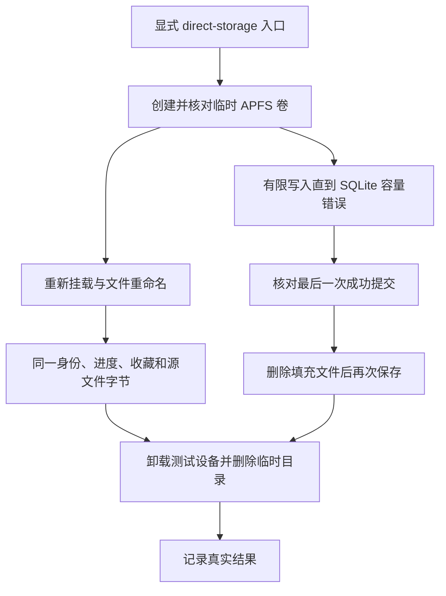

# Disposable-volume storage acceptance

## Entry point

Run `./scripts/test-dev.sh --direct-storage` on the pinned macOS toolchain. It builds the existing hostless test bundle and selects only `StorageIntegrationTests`; it does not launch Bomu or a test-host window. Routine `--direct-hostless` runs skip these two cases. The XCTest subprocess receives only the required system paths and the explicit storage opt-in, rather than inheriting unrelated shell credentials.

The tests create 64 MiB sparse APFS images under unique temporary directories. Mounting uses `hdiutil -nobrowse`, and the returned image device and mount path are checked before use. At least 256 MiB of host free space is required. Test teardown detaches the observed test device before removing its directory; a failed detach leaves the directory in place and fails the test. Cleanup never recursively removes a still-mounted directory.

## Covered behavior

### Volume identity

The checkpoint database stays outside the disposable media volume. The test indexes one fixture, saves a checkpoint and favorite, unmounts the volume, mounts a second temporary image to occupy the prior attachment slot, and remounts the first. It requires the POSIX device number to change while the volume UUID and inode remain equal. After renaming the file, the same store must return the original media row and checkpoint and retain the favorite; source bytes must remain unchanged.

### Capacity failure

The checkpoint database lives inside the disposable volume; the media fixture stays outside it. The test commits a checkpoint, truncates the WAL, and fills a separate file until the filesystem reports an actual out-of-space error. APFS may still have enough allocatable blocks for SQLite, so the test performs at most 256 further checkpoint saves until SQLite itself reports `SQLITE_FULL` or a storage I/O error. A filler-write failure alone is not a passing result.

After the database write fails, a separate connection verifies the last successfully committed position. Removing only the generated filler file must allow another save and normal checkpoint lookup. The test does not fill the Mac's main filesystem and does not modify user media or the user's library database.

### 验收与清理链路

专项入口使用独立临时卷；只有底层存储错误、已提交数据保留和恢复保存均被观察到，容量验收才通过。

## Limits

These tests exercise the production persistence store and real APFS allocation/mount behavior. They do not prove native offline-card presentation, physical USB disconnection during decoding, network filesystem behavior, or the user's main disk becoming full. Those remain separately scoped acceptance cases. The main app is not started by this entry point.

## Observed results — 2026-10-19

The 13:32 explicit storage run passed both tests with zero failures and zero skips. A 15:07 rerun after the current persistence and integration changes again passed both tests: SQLite returned result code 13 (`SQLITE_FULL`), the last committed checkpoint survived, and saving recovered after the filler was removed. The remount test observed device 16777247 → 16777255 with unchanged inode 16, then verified the original media row, 42-second checkpoint and favorite after rename.

The 15:06 full hostless run passed 175 XCTest cases (177 discovered, 2 disposable-volume cases skipped) and 148 Python checks. The separate 15:07 storage run passed both opt-in cases. This verifies that normal testing does not accidentally mount disposable volumes. Both direct XCTest paths run with an explicitly restricted environment. The disposable images were detached and cleaned by the test; no application window, user media or library database was used.
