# B11 media regression preparation

B11 requires 60 local samples, 30 minutes of synchronization acceptance, 100 file switches, and sleep/wake recovery. The source preparation below enables those checks; it does not close B11 or its dependencies.

The earlier app-host and incomplete long-run results are retained in the [dated B11 validation record](../native-poc/b11-validation-2026-10-15.md). That record is historical evidence; the full B11 acceptance remains open.

## Matrix and ownership

`generate-media-suite.py --suite b11` reuses A04's audiovisual cases and adds distinct codec, container, frame-rate, dimension and audio-format combinations. A04's 30-case matrix, including audio-only, silent and invalid inputs, remains unchanged. Fixtures contain only generated patterns and mathematical tones and are dedicated to CC0-1.0.

An audit found three duplicate encoding recipes under different filenames: FLAC stereo, PCM16 and AAC 5.1. B11 now replaces them with FLAC stereo at 96 kHz, float32 PCM and AAC 7.1. The generator rejects duplicate encoding parameters within the same container, ignoring filename and descriptive label; renaming an existing case does not increase coverage. Each generated file must match actual FFprobe properties and fully decode every audio/video stream before a success manifest is written. This is synthetic parameter coverage, not coverage of 60 independent camera or editor implementations.

The current manifest and media stay in `.build/b11-media-suite`. [Compact preparation evidence](b11-preparation-2026-10-19.json) records the generator, manifest identity, per-file hashes and actual stream parameters without committing media or duplicating the full probe output.

## Benchmark compatibility and evidence

The independent benchmark is a caller of the production `PlayerModel` API. Its absolute-seek actions now retain their original request IDs, matching the application timeline contract. A missing request fails explicitly. Both media-matrix seeking and replacement-burst seeking use this boundary.

`./scripts/build-dev.sh --benchmark -quiet` compiles this target without generating media or launching a window. CI now runs that entry separately, so API changes cannot leave the visible benchmark unbuildable while the application alone stays green. Local compilation does not establish that the updated GitHub workflow has run.

The report summarizer now recognizes `b11-suite` and requires:

- 60 distinct passing audiovisual cases in one continuously visible window;
- 100 completed pause/resume cycles and 100 file switches, with distinct request IDs in matrix order;
- at least 1,800 seconds of measured wall time and visibility observation, with advancing media time;
- release of the core, render context and graphics context.

The native driver still owns the real decode, new-frame, pause, seek, output and resource checks. Summary tests use synthetic report data to validate acceptance rules, not to claim playback. Source-aligned flashes and pulses are not physical speaker/display synchronization measurements. Sleep/wake notification counts likewise do not prove post-wake audio/video recovery; the report explicitly preserves that pending gate.

### Evidence flow

The matrix and the visible benchmark retain separate results so fixture success cannot be mistaken for product acceptance.

```mermaid
flowchart LR
    Recipes[Distinct encoding recipes] --> Generate[FFmpeg generation]
    Generate --> Probe[Actual stream parameter checks]
    Probe --> Decode[Full audio and video decode]
    Decode --> Manifest[Licensed manifest and hashes]
    Manifest --> Native[One-window production playback benchmark]
    Native --> Report[Measured per-case, switch and soak records]
    Report --> Summary[Strict B11 automated evidence summary]
    Summary --> Pending[Listening, physical sync and sleep recovery remain separate]
```



## Verification — 2026-10-19

- The duplicate-recipe rejection test first failed against the old generator, then passed after correction.
- All 60 generated files passed recipe/probe checks, complete audio/video decode and manifest hash verification; there are 60 distinct file hashes. Total media size is 193,596,747 bytes (about 185 MiB); no additional archive was created.
- A compile-only benchmark build reproduced the stale seek API call; both callers were corrected and the final Xcode 27.0 build passed.
- All 148 Python tests passed, including incomplete matrices, repeated/out-of-order requests, short/nonadvancing playback, insufficient visibility duration, nonfinite time and unreleased-resource rejection. Shell syntax and diff whitespace checks passed.
- No new Bomu window was launched. The most recent Screen 1 check was locked. Native playback of this 60-case matrix, 100 switches, the 30-minute run, listening and sleep/wake recovery remain unverified.

To prepare or inspect without using the desktop:

```sh
python3 scripts/generate-media-suite.py --suite b11
python3 scripts/media_fixtures.py .build/b11-media-suite
./scripts/build-dev.sh --benchmark -quiet
```

The separate `./scripts/benchmark-dev.sh --b11-suite` command performs visible playback and must follow the single-window, Screen 1 constraint. Do not run display-transition modes or sleep the user's Mac implicitly.
