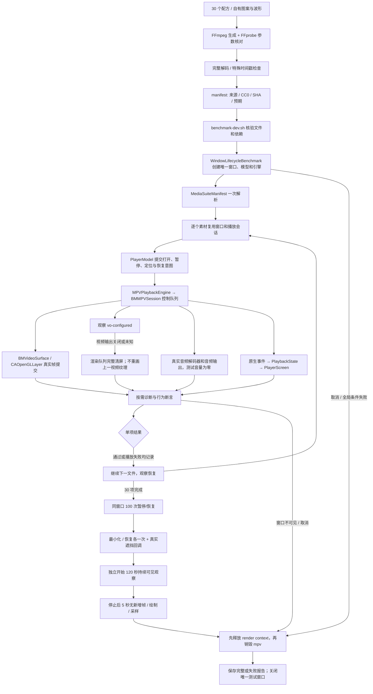
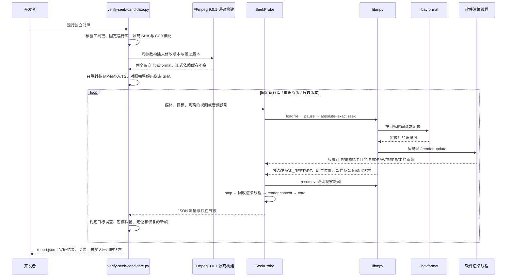
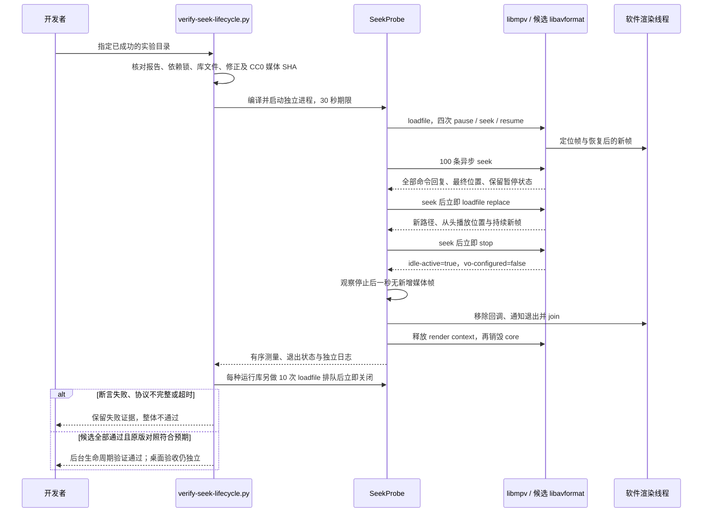
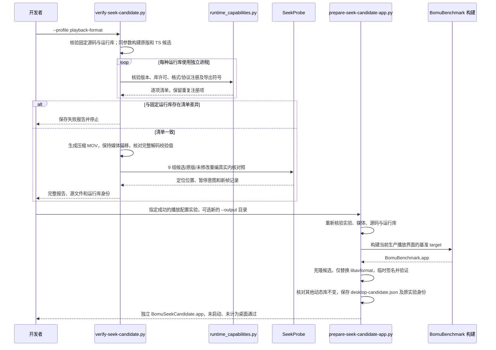
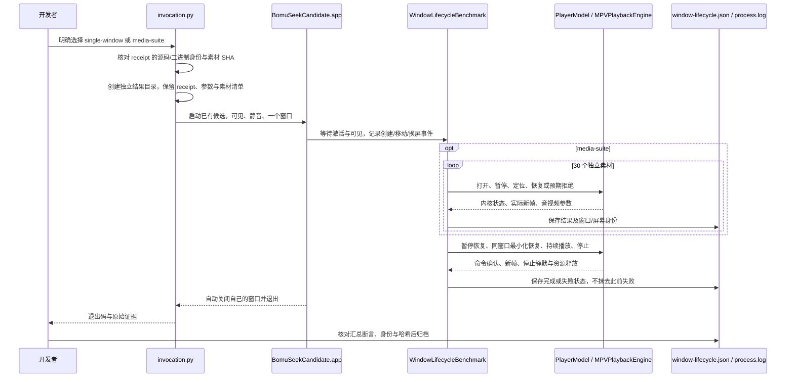

# 真实调用链

## 素材矩阵与单窗口播放

以下链路使用正式播放页面与渲染适配层，分别记录素材结果、窗口可见性和资源释放。

存在素材失败时，后面的独立检查可以继续执行，但最终整体仍失败。主动最小化、素材播放和持续播放的可见性记录互相独立。交付结果以实际报告为准，图中流程不代表每轮必然走完。

## TS 定位的独立内核对照

该链路用于隔离解封装问题，所有帧写入内存，声音送入 null 输出。它不启动应用窗口，也不提供桌面播放或实际听感验收证据。

源码修正限定在 MPEG-TS 视频包的定位语义。脚本不会根据文件名或扩展名修改播放器策略，也不会改写正式 `Dependencies.lock.json`。任何构建、协议、超时或候选行为失败都会阻止实验整体通过；原版已知失败作为对照如实保留。

## 候选内核的交错操作与释放

该链路复用已经验证的实验运行库，单个子进程始终拥有自己的 core 和渲染线程；可见应用与正式依赖均不受修改。

该工具检查 libmpv 命令交错，不提供应用层 request ID、OpenGL、实际声音或物理同步证据。时间测量在 core 销毁后使用系统单调时钟，避免再次调用已失效的 mpv handle。

## 播放用候选构建与独立应用准备

该链路补齐最小诊断配置不覆盖的读取能力，先核验运行库清单和实际媒体行为，再准备供单窗口验收的应用。准备应用的步骤不会启动它。

正式依赖缓存和 `Dependencies.lock.json` 不参与修改。清单比较、内存帧、应用构建和临时签名分别提供有限证据；可见播放、物理声音和发行条件仍有独立验收边界。

## 候选应用的单窗口运行与归档

2026-10-14 的运行复用已准备的应用，通过各结果目录保留的 `invocation.py` 启动。运行期间仅读取进程日志，不接入桌面操控工具；短时诊断与完整矩阵分别保存，不改变准备时 receipt。

- 完整矩阵的 100 次暂停恢复及 120 秒持续播放与短诊断分开记录；短诊断不计作完整验收。
- 同屏、可见性及新帧断言保留；窗口发生变化时不能通过强制搬回或抢焦点修饰结果。
- 自动报告、用户实际观感和物理音画同步各有证据边界。正式运行库仍未替换，工具链升级后的重建也需独立验证。
