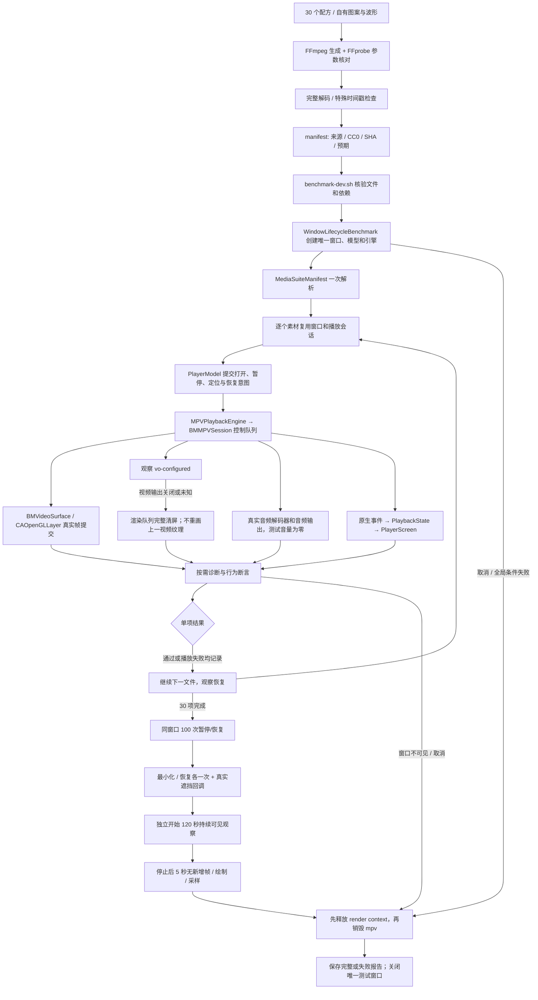
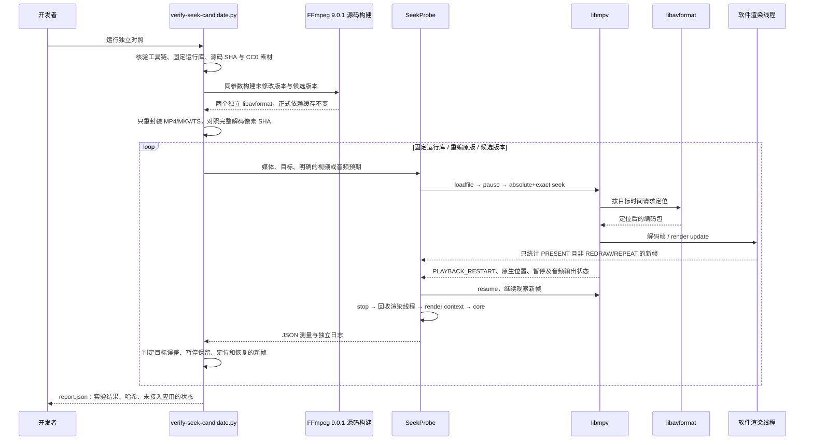

# 真实调用链

## 素材矩阵与单窗口播放

以下链路使用正式播放页面与渲染适配层，分别记录素材结果、窗口可见性和资源释放。

存在素材失败时，后面的独立检查可以继续执行，但最终整体仍失败。主动最小化、素材播放和持续播放的可见性记录互相独立。交付结果以实际报告为准，图中流程不代表每轮必然走完。

## TS 定位的独立内核对照

该链路用于隔离解封装问题，所有帧写入内存，声音送入 null 输出。它不启动应用窗口，也不提供桌面播放或实际听感验收证据。

源码修正限定在 MPEG-TS 视频包的定位语义。脚本不会根据文件名或扩展名修改播放器策略，也不会改写正式 `Dependencies.lock.json`。任何构建、协议、超时或候选行为失败都会阻止实验整体通过；原版已知失败作为对照如实保留。
