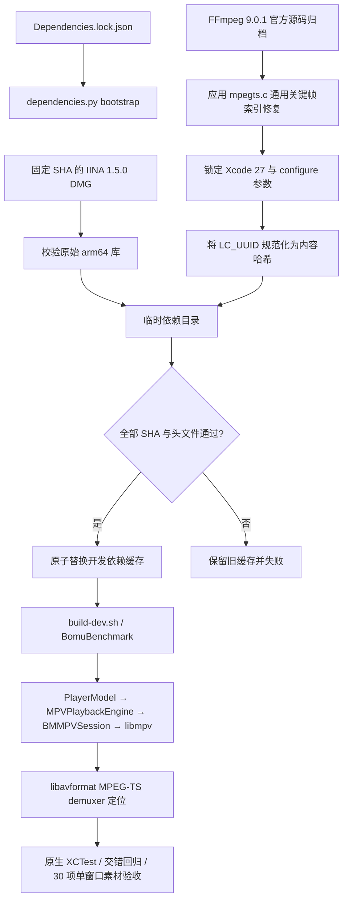

# MPEG-TS 定位修复接入

更新：2026-10-14。状态：FFmpeg 9.0.1 的通用 MPEG-TS 定位修复已接入开发依赖锁；Xcode 27 下独立重建、正式 Bomu 开发构建、原生 XCTest、单窗口交错回归、30 项素材回归，以及最终单屏 100 次暂停/恢复和 120 秒持续播放均通过。独立最小化恢复探针发现 macOS 将外接屏上的测试窗口恢复到内屏，本轮同屏长播因此单独跳过该探针。发行包仍不可构建：依赖配置继续标记 `development-poc-only`，且 FFmpeg 开启 GPL。

## 设计

故障来自 FFmpeg MPEG-TS 时间戳搜索：搜索过程把任意视频包加入关键帧索引，并可能把非关键帧包作为 seek 起点。修复在固定版本 `mpegts.c` 中只把真实关键帧作为视频 seek point；音频索引仍可作为 seek point。解码器、容器注册和协议保持 FFmpeg 9.0.1 的播放格式配置，不按文件名或样本特判。

修复只覆盖开发锁定的 `libavformat.63.dylib`。libmpv、libavcodec 和其余 IINA 1.5.0 运行库沿用原始二进制。`Config/Dependencies.lock.json` 记录原始 DMG 身份、FFmpeg 官方源码归档 SHA、补丁 SHA、完整 configure 参数、基础解封装库 SHA 和修复库 SHA。播放器 C API 和 Swift 状态模型没有改变。

构建产物含有链接器随机生成的 Mach-O `LC_UUID`。构建器先将该 128 位调试身份替换成“除 UUID 字段外完整 Mach-O 内容的 SHA-256 前 128 位”，再验证并进入依赖锁。来自两个全新源码目录的构建结果均为 `d8d597689bd03c78d6ab743e981d4982948bac8385f22a452853d59bbd09058e`。macOS 要求该动态库包含 `LC_UUID`，因此构建不关闭 UUID；规范化仅去掉链接器的随机性，不改变代码或 ABI。

`dependencies.py bootstrap` 在临时目录挂载经 SHA 校验的 IINA DMG，验证全部原始运行库后构建 FFmpeg overlay。只有每个库和头文件都匹配锁后，脚本才通过同文件系统目录重命名替换 `.build/dependencies/lib`；构建失败时旧缓存保留。普通构建通过 `dependencies.py check` 验证缓存，再由 Xcode embed 阶段签名复制到 app。

## 实际调用链

普通文件打开仍从 `BomuApp.onOpenURL` 到 `AppLifecycle.player`，再进入生产 `PlayerModel.open`。会话初始化后，`MPVPlaybackEngine` 把请求送入 `BMMPVSession` 的串行控制队列；C session 调用同一个 mpv core。mpv 通过锁定的 libavformat 为 TS 找 seek 起点，返回时间戳、定位完成事件和新帧，再经现有 snapshot 与 `PlayerModel` 的 request ID 校验更新界面。没有新播放器或旁路播放路径。

快速交错验收通过开发专用 `BomuBenchmark` 使用相同的 `PlayerScreen`、`PlayerModel`、`MPVPlaybackEngine` 和 `BMMPVSession`，在一个普通窗口内提交 12 个将立即停止的打开请求、停止并等待原生 idle，再提交 24 个连续替换。最后一个请求必须为 TS；报告断言 request ID 保持最新、暂停定位到 0.2 秒误差内、恢复后出现新帧、core/render 各只创建一次，并在退出后释放。静音回归不代表听感或物理音画同步。

## 验证结果

工具链：Xcode 27.0 (`27A266a`)、Swift 6.4、macOS SDK 27.0 (`26A425`)、Swift 6 模式、macOS 14 arm64。锁定依赖 bootstrap 已从 IINA 包和官方 FFmpeg 归档重建；规范化产物 SHA 与两次隔离重建一致。正式 `Bomu` 开发构建通过。

| 检查 | 结果 |
| --- | --- |
| Python 测试 | 54/54（52 项既有测试 + 2 项 overlay 锁与可重复 UUID 行为） |
| 无宿主 Swift 测试 | 12/12 |
| 原生 XCTest | 5/5，真实 libmpv；同一个宿主窗口 |
| 正式应用交错回归 | 12 个停止前打开 + 24 个替换；TS 定位后恢复出帧；资源各 1 次创建并正常释放 |
| 正式应用素材回归 | 30/30，包括 16:9 TS、定位/恢复、损坏输入恢复、音频解码属性；同一内屏窗口 |
| 生命周期 | 最终长播固定在外接屏 ID 3；100/100 次暂停恢复；120.09 秒持续播放，3598 帧（29.96 帧/秒）；AppKit 未报告遮挡 |
| 停止与关闭 | 停止后帧、draw、snapshot 增量均为 0；退出后 core 与 render context 均释放 |

最终配置下的交错报告为 `.build/benchmarks/20261014-153312/window-lifecycle.json`。最终配置下的媒体套件报告为 `.build/benchmarks/20261014-153504/window-lifecycle.json`，30 项全部通过；其后 6 次暂停/恢复通过，第 7 次检查发现窗口被遮挡，套件按设计中止。随后单独运行生命周期场景，仍在第 6 次循环后检测到同一窗口被遮挡，报告为 `.build/benchmarks/20261014-154128/window-lifecycle.json`。两次报告都记录了 core 与 render context 释放；没有强制置前、切屏或再开测试窗口。前一次报告 `.build/benchmarks/20261014-153334/window-lifecycle.json` 在第 26 项时也观察到窗口变为不可见，因此不作为媒体覆盖率失败。旧配置报告 `.build/benchmarks/20261014-151402` 中的 100 次暂停恢复和 120 秒播放是在 FFmpeg overlay 仍关闭 muxer 的配置下完成，不能作为当前最终依赖的验收证据。完整同屏生命周期报告为 `.build/benchmarks/20261014-154944/window-lifecycle.json`：100 次循环、120.09 秒静音播放均完成，显示器 ID 3 保持不变，停止后计数无增长，退出后两项原生资源释放。长播期间 AppKit 未报告遮挡。报告汇总为同目录 `summary.md`。最小化/恢复探针另行验证时，恢复后的新帧正常，但 macOS 将测试窗口从显示器 3 放回显示器 1；因此本轮长播显式跳过该探针，避免窗口跨屏。此系统行为不等同于已确认正式播放器窗口也会迁移。最终配置报告摘要及文件身份见 [验证记录](ts-seek-integration-2026-10-14.json)。

自动化确认视频帧提交、定位数值和恢复后的新帧，不替代人工观感、真实音频听感、实物显示器色彩校准或物理音画同步。用户此前对另一轮画面回答“没观察到，暂不确认”，本次也未作人工画面确认；声音静音，不把声音验收写成通过。发布流程仍需另行完成 GPL 义务、依赖许可证清单、签名和公证。
