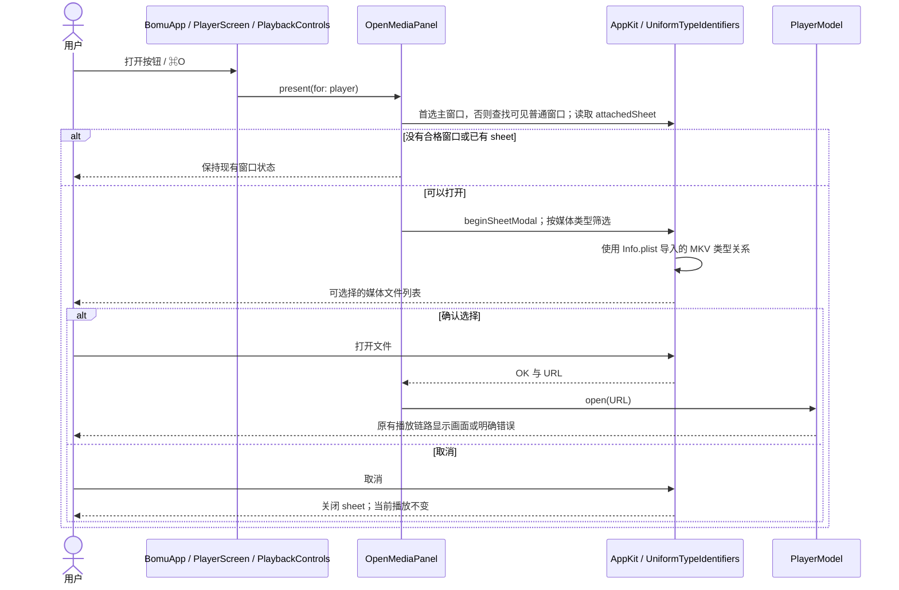

# 系统文件打开入口

日期：2026-10-14。状态：已实现并完成本机入口验证，归入 `v0.0.1-dev.2`。

## 问题与实现

本机原有 `.mkv` 解析为 `dyn.ah62d4rv4ge804450`，不符合 `NSOpenPanel` 的视频/音频筛选条件。内核直接打开 MKV 的用例通过，不能证明用户能在普通文件列表中选中它。

`Config/Info.plist` 现在通过 `UTImportedTypeDeclarations` 声明 `org.matroska.mkv`，归属 `public.movie`，对应扩展名 `mkv` 和 MIME `video/x-matroska`。它是外部文件格式，使用 imported 声明；不引入 Bomu 私有格式，也不放宽选择器为所有文件。MKV 的类型继承关系由系统管理；Swift 的 `MediaFileType` 维护产品接受的媒体扩展名集合，供打开面板和文件夹扫描共用。

类型声明遵循 [Apple 的类型声明规则](https://developer.apple.com/documentation/uniformtypeidentifiers/defining-file-and-data-types-for-your-app)；标识与现有社区实现一致，例如 [QuickLookVideo 的类型配置](https://github.com/Marginal/QuickLookVideo/blob/master/mdimporter/Info.plist)。应用继续以 `Alternate` 提供打开方式，不设置用户默认播放器。

2026-10-23 补核：当前 `MediaFileType` 的扩展名集合用于打开面板筛选和文件夹扫描；`Info.plist` 的 imported 声明负责 MKV 与系统 `public.movie` 的类型关系。正常系统上下文中只读查询了 MKV、MP4、MOV、TS、WebM、AVI、MPG、FLAC、WAV、MP3 和 M4A：每项系统实际类型都继承预期的 movie/audio，且与选择器按扩展名取得的类型一致。此项只验证类型标识，实际面板选择和播放结果仍以单窗口验收为准。

随后逐项审计 54 个声明的扩展名，发现 `alac`、`mp2v`、`mps`、`tod`、`weba` 的系统实际类型与原先强制声明为 movie/audio 的动态类型不同，打开面板可能将文件置灰。选择器现在直接使用 macOS 对各扩展名的实际类型；同一系统注册表下复核为 54/54 可匹配。新增 hostless 行为测试覆盖这些差异项和常见格式；Xcode 27.1 Debug 构建、静态分析、148 项 Python 检查和 183 项 XCTest 均通过（2 项显式 APFS 用例按入口跳过）。这修正的是文件选择入口，尚未在规范 Debug 窗口逐项点击五种文件，也不声称它们已解码播放。

入口边界不同：文件夹递归扫描按上述扩展名集合筛选；用户直接提供的本地普通文件（拖放或系统打开方式）经过非目录、非符号链接检查后会交给 libmpv 尝试加载，失败由播放器明确显示。该直接路径不构成对清单外格式的支持承诺。`.m3u8` 未列入本地格式清单，也没有流媒体 URL 输入入口；若用户直接提供一个本地播放列表，能否打开及其外部引用行为尚未验收，不能据此宣称 HLS 已实现。

实测同时复现了重复触发“打开”产生多个非模态面板的问题。`OpenMediaPanel` 改用 `beginSheetModal(for:)`，所有入口共用所选窗口的 `attachedSheet` 状态。当前优先使用 AppKit 主窗口；辅助功能操作发生在应用非活动状态、`mainWindow` 为空时，回退到一个可见、可成为主窗口的普通 Bomu 窗口。找不到合格窗口或已有 sheet 时不创建新面板；取消和结束由 AppKit 管理，不额外复制一个“是否打开”的全局状态。这个回退已构建并通过静态分析，实际 Open Video 与外置字幕面板仍待同一规范 Debug 窗口可见复验。

## 验证

使用同一屏幕上的一个 Bomu 窗口，未执行全屏切换、屏幕迁移或改变窗口尺寸。

| 检查 | 实际结果 |
| --- | --- |
| `17-h264-flac.mkv` | 普通列表可选；打开后显示该文件名、真实进度与视频画面 |
| `18-hevc-main10.mkv` | 普通列表可选；打开后显示该文件名、真实进度与视频画面 |
| `28-two-audio-tracks.mkv` | 普通列表可选；打开后显示该文件名、真实进度与视频画面；未验收音轨切换 |
| `03-high-1080p30.mp4` | 正常打开和出画面；暂停控制可用 |
| 普通列表点击 `README.txt` | 不改变当前 MKV 选择；文本继续呈灰色，不是媒体类型 |
| 重复 ⌘O | 保留一个附着面板；取消一次即回到播放器 |
| 播放暂停后打开并取消 | 仍是原 MP4，位置保持约 0.633 秒，暂停状态不变 |
| 系统打开方式 | 刷新本地构建的 Launch Services 注册后，三种 MKV 均解析为 `org.matroska.mkv`，且候选打开应用包含 Bomu；MP4、MP3 对照保持正常 |

系统面板的“前往”输入完整路径可以预选原本呈灰色的文本文件，因此负例使用普通列表点击验证，不能把文件类型筛选当作内容安全或可解码性验证。真正的加载/失败仍由播放内核处理。开发产物位于隐藏构建目录，系统注册可能尚未刷新；本轮显式刷新了这个应用的注册，未修改默认打开应用。

固定工具链的正式开发构建通过。52 项 Python 行为测试、12 项无应用宿主的 Swift 逻辑测试通过；上述界面操作为实际手工自动化验证，没有将其计入单元测试数量。30 个合成媒体文件的 SHA-256 全部保持一致。构建首次遇到执行环境限制，允许访问 Swift 宏插件服务后使用相同工具链构建成功。

证据摘要、源文件与本地产物校验值见 [file-opening-validation-2026-10-14.json](file-opening-validation-2026-10-14.json)。这一轮未重新证明物理音画同步、色准、音轨选择、长期资源占用或 TS 精确定位；既有内核证据及未完成项仍见 [requirements.md](requirements.md)。

## 实现状态与完整链路

所有现有打开按钮与 ⌘O 共用下面的文件选择链路，确认后继续原有异步播放流程。系统直接打开文件仍经 `BomuApp.onOpenURL` 调用同一个 `PlayerModel.open`。播放、失败恢复与退出的完整链路见 [flow.md](flow.md)。

### 文件选择与取消

类型声明负责系统识别，选中的普通应用窗口负责面板归属，只有确认选择才向模型提交新文件。

