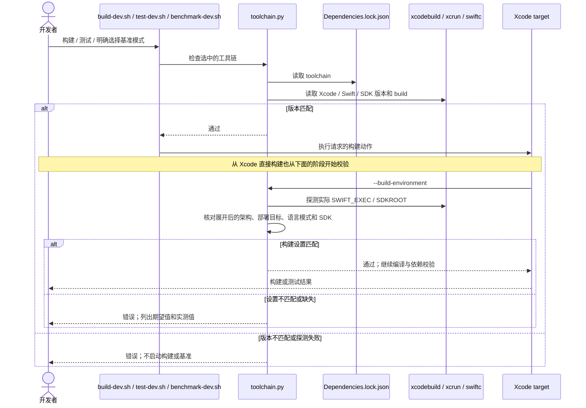
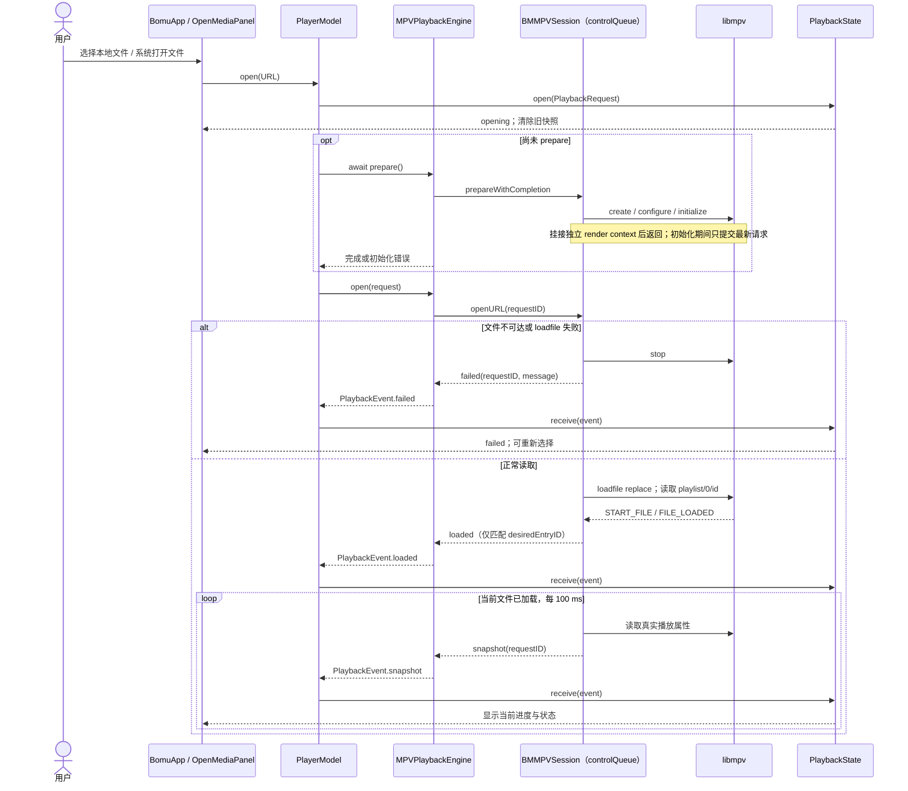
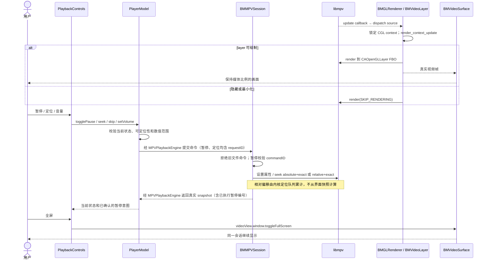
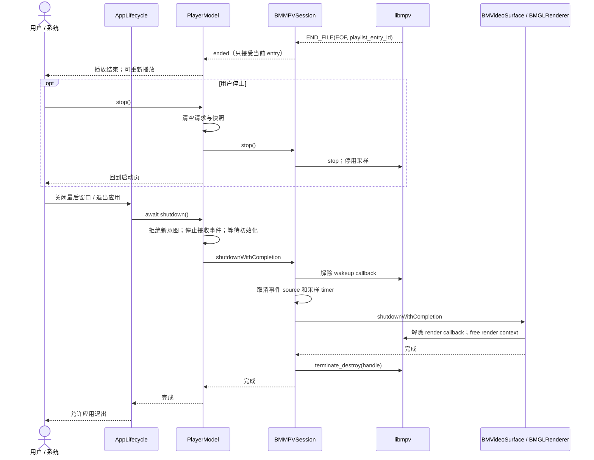
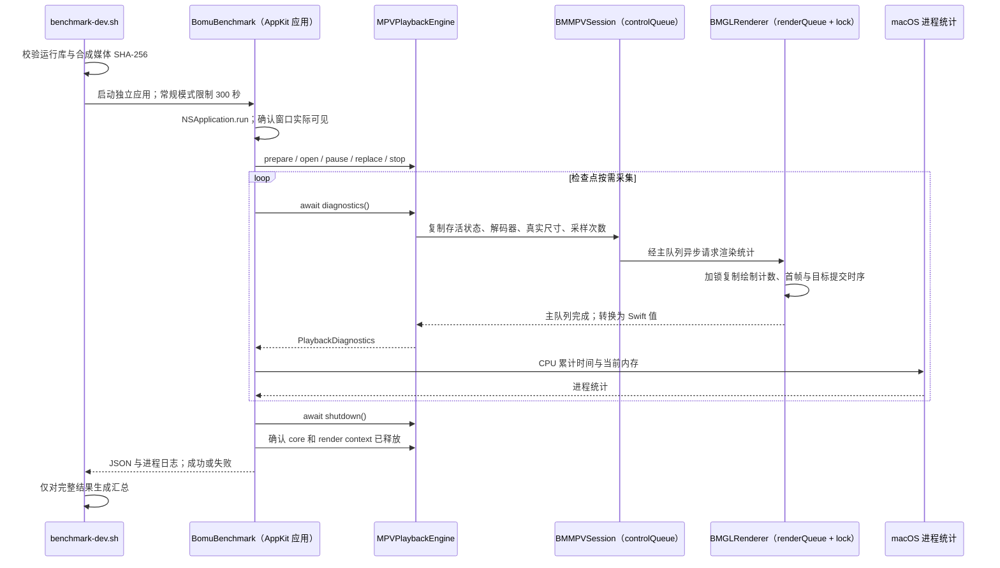
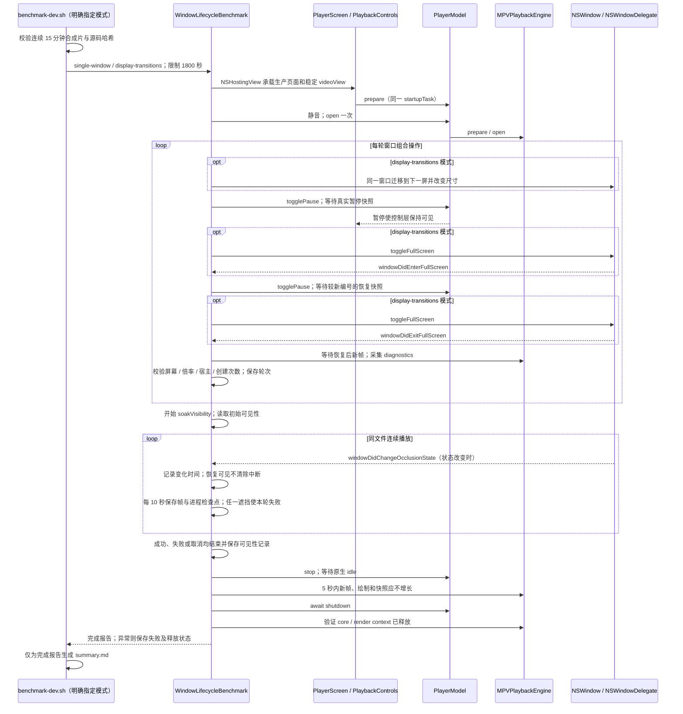

# 原生播放完整链路

以下链路对应本次实现的 `BomuApp`、`PlayerModel`、`BMMPVSession`、`BMVideoSurface` 与 `PlaybackState`。所有媒体读取发生在本机，不写原视频，不经过业务服务器。

## 开发构建与工具链校验

构建、测试和基准共享工具链锁。Xcode 中直接构建也经过 target 的首个检查阶段，避免只在入口脚本中校验而遗漏实际构建参数。

- 检查只读取当前工具链；不会修改系统 Xcode 选择或安装工具。
- 基准保存经过校验的 `toolchain.json`，运行库与媒体仍分别校验 SHA-256。

## 打开、替换与播放状态

系统文件入口和选择面板汇入同一模型。图中将原生内部串行队列标在相应参与者后，体现异步命令与结果的区别。

`OpenMediaPanel` 仅在主窗口存在且没有附着 sheet 时创建选择面板，取消不提交 `open`。MKV 的导入类型在 `Info.plist` 中归属 `public.movie`，系统完成类型解析，播放层不按扩展名分支。选择器与系统打开方式的具体回归见 [file-opening.md](file-opening.md)。

- `PlaybackState` 丢弃旧 request ID，即便事件已排进主线程也不会覆盖当前文件。
- `loadfile` 成功只表示接受命令；`FILE_LOADED` 才进入 ready，首个快照之前控制仍禁用。
- 用户文件保持原位，仅由 libmpv 只读打开。损坏文件恢复走同一 `open` 链路。

## 视频绘制、暂停和定位

视频 callback 独立于 SwiftUI 刷新；控制命令通过控制队列执行，快照确认后再更新界面。

- 时间线拖动期间只保留局部预览，释放时提交一次 seek；seek 不改变暂停状态。
- 前后跳转提交 `.relative`，拖动提交 `.absolute`，连续操作均由内核定位队列排序；进度仍只展示原生快照。所有定位入口共用 `canSeek`。
- 悬停、焦点、拖动和暂停会保留控制层，恢复空闲后重新计算隐藏时间。
- 普通 mpv 命令不进入 render 路径，渲染也不等待控制队列。核心采用音频时钟与零提前量，绘制和隐藏跳帧均不等待未来目标时间。
- 暂停意图按请求与命令编号确认；布尔值相同的旧状态不能提前确认新意图，旧编号不能覆盖已确认的新状态。

## 自然结束、停止与退出

自然 EOF、手动停止和应用退出是不同用例。退出必须按资源依赖顺序完成才能允许进程结束。

- 退出 task 由模型持有，重复调用等待同一个 task，不重复释放资源。
- 所有跨队列步骤异步串接，没有主线程同步等待控制队列的调用。
- 完整验收和未验证项见 [requirements.md](requirements.md)。

## 开发基准与诊断采集

该入口属于同一工程中的独立开发工具，不进入产品界面。诊断只复制资源所有者提供的事实，不改变播放阶段。

文件名、用户路径与媒体内容不进入诊断对象。首帧发生在渲染成功且 `glFlush` 之后；重绘旧帧或绘制空白背景不算首帧。指标口径与复现方式见 [benchmark.md](benchmark.md)。

## 正式界面的窗口验证

`--single-window` 使用同一个普通窗口承载正式 SwiftUI 页面。只有明确选择 `--display-transitions` 才执行下图中的可选迁移和全屏步骤。全屏完成来自系统委托回调，调用 `toggleFullScreen` 本身不代表通过。

2026-10-14 单窗口模式移除 `.moveToActiveSpace`，启动先等待激活、主窗口焦点及可见状态；窗口创建、显示、移动和换屏会留下位置日志。两次候选启动仍有屏幕变化失败，新日志尚未取得运行证据，不能据此宣称跨屏问题已解决，见 [候选启动记录](../media-suite/desktop-candidate-validation.md)。

- `WindowLifecycleReport` 与常规播放基线使用独立 schema；原始输入、源码与日志仍放在同一个运行目录。
- schema 3 的汇总要求可见性观察已经结束且没有遮挡记录；schema 1/2 汇总明确说明只验证过周期采样点，不升级历史证据。
- 播放器只打开长片一次；素材生成器将有许可的合成片复用为连续时间戳文件，不通过播放器反复 seek 或 reopen 冒充连续播放。
- 报告中的图层提交、屏幕属性和短时进程统计不能代替物理音画同步、色准或长时间泄漏验收。
