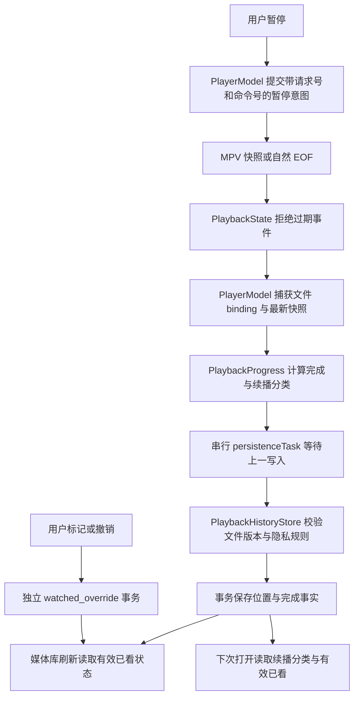

# 完成判定、短片续播与暂停检查点

本批落实 2026-10-26 仓库审查中的 R04/B07/C16 缺口，保留现有单会话、文件版本绑定、私有目录和串行写入合同。功能实现与阶段验收分别记录；不据此关闭 A02/A07/A08/A10 或公开发行门槛。

## 用户行为与事实源

- 暂停命令由当前请求与递增命令号标识。内核确认当前暂停后，立即提交该确认快照的检查点；重复确认不会重复触发暂停保存。过期请求、已经被恢复命令取代的暂停确认不能保存。内核自行从播放进入暂停也保存一次。原有 5 秒、切文件、停止、返回浏览、自然结束和退出保存继续有效。
- 自动已看以真实内核位置和时长判断：不足 10 分钟只用 95%；至少 10 分钟用 95% 或剩余不超过 120 秒。自然 EOF 本身也是完成事实，避免最后一份周期快照稍早导致漏标。完成事实在同一文件版本内保持，重播或向前拖动不会自动撤销。
- 仅已知时长至少 30 秒、有效已看状态为 false，且开启续播偏好时自动恢复位置。短于 30 秒、未知时长、已看文件从头打开。用户明确选择 Continue 仍可使用保存位置，Play from Beginning 和 Replay 始终从头。
- 旧检查点没有可信的时长分类，迁移不猜测。普通打开会从头；明确 Continue 仍可使用旧位置。后续真实播放检查点会更新是否允许自动续播。
- 手工已看/未看有独立优先权。用户将自动已看改为未看后，后续周期保存和 EOF 不得覆盖。撤销恢复原始覆盖值，包括“无手工覆盖”，不把自动状态意外固化成手工标记。

## 持久化模型与迁移

`PlaybackState` 仍拥有瞬时播放状态。`PlaybackProgress` 只从检查点推导两个可恢复事实：`isCompleted` 与可选 `allowsAutomaticResume`，不另存一份时长、解码器或缓冲状态。数据层将它们与位置在同一事务中保存。

新增迁移 `playbackCompletionAndWatchedOverride`：

| 字段 | 含义 |
| --- | --- |
| `playback_history.is_completed` | 该文件版本曾达到完成条件；写入取旧值与新值的 OR |
| `playback_history.allows_automatic_resume` | 已知短片 false、已知至少 30 秒 true、未取得事实 NULL；未知新快照不抹掉已知分类 |
| `media_file_preferences.watched_override` | 手工 true/false；NULL 表示由历史完成事实决定 |

有效已看统一为 `COALESCE(watched_override, is_completed, 0)`，首页继续观看和已看筛选均使用它。原 `is_watched` 列迁移后删除；旧表把默认 false 和手工 false 混在一起，因此只把旧 true 迁移为手工覆盖，旧 false 留为 NULL。这样旧收藏/分类行的默认值不会阻止真实播放后的自动完成。旧版本确实由用户手工选过的 false 无法从原字段识别，升级后也会成为未知；已迁移到新列的现有用户记录不做无依据的批量重写。新建收藏或分类行的覆盖默认为 NULL。

自动已看随历史清除；手工已看、收藏和分类保留。私有目录沿用检查点的拒绝/删除路径，因此不会另在偏好表留下自动观看事实。文件替换沿用打开时捕获的 binding，旧文件位置与完成事实不能写入替换文件。

归档 v1/v2 的身份匹配合同不变，新增可选字段 `File.watchedPreference`、`History.isCompleted` 和 `History.allowsAutomaticResume`。新归档往返保留自动/手工语义；旧归档没有这些字段时，仅将 true 当作手工已看，false 按来源未知处理，时长分类也保持未知。旧阅读器可忽略新增字段并保留有效已看值，但不能保留新增的自动来源语义；不宣称旧版降级能无损往返。

旧历史的 `allows_automatic_resume=NULL` 不能证明视频不足 30 秒。普通打开先从头开始；若当前请求加载后提供可定位的真实时长，且保存位置未达到完成条件、时长至少 30 秒，`PlayerModel` 为该请求只发送一次恢复定位。短片、已完成、手工从头及被后续文件替换的请求不会触发这个定位。明确点选 Continue 仍直接使用保存位置；未知时长一直未知时不自动跳转。

## 调用链与资源归属

`PlayerModel` 持有写入任务，切文件和恢复等候前序写入，退出排空。`PlaybackHistoryStore` 持有连接和迁移，UI 不接触 GRDB。`toggleWatched` 在同一事务返回新值和旧覆盖，`MediaLibraryModel` 的撤销任务使用该旧覆盖，避免先读后写竞态。

## 验证记录

2026-10-26 当前功能源码的 `--direct-hostless`：167 项 Python 通过；221 项 XCTest 中 219 通过、2 项显式 APFS 专项跳过，0 失败。新增覆盖：暂停确认去重/过期隔离、阈值与未知时长、EOF 后先保存再切下一项、自动已看/手工未看/撤销、历史清理、旧库迁移、归档往返以及 Continue Watching 实际查询链。原有文件替换、事务失败、隐私和迁移恢复回归保持通过。

首次补充回归暴露一个旧测试种子缺少时长事实；已为“允许自动续播”的种子明确提供真实场景的 120 秒时长，同时新增未知时长不自动续播的独立用例。没有放宽生产策略来保留旧假设。

同日 `--native` 15/15 通过，新增测试要求暂停时检查点在停止/退出之前存在，并验证追加不改变请求、暂停位置、core/render context 数量；短片正常打开不自动恢复第 6 秒，另一个原生用例明确 Continue 恢复位置和选定音轨。测试通过 `TEST_RUNNER_BOMU_ACCEPTANCE_LIBRARY_DIRECTORY` 注入标记临时库，已确认数据库在临时目录初始化；宿主退出后清理。全程一个宿主窗口，无全屏/跨屏操作。日志及 xcresult 的索引见落地清单。

最终 Debug 构建、静态分析、身份核验通过：`0.0.1 (2)`，仅英文，源码摘要 `43a8d4cdda56c24d9ea5e47785a4b0cd6cfdccbe46ddc5b1ac9ea8674f2cca22`。正常用户库也完成升级，迁移前后来源/文件/历史/偏好行数均为 `2/125/36/8`，完整性检查 `ok`，Home 已可见恢复。

第一次正常库重开继承了先前 Welcome 自动化的已删除临时目录，触发显式拒绝；核对进程环境、真实库迁移表和完整性后，以不带验收环境的规范可执行文件重开解决。没有清库、删除备份或为绕过错误放宽存储保护。

规范包三尺寸和新增 UI 入口由协调中的 UI 任务另行检查。原生自动化不证明物理声画同步、色彩或完整 UI。

2026-10-27 补充旧数据语义：普通打开缺少续播分类的历史时，请求绑定到真实时长快照后才决定是否一次定位；旧收藏默认 false 与旧归档 false 不再伪造手工覆盖，旧 true 保留。行为回归覆盖长片/短片/已完成、重复及过期快照、显式从头、旧库迁移和旧归档导入后自动完成。`./scripts/test-dev.sh --direct-hostless` 在 Xcode 27.1 下为 Python 186/186、无宿主 XCTest 235 项中 233 通过、2 项显式存储专项跳过、0 失败；构建和 `--analyze` 通过。构建身份 `b57734c83040254924ae924f0786b61cc35e7a04b76711ebb8f8068b829aa36a`，包为 0.0.1 (2)、仅英文，内嵌回补库哈希 `68befb71…`。这不把旧用户资料库中已经迁移出的 false 行自动重写为未知：旧列没有来源证据，不能可靠区分手工与默认。
