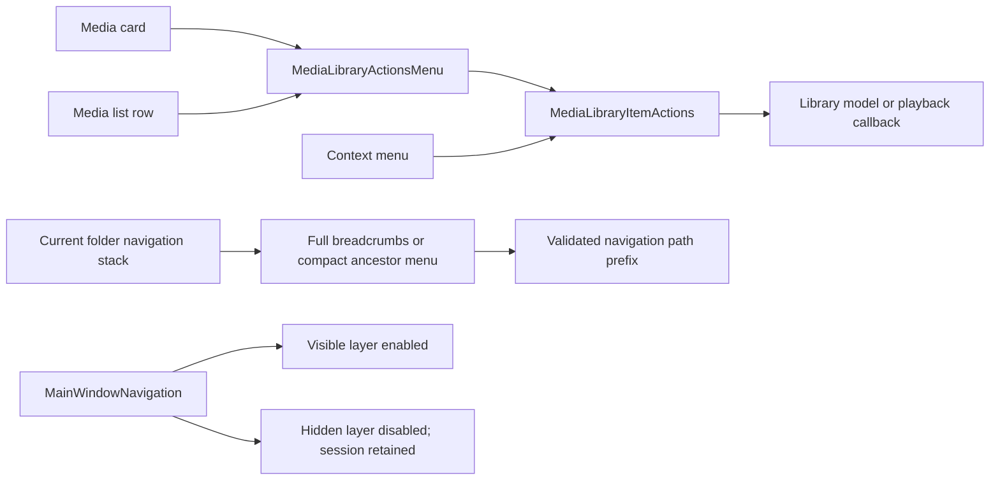
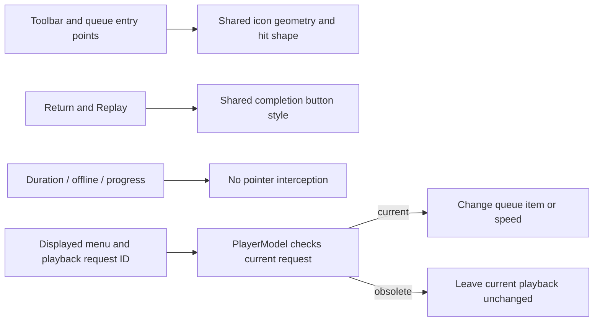

# Application interaction consistency

## Contract

The audit covers the application shell, all five library destinations, folders, grid/list media, playback, recovery/ended states, Settings, and their menus and file panels. A shared visual role has one typography, spacing, shape, and state contract. It does not require a primary playback button, a compact menu, and a navigation row to have identical dimensions.

On 2026-10-19, the Settings section chooser changed from horizontal tabs to a compact vertical list inside the white Settings pane, following the user's direction. The main application sidebar remains unchanged; the Settings list is separated from its form by a subtle vertical rule rather than a second gray sidebar. The rebuilt page was visually inspected in one ordinary window, including the Appearance and Storage content switches. Exact-size comparison and keyboard/VoiceOver review remain part of the pending application acceptance.

`AppTheme` owns the shared values. Sidebar actions share one local button style; folder breadcrumbs share another. System menus retain native keyboard/accessibility semantics. The visible media More actions control uses a SwiftUI popover and needs separate keyboard/VoiceOver acceptance. Model state remains authoritative for selection, playback availability, and saved preferences; views do not introduce duplicate selection or playback state.

| Role | Contract |
| --- | --- |
| Sidebar | Whole 40 pt row is clickable, including transparent padding; 13 pt text, 14 pt symbols, selected/hover/pressed/disabled feedback |
| Media artwork | Equal 16:10 boxes within the same grid; 14 pt corners; loading, unavailable and offline states preserve geometry |
| Media details | 13 pt semibold title and 11 pt metadata; standard grid reserves two metadata lines, Continue Watching and wide list rows reserve one |
| Selection | Artwork outline in grids, flat background in lists; details and blank row space select without starting playback |
| Compact actions | 28 pt target for media actions, dismiss, Undo, View All and breadcrumbs; circular play controls use their entire circle |
| Player toolbar | 35 pt targets; symmetric seek availability; selected menu items reflect actual engine state |
| Folder rows | Shared 44 pt icon bounds and 12 pt vertical insets; one-line names prevent accidental height changes |
| Settings | Native grouped forms, menus and confirmation panels; subtitle slider fills its row and retains an accessibility label |

The two-column Continue Watching section intentionally has larger artwork than the three-column general grid. Cover sizes must match within each role. Media layout is not a masonry layout. Details use real values, explicit loading, or Unknown.

## Corrections

- Sidebar hit testing previously ended at the icon/text. The common row style now defines its hit shape after expansion and padding, covering navigation, sources, Add Folder and Settings.
- Grid selection now has a visible outline; list selection has a background. Thumbnail, metadata and blank selection areas work without absorbing the independent play/menu actions.
- Card/list metadata typography and reserved slots are consistent. Offline list status overlays the thumbnail instead of adding a line that changes row height.
- Source and child folder rows now use the same icon dimensions, disclosure style and vertical insets; long names truncate.
- View All, breadcrumb, Undo, dismiss, current-playback and fullscreen controls have explicit targets. Forward seek now observes the same `canSeek` condition as backward seek.
- Subtitle Off had an inverted checkmark condition. It is checked only when no subtitle track is selected.
- Settings entry now uses SwiftUI's environment `openSettings` action instead of dispatching a string selector. The settings subtitle slider no longer reserves an empty form-label column. Data-management copy describes export/import as well as clearing, rather than presenting all three as deletion.

### Subsequent navigation and menu corrections

Home's Continue Watching `View All` previously opened the entire Library with its retained filters. It now opens the full continue collection, with a Home return action and a dedicated empty state; its sidebar selection is derived from the page route. Grid, list and context actions now share `MediaLibraryItemActions`, including favorite, watched, resume, start-over and current-category feedback. At the time of this source pass, Screen 1 was locked and the changes had only compilation and regression evidence. Later pointer checks are recorded below; full keyboard and VoiceOver acceptance remain open.

Home now shows `View All` only when Continue Watching has more entries than the two already displayed. Empty and fully visible sections do not offer a redundant route.

## Observed validation — 2026-10-19

The canonical English-only Debug app, version 0.0.1 (2), was rebuilt and relaunched. Tests used the existing ordinary Screen 1 window. The main window was minimized before inspecting Settings, then restored after Settings closed; no fullscreen or cross-screen cycle was performed.

| Surface | Observed result | Remaining boundary |
| --- | --- | --- |
| Sidebar | Before-fix right-blank Library click did nothing; after-fix Library, Folders, Favorites, Search, source and Add Folder blank clicks worked; folder panel cancelled | The Settings pointer action was separately verified on 2026-10-23 in the canonical Debug app; exact hit-region edges and keyboard traversal remain open. |
| Home / Library | Current fixture cards align; short/unknown metadata does not shift cover tops; metadata blank space selects; menu and play act independently | Real artwork and three measured point-size layouts |
| Folder list | Final compact rows show equal heights for normal and unknown metadata; thumbnail, right blank space and vertical padding select without playback; double-click plays; favorite/Undo round-trip and grid/list switching work | Native offline-volume and deeply nested long-name walkthrough |
| Favorites / Search | Destinations and empty/search-field states reached | Full keyboard/VoiceOver traversal; broader filters covered by prior C07 checks |
| Player | Replay, pause at 7.933 s, retained controls, speed 1× checkmark, return with Continue at 0:07 and Play/Show Player bar; latest build paused at 7.033 s | Seek-disabled native stream, menu focus during auto-hide, full track matrix |
| Subtitles | Latest build marks Off; loading a generated SRT changes selection to the external track and removes Off's checkmark; Off can be selected again | Multiple/duplicate subtitle tracks and rendered subtitle timing |
| Recovery / ended | Corrupt fixture displays recovery actions and returns to Library; natural end displays Back to Library and Play Again | Additional engine/permission failure presentations |
| Settings | Four tab entries were inspected in the earlier pass; latest subtitle slider spans the form row; clear-library confirmation shown then cancelled; unavailable update action disabled | Import/export panel completion and VoiceOver; no destructive user-data action performed |

The full hostless run at 12:10 passed 143 Python checks and 144 XCTest cases, including active-checkpoint export and failure recovery. Debug build and static analysis passed. Styling was checked in the real app rather than with tests that match source strings. The final compact-list layout was rebuilt and verified in the canonical app. Test favorite state was undone, the grid restored, playback stopped, and the owned app quit. The generated subtitle fixture was removed after use.

On 2026-10-23, the canonical Debug app was reopened in one ordinary window for the previously missing isolated Settings sidebar pointer check. Clicking the visible Settings button removed Home's selected state, selected Settings, and displayed the Appearance page with its five vertical section buttons. This was a single check at the restored nonstandard window size; it does not establish exact target edges, three-size fidelity, or keyboard/VoiceOver access. Quit Bomu completed and the running-app inventory no longer listed it. No system accessibility setting was changed.

## Functional follow-through

The same consistency pass now also covers application-owned export/import preparation and privacy updates, repeated return-to-library refreshes, shared thumbnail requests and offline metadata retention. Accepted writes have one owner, cancellation does not publish stale preparation, and cached facts remain available while sources are offline. The latest 2026-10-19 12:39 hostless run passed 152 XCTest cases and 143 Python checks. These checks extend the functional evidence; they do not replace the pending native checks below. Details and failure-recovery evidence are in the [roadmap](../engineering/roadmap/progress.md).

### Playback waiting follow-through

Opening now provides Cancel through the existing stop lifecycle. Real seeking/buffering flags drive a status indicator and keep controls visible; completion returns to the normal idle-hide policy. [State ownership and validation](../playback/controls/waiting-and-cancellation.md) distinguish model coverage from the remaining native cancellation and layout checks.

### Contextual track actions

Audio/subtitle selection, external subtitle panels and subtitle offsets now carry the request that produced the displayed menu or panel. An obsolete choice cannot target the next file or dismiss that file's error. The delayed-panel regression reproduced both effects before the correction; [track action ownership](../playback/controls/tracks-speed-and-subtitles.md) records the shared boundary and the remaining native handoff check.

### Timeline ownership

Absolute timeline commits now retain the displayed file's request ID. A delayed callback cannot seek a replacement file; per-file control identity resets scrub preview, focus and idle state without resetting the video host. Both seek directions and the timeline reject invalid or unknown duration. The model regression first reproduced the incorrect replacement seek and now passes; native drag/replace validation remains open. See [precision seeking](../playback/controls/precision-seeking.md).

### System playback integration

The system adapter now publishes macOS playback state as well as metadata, stops elapsed-time extrapolation while waiting, updates paused default speed, and rejects stale command registrations. App shutdown prevents late view updates from reacquiring media controls. Hostless tests use a recording system boundary and do not claim hardware media-key acceptance; see [Now Playing ownership](../playback/controls/now-playing.md).

## Application-wide follow-up — 2026-10-19

The follow-up inspected the shell, sidebar, Home, Library, Folders, Favorites, Search, media grid/list actions, playback controls and terminal states, and four Settings tabs in the layout at that time. Shared typography and corners remain in `AppTheme`; native forms, menus and dialogs keep their platform roles rather than being restyled as media cards.

- The inactive library/player layer now disables its controls in addition to hiding pointer and accessibility interaction. Both views and the playback session retain their identities. This closes the missing keyboard-interaction boundary; live focus traversal is still pending.
- Grid and list rows share the visible `MediaLibraryActionsMenu`, including its 28 pt target and accessible name. Its focusable trigger opens a SwiftUI popover; list users can click watched/category/resume/start-over actions without discovering a context menu. The favorite shortcut and native context menu remain available. Keyboard traversal inside the popover is still incomplete.
- Search's initial and no-result states now reuse the library empty-state layout, with the appropriate search symbol. Their title/body typography, icon shape and spacing no longer depend on a separate system empty-state presentation.
- Folder breadcrumbs use the existing navigation stack as their only destination source. At insufficient width, the ancestor buttons collapse into a menu instead of squeezing long names into multiple lines. Both presentations use the same navigation action. The unused path-derived ancestor implementation and its isolated test were removed; the retained navigation test covers root/intermediate destinations, stale destinations, a different source with the same name, and an absent intermediate route.
- Folder headings truncate in the middle on one line, retain the full name in help, and leave the grid/list switch at its intended size. The main Add Folder capsule now explicitly includes its padded shape in hit testing.

The compact breadcrumb arrangement uses SwiftUI's built-in [ViewThatFits](https://developer.apple.com/documentation/swiftui/viewthatfits), which selects the first proposed arrangement that fits. It does not add width measurement state, a separate navigation model, or screen-specific thresholds.

### Shared action and layout ownership

The controls forward intent to their existing owners; visual alternatives do not duplicate business state.

The build, hostless regression and static analysis results for this dated source pass are recorded in the roadmap. Screen 1 was locked during that pass, so its then-current build had no live visual or keyboard evidence; later native observations must be read with their own build and scope. Remaining checks include list-menu keyboard operation, deep long-name paths at all three required sizes, and Tab traversal after switching between Library and Player.

### Cancelling a queued folder selection

The cross-application behavior audit reproduced an indefinitely active scan indicator after selecting another directory and cancelling before the new scanner started. Scan activity now derives from the current owned intent, with cleanup established before waiting for the old producer. Cancellation still refreshes committed files and a later selection works. The real-directory regression and existing hostless suite pass; the native cancellation walkthrough is pending. See [queued replacement ownership](../playback/library/incremental-scan.md#queued-replacement-cancellation--2026-10-19).

## Follow-up gates

This is a cross-application audit pass, not a declaration of pixel fidelity or complete product acceptance. Three exact point-space window sizes, complete keyboard/VoiceOver navigation, native offline states, pending operation shutdown and the remaining functional matrix stay open in the [roadmap](../engineering/roadmap/progress.md). The authoritative visual reference remains [the native UI specification](native-ui-spec.md) and its linked design baseline.

### Player stage and file details spacing — 2026-10-19

The approved reference assigns separate spacing roles: `.m-play-layout` uses 12 pt on every side of the fixed 16:9 stage, while `.m-player-meta` uses 24 pt horizontally and 3/17 pt above/below. `AppTheme.Layout` stores these values separately. `PlayerPageLayout` uses the measured footer and available viewport to fit the stage without changing its ratio or introducing a page scroll area; if height is the limiting dimension, it centers the narrower stage. On 2026-10-19, a source audit found that the layout applied the 12 pt stage inset only horizontally. The layout now also reserves the top inset and the gap between the stage and details. The user authorized updating the exact Xcode lock to installed 27.1 (27A9275); lock validation, Debug build, and static analysis passed. The rebuilt app was visibly checked at 960×640 pt (1928×1288 screenshot) and resized toward 1280×800 pt with the fixed stage and footer visible and no page scroll indicator. AppKit frame dimensions were not independently available for the second view, so it is not counted as an exact-size pass. The 1440×900 pt check remains open; the connected external display offers a 1920×1080 pt UI mode, and the user authorized using the larger display, so the same window can be moved there after unlock. Main library content follows the reference's 30 pt horizontal and 28 pt vertical inset.

The user's later instruction supersedes the external footer for playback: metadata is opened from an info icon inside the player, and the 16:9 stage alone fills the available playback region. `PlayerPageLayout` returns the full viewport height and fits the stage only from viewport width/height, so details cannot shrink the parent's measured height. Library scroll indicators are overlay-only while scrolling remains enabled. The canonical Debug app was visibly checked at 960×640, 1280×800 and 1440×900 pt; the in-stage information panel stayed inside the fixed stage at all three sizes. A fresh active-playback check found the information panel faded out with auto-hidden playback controls, even though its AX entry remained. `PlaybackControls` now pins its existing controls while media details are open; the rebuilt canonical app was visibly checked at 960×640 and 1280×800 after waiting beyond the hide interval, with the panel and controls still present and no player-page scroll area. This does not establish full-page pixel fidelity. The user-reported intermittent flicker still needs longer observation, and the previously deferred sleep/wake check remains pending until DeviceHub's display stream is disconnected.

The application-wide source audit checked shared page inset, grid column sizing, reserved metadata line heights, sidebar row bounds, control targets, type roles, and corner tokens. The previous width-driven stage implementation was visually checked, but did not include the full vertical stage inset. Its recorded playback result is historical evidence for that earlier layout, not acceptance evidence for the current source edit. The independent B11 runner still times out before media playback because it cannot acquire an active key window. A direct invocation of the app executable aborted during AppKit application registration before `BomuApp` or playback code ran; that launch method is excluded from further validation.

The player toolbar now matches the reference's per-control 35 pt glass surfaces, 1 pt low-opacity outlines, 16 pt top/side placement, and 6 pt control spacing. The previous implementation had a 25 pt combined horizontal inset, 21 pt top inset, and transparent buttons. The corrected toolbar was visibly checked in the canonical Debug app: each icon has its own glass surface, aligned with the stage inset. Reduced Transparency behavior remains open.

## Toolbar, overlays and contextual commands — 2026-10-19

The additional source pass covered the shell and navigation, Home/Library/Favorites/Search cards, folder grid/list and breadcrumbs, active/opening/ended/failed playback, notices, all Settings sections, and file-panel cancellation. Previously verified native behavior is listed above; this pass does not claim a fresh desktop walkthrough while Screen 1 is locked.

- Player toolbar buttons and menu labels now share `PlayerToolbarIcon`: one 35 pt target, symbol typography and hit shape. Menu entry points use the same borderless, indicator-free presentation, including the queue on ended/error screens. The native menu contents remain native. Menus participate in the existing focus state that keeps controls visible; keyboard focus and menu tracking still require native verification.
- The ended screen uses one local button style for Return and Replay, with the same font, height, padding, corners, pressed/disabled feedback and complete hit shape. Primary/secondary colors express action priority without changing geometry.
- Artwork duration/offline badges and progress strips explicitly ignore hit testing and duplicate accessibility exposure. The cover's accessible summary retains the status and duration; decorative layers cannot own the play/selection target underneath.
- Main-page Add Folder keeps its intrinsic label width. Settings private-folder names and paths truncate consistently, retain full help text, and leave Remove at its intrinsic size. Native form typography remains platform-owned.
- Cancelling the folder chooser is a neutral outcome, matching the other file panels; an explicit `userCancelled` result no longer becomes a library error banner.
- The application Playback menu disables Stop when no request exists, while retaining cancellation during opening.
- Speed options use the same supported values as Settings. Queue item/previous/next menu actions and speed selections capture the displayed playback request ID. `PlayerModel` validates that ID before changing the queue or speed. Immediate system next/previous commands retain their existing current-session semantics.

The regression uses two real temporary file queues and a recording playback engine. It verifies that old menu callbacks cannot change the replacement queue or its speed, current callbacks work, and callbacks after Stop cannot reopen playback. This is model-level evidence, not proof that a native menu stays open across file replacement. Final build/test/analyzer results are recorded in the roadmap; native visual, focus and overlay clicks remain pending.

### Media actions at narrow window edges — 2026-10-23

The visible More actions popover now opens toward the available content width: grid cards in the last column and folder list rows open left; earlier grid columns open right. This fixes the 960×640 pt Folders list clipping without pushing a first-column Search result popover over the sidebar. In the rebuilt canonical Debug app, the complete action labels were visible in Home's two Continue Watching columns, Search's single result, the Library middle and last columns, and the Folders list at 960×640 pt. A reversible favorite add/remove through Search and Favorites also confirmed that the pointer action reaches the model and refreshes both pages. The window was closed after the check. Full Keyboard Access was not enabled; internal popover keyboard traversal and VoiceOver remain open.

The later Folders row pass aligned root and child row geometry with the approved HTML and changed their icons from `folder.fill` to the outline `folder` symbol. Root rows were visibly checked at all three standard sizes. A temporary nested directory inside the already indexed generated-media source then supplied a real child row: its List presentation was checked at 960×640, 1280×800 and 1440×900 pt, and entering it exposed a real media item. The temporary directory was removed and a fresh app launch showed the row gone. Media-list rows were separately checked at all three sizes. The scope and remaining exact-color/long-name limits are in [native-ui-spec.md](native-ui-spec.md).

In the same canonical Debug app at 960×640 pt, the first Library card's More actions popover was exercised with pointer input. Mark as Watched changed the card's accessible status from Unwatched to Watched; setting Movie added that category to its accessible summary; Clear Category removed it; Mark as Unwatched restored the original status. The saved playback position remained at 0:05. The test app was quit afterward. This covers the pointer and model-update path for those actions, not keyboard traversal inside the popover.

In a later canonical 0.0.1 (2) Debug build, the first Home card's popover focused Add to Favorites on entry, but Tab closed the popover and returned focus to the card's Play button. Only that first action had been explicitly marked focusable. After the remaining buttons and category menu were marked focusable, the rebuilt app kept the popover open and moved focus from Add to Favorites to Mark as Watched on the first Tab. `./scripts/build-dev.sh` and `./scripts/build-dev.sh --analyze` passed. Further Tab traversal stopped when the desktop was operated by the user; this single transition does not establish the complete sequence, reverse order, category submenu, Folders list behavior, or VoiceOver speech. Full Keyboard Access stayed off.

At 1440×900 pt, adding that card to Favorites displayed the bottom `Added to Favorites` notice and an AX-exposed Undo button. Clicking Undo within the five-second window dismissed the notice; opening Favorites confirmed the original empty state. The same notice was first observed without activating Undo before expiry, and the card was restored manually; the second immediate round trip is the one that proves Undo. A separate Mark as Watched round trip exposed `Marked as Watched` and Undo, then restored the card's AX state from Watched to Unwatched while retaining its 0:05 checkpoint. This covers the two notice texts and AX activation, not VoiceOver speech.

### Privacy removal is not an undo of deletion

The data-management follow-through now distinguishes an active “do not record” setting from a completed deletion of old checkpoints. Removing a rule allows new recording but cannot resurrect deferred v0.0 history on a later read, scan, index or save. Real SQLite migration/import rollback and retry tests cover this boundary; native Settings acceptance remains open. See [deferred history handling](../playback/library/archive-import.md#deferred-legacy-privacy-deletion).
